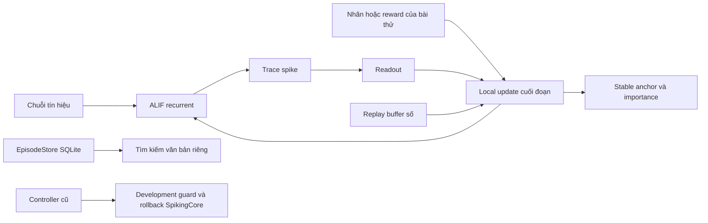
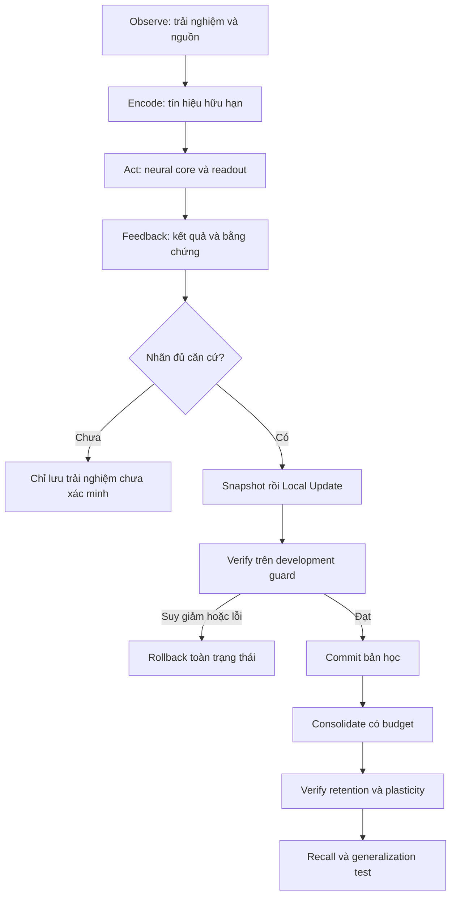

# SCAR-X — Kế hoạch nghiên cứu chính

**Phiên bản tài liệu:** 1.32 — 2026-11-10. **Trạng thái:** một core có capacity linh động và vòng học xuyên hội thoại: hỏi→feedback→local micro-update→idle review.48 là baseline lịch sử, không là trần sản phẩm. Neural quality/retention vẫn PIVOT; không mở huấn luyện lớn.

**Phê duyệt mới:** người dùng chọn **“Chỉ duyệt kiểm tra P0”** cho đề xuất
usefulness v2. [Protocol P0](../experiments/readout-usefulness-p0-v1.md) chỉ mở
math/parity/codec/rollback/budget trong prototype ALIF riêng; **chưa duyệt pilot
P2**, trainingchat/vision hoặc deploy. Các thông báo pending P0 phía dưới là
lịch sử trước câu trả lời này. Không coi P0 pass là quality/retention pass.

**Đối chiếu cập nhật DeepSeek:** [review40](research/40_DEEPSEEK_REVIEW.md) kiểm
guard/rollback/đo state và interference trên copiedmodels, không đổi learning
rule/weights phiên người dùng đã restore. Productmetric v2 tách khỏi v1 để
không viết lại số cũ; ACCEPTED khác acquisition. Workspace hiện đã có Git từ
các cập nhật khác; review không init/commit/push. ProtocolReadoutProtection mới
vẫn CHƯA DUYỆT, cần sửa thiết kế/đối chứng trước khi trình triển khai.

**Phê duyệt mới ngày10/11/2026:** người dùng duyệt nghiên cứu đềxuất30,
one-stepreadout-errorfeedback + neuron-localforwardeligibility trong prototype
riêng. KhôngTransformer/pretrained/proxy/BPTTmain/autogradcandidate/RTRL, không
deployHermes hoặc scale. “Pending” trong báo cáo/mốc cũ giữ nghĩa lịch sử;
§3.3 phân biệt rõ core đang chạy với ngoại lệ nghiên cứu đã được duyệt.

**Học liên tục trong sản phẩm:** người dùng đã duyệt chủ động hỏi trong Hermes,
học từ lời sửa/đáp án có nguồn và lúc rảnh xem lại. Không khởi tạo learner mới
theo cuộc chat hoặc epoch. Source/controller được tách khỏi neural language;
controller hỏi không chứng minh model tự biết chân lý. Tự lấy output làm nhãn
vẫn cấm. [ADR0009](decisions/0009-continuous-dialogue-human-feedback.md) thay mặc
định idle-learning-off trước đó bằng guarded human/verified-label learning.

[Báo cáo dữ liệu và online learning](research/10_DIALOGUE_DATA_AND_ONLINE_LEARNING.md)
ghi Antigravity candidate, verifier và luồng thử mới. One-learner/RNG persistence
đã kiểm, nhưng acquisition vẫn thất bại; không nới forgetting gate hoặc đưa
corpus chưa xác minh vào phiên cá nhân. Normal photo QA cần encoder và đường
học ảnh–từ trong cùng core; hai ảnh annotation không là năng lực đã triển khai.

**Prototype capacity hiện hành:** một core khởi đầu48, có thể cấp48–128neuron;
chỉ nhóm chọn được tính, weights đã cấp vẫn ởRAM. Bộ điều phối dùng inputload/
modality hoặc budget rõ ràng, chưa đo được độ khó ngữ nghĩa hay thiếu capacity.
Neuron mới chưa học có readout0; không ngụ ý tăng thông minh. Lưu topology,
activecounts/clocks/RNG đầy đủ, không pruning/rewiring. [ADR0008](decisions/0008-adaptive-neurons-and-request-load.md).

**Sản phẩm hiện hành:** [Generation 1](../README.md), một quần thể ALIF khởi đầu48 với prototypecapacity48–128, một bộ trọng số recurrent, một trạng thái/checkpoint và một ID Hermes `scarx-generation1`. Văn bản/ảnh/nền dùng cùng core. [ADR0008](decisions/0008-adaptive-neurons-and-request-load.md) cập nhật giới hạn sản phẩm của ADR0006. V0.1/V0.2 và cấu hình48cũ được giữ như hồ sơ lịch sử.

**Phán quyết nghiên cứu: PIVOT cơ chế học; NO-GO cho tăng quy mô với các quy tắc hiện tại.** Gate nghiên cứu không còn là điều kiện chặn xây ứng dụng thử nghiệm. Có acceptance/demo sản phẩm mới, không được gọi là đã qua gate forgetting/representation.

Đây là **master plan duy nhất** của SCAR-X. [README](../README.md) là điểm vào; [STATUS](STATUS.md) là tóm tắt tiến độ; [kiến trúc](research/02_SCAR_X_ARCHITECTURE.md) là tài liệu kỹ thuật. Các protocol đã chạy trong [experiments](../experiments/) và báo cáo trong [runs](../runs/INDEX.md) là hồ sơ lịch sử bất biến, không phải các kế hoạch phát triển cạnh tranh.

**Quy trình hiện tại:** Build → Run → Interact → Learn → Test → Improve → Repeat. Mỗi vòng tạo một cải thiện dùng trực tiếp trong [ứng dụng local](../README.md); giữ bản chạy ổn gần nhất nếu rule mới chưa tốt. Nghiên cứu tiếp tục làm công cụ kiểm tra, không trì hoãn sản phẩm tới khi hoàn thiện kiến trúc.

**Hồ sơ pilot trước G1:** hai pilot độc lập 48 hidden, không pretrained/BPTT; language 3/16 test exact (fail), digits 89,17% diagnostic. V0.2 từng mở để dạy/quan sát, nay đã ngừng phục vụ như sản phẩm riêng. [Pilot V2](../runs/20261108T190315Z-language-vision-pilot-v2-6a889e/report.md) giữ nguyên evidence. Lesson sửa `chào bạn` là training point, không phải heldout proof. Số đo pilot không được chuyển thành số đo core G1.

## Mục lục

1. [Project Vision](#1-project-vision)
2. [Current Status](#2-current-status)
3. [Existing Architecture](#3-existing-architecture)
4. [Proposed Extensions](#4-proposed-extensions)
5. [Conflict & Compatibility Matrix](#5-conflict--compatibility-matrix)
6. [Learning Lifecycle](#6-learning-lifecycle)
7. [Experiment Roadmap](#7-experiment-roadmap)
8. [Hardware & Resource Budget](#8-hardware--resource-budget)
9. [Learning & Memory Metrics](#9-learning--memory-metrics)
10. [Risks and Open Questions](#10-risks-and-open-questions)
11. [Implementation Checklist](#11-implementation-checklist)
12. [Decision Log](#12-decision-log)
13. [Change Log](#13-change-log)

## 1. Project Vision

SCAR-X nghiên cứu **kiến trúc neural có khả năng học thích nghi suốt quá trình hoạt động**: tích lũy kinh nghiệm, tạo representation hữu ích, hình thành kỹ năng, giữ kiến thức cũ và còn khả năng học điều mới. Representation là cách mạng biến tín hiệu đầu vào thành đặc trưng bên trong có ích cho nhiều tình huống.

Lõi chính là **Spiking Recurrent Neural Network** — mạng neuron phát xung có kết nối hồi quy — với LIF/ALIF và local synaptic learning. Synapse phải thay đổi trọng số thật; không dùng một LLM có sẵn kèm RAG để thay thế câu hỏi nghiên cứu neural. Kho trải nghiệm và công cụ xác minh hỗ trợ lõi; khả năng truy xuất dữ liệu không chứng minh lõi đã học kỹ năng.

**Ràng buộc gốc được người dùng tái khẳng định ngày10/11/2026:** cấm tự ý
chuyển SCAR-X sang Transformer, LLMpretrained hoặc dùng LLMproxy làm model
trả lời thay lõi neuron. Cải thiện hội thoại/vision phải giữ lõi phát xung,
học synapse cục bộ và CPU-first/2GB. Qwen chỉ là đối chứng nghiên cứu độc lập,
không là thành phần suy luận hoặc nguồn trọng số của SCAR-X. Từ “transfer”
trong báo cáo25 nghĩa là thử một quy tắc học cục bộ trên bài dự đoán từ;
không có nghĩa là chuyển sang kiến trúc Transformer. Pilot đó đã STOP.

Số tham số và độ dài context là biến kỹ thuật, không phải mục tiêu trung tâm. Mục tiêu 1M context đã ngừng làm tiêu chí kiến trúc; không xóa số đo cũ hoặc phủ nhận rằng context kỹ thuật vẫn tồn tại. Đích năng lực đa năng dài hạn chưa được chứng minh và không là lời hứa của vòng nghiên cứu hiện tại.

### Ràng buộc giữ nguyên

Phê duyệt mới áp dụng prototype capacity nhỏ trong sản phẩm; không sửa điều kiện
cố định48của trial đã đăng ký. Trần128là guard kỹ thuật vòng này, có thể thay sau
auditresource/protocol;2GBCPUfirst vẫn giữ. Không mở model10M–100M hoặc corpuslớn.

- CPU-only bắt buộc; CPU-first trong thiết kế. iGPU tùy chọn. GPU rời có thể tăng tốc nghiên cứu, nhưng kết quả trên GPU không thay cho phép đo CPU.
- Mục tiêu toàn phiên vận hành **≤2.000.000.000 byte RAM**, bao gồm học, củng cố, lưu checkpoint và rollback; dung lượng trên SSD phải báo riêng.
- Không backward qua toàn mạng hoặc BPTT trong nhánh chính. Sai số tại chính readout, dấu vết tại synapse và tín hiệu điều biến được phép. BPTT chỉ là đối chứng tách biệt.
- Không tăng từ mạng thử nghiệm 48 neuron lên model lớn, không huấn luyện ngôn ngữ 10M token, không tối ưu C++/iGPU trong Phase 2.2 đề xuất.
- Giữ nguyên tiêu chí đã đăng ký. Tiêu chí mới phải ghi trước thí nghiệm mới; không chấm lại kết quả cũ bằng tiêu chí có lợi hơn.
- Phê duyệt docs-only trước đây được thay bằng quyền triển khai MVP V0.1, UI, sửa tích hợp và test cần thiết. Không tự tải model/corpus lớn, gọi paid API, thay core bằng LLM hoặc mở rộng tài nguyên. Dạy tương tác thường ngày không cần chờ protocol nghiên cứu; benchmark khoa học vẫn phải đăng ký trước.

## 2. Current Status

**Product dialogue/state kiểm bằng model thật:** [báo cáo23](research/23_REAL_DIALOGUE_STATE_AND_CURRICULUM.md).
AGY48diagnostic/160curriculum đã sinh, review giữ117train/31dev; Qwen4B reference
48câu thực đã tắt. Rehearsal và curatedreadout training chưa qua acceptance,
không importweights/normalizer vào live. Có source-aware explicitprojectteaching
qua controller hiện có, không coi là cải thiện tổng quát hoặc đổi researchgate.

**Dynamics diagnostic đã dừng:** [báo cáo22](research/22_INFERENCE_AND_TIMESCALE_PROPOSAL.md),
72firingnoiseviews và60timescaleviews trênimmutableweights không đủendpoint65%.
Không mởtraining hoặc tiếp tụcgrid từview-screen; giữ các đề xuất như lịch sử,
không mô tả heterogeneouslearner là core đã triển khai.

**P2 baseline fail joint gate:** [báo cáo21](research/21_P2_RETENTION_AND_CUE_INFORMATION.md).
18trials/3seed,20context, full+reservoir acquisition57,64%,final34,74%,
forgetting29,09đ. Frozenhidden vẫn quên; offlinejoint/refit dưới65%, nên không
tối ưu protection để giữ một feature chưa đủ tốt. Cue/noise audit cho thấy
thông tin tronginput nhưng decodability/neuralstate endpoint còn yếu. Chưa có
importancecandidate hoặc P2confirmation/deploy. P1 narrowpass giữ nguyên;
representation/state và readout stability tiếp tục là ưu tiên, khôngscale.

**P1 gate hẹp đã qua:** [báo cáo20](research/20_SCORE_ELIGIBILITY_AND_VARIANCE.md).
Paired-scorev2 dùng forward eligibility/scalar reward, không backward hoặc
taskW_out feedback.108development+120confirmation trials;8seedmới/task xác nhận
gainorder18,33đ/XOR20,00đ, lowerCI14,65/15,06; direct91,99/74,56%. Binding49,56%
vẫn thất bại. **GO_P2_RESEARCH_ONLY**, chưa deployment, retention, broad skills
hoặc language/vision. Không mở lại local-classifier/target-rate đã dừng, không
claim lợi thế nhất quán hơn mọi baseline hoặc equal-cost so thí nghiệm cũ.

**P1 control-factor audit:** [báo cáo19](research/19_CONTROL_OPTIMIZER_AND_COVERAGE.md)
tách optimizer/coverage trên45isolatedcontrols,3freshseeds. BindingAdam-all
82,42% so vớiAdam-rot12:63,28%, SGD-all61,07%; không quy mọi gap cho credit.
Chỉ diagnostic, không candidate/confirmation/deploy; familylocal-classifier
vẫnNO-GO. Protocol local mới cần phân lập effective step, coverage và tín hiệu;
không coi3seedbootstrap hoặc bài100% là chứng nhận normalchat/lifelong.

**P1 local-classifier family đã đóng:** [báo cáo18](research/18_LOCAL_CLASSIFIER_FINAL_AND_LEARNABILITY.md),
108development trials với3freshseeds, conditioning/timing ablations khôngqua
representation gate. Khôngconfirmation/deploy/vòng3.18isolatedBPTTcontrols
cùngforward/head chobinding91,67% so với62,37%readout-only; kiến trúc nhỏ có
thể giải bài trongbudget nhưng chưa có localrule đạt. Đây không là thay thế
lõi chính bằngBPTT. Auditreadoutmatching/coldcontinuation9/9exact. GiữPIVOTP1/P2,
không tăngdata/model để che lỗi; normalize/timing không chứng minh lifelong.

**Trace thụ động theo yêu cầu mới:** [ADR0012](decisions/0012-passive-real-work-trace.md)
bỏ yêu cầu người xem chọn/bấm chạy. Website tự hiện input/câu sinh/target và
Qwen đã đo khi có; loss, synapse updates, ΔW và guard từ giao dịch học thật.
Đã chạy24 inference và một verified integer lesson trên serving core; không
mock/teacher proxy, không target leakage. Input scope khác Qwen được ghi rõ;
17 accepted updates trên một bài không chứng minh lifelong hoặc normalchat.

**Quan sát live đã được yêu cầu và triển khai:** [hướng dẫn](OBSERVING.md) và
[ADR0011](decisions/0011-local-observatory.md): chuỗi task trên core thật hoặc
clone, active/allocated/dormant, checkpoint trước live demo và journal nghiên cứu
có PID/create-time. Không suy neuron count thành độ khó đã học/quality. Lượt P1
[local classifier](research/17_LOCAL_CLASSIFIER_ADAPTATION.md) đã được theo dõi
trực tiếp, chưa đạt representation gate, không deploy.

**Ảnh thật:** [báo cáo16](research/16_REAL_RGB_GROUNDING.md) có smallheldout
RGBobjectclassificationvàimageablationđãaudit, accuracy19–20%chưagate30%.
Không gọi digit/color/classlabel lànormalphotoQA. Qwen3-4Btextreferencekhông
đủscopevision; chưacóQwenVLđốichiếuảnh. Khôngdeploy/tăngmodel.

**Codec/memory continuation:** [báo cáo15](research/15_BYTE_CODEC_AND_WORKING_MEMORY.md)
phân biệt UTF8representability, autoregressivequality và memoryactivity. Hai
vòngbytefailed, isolatedBPTTcontrolcũngchưahọc trongbudget; đãdừngfamily, không
đổi gates hoặc deploy. Mục tiêu normalchat/vision vẫn còn thiếu.

**End-to-end dialogue trial:** [báo cáo14](research/14_EVENT_DIALOGUE_AND_QWEN_REFERENCE.md)
ghi việc train thật trênAntigravity dialogue, coldresume và Qwen cùngprefix.
Năng lực ngôn ngữ vẫnfail, không thay model live. Corpus từng “chưa train” nay
đã được dùng trong prototype cô lập; không nhập vào phiên người dùng. Wordcodec
đóng/OOV, credit assignment và retention vẫn cần giải theoP1/P2.

**P1/P2 audit mới:** [báo cáo13](research/13_INPUT_AND_LOCAL_LEARNING_AUDIT.md)
phân biệt input-information loss, hidden-rule failure và readout conditioning.
Ordered/RGB compiler mới còn Experimental; hai local-target rounds đã dừng.
Normalization xác nhận lợi ích đọc feature, nhưng retention fail nên chưa
deploy. Curriculum Antigravity mới được version/curation, chưa live auto-import.

**Tab Hỏi để học:** đã có plugin Hermes riêng qua cơ chế desktop/backend hiện
có, để nhận câu hỏi chủ động và gửi lời dạy hai chiều. [ADR0010](decisions/0010-learning-tab-and-cognitive-modes.md)
phân biệt transcript/controller với neural knowledge. Native GUI QA4+4→8 đã
ghi/settle; không là chứng minh general chat, ACT hoặc tự khám phá thành công.

**Diagnostic tải kiến thức2026-11-09:** [báo cáo11](research/11_KNOWLEDGE_LOAD_RETENTION.md)
ghi ladder, Qwen4B thực chạy, metric audit và retention chưa đạt. Đây là test của
core một quần thể hiện có, không xác nhận kiến trúc nhiều tầng. Người dùng đã làm rõ ba chế độ fast/deep/idle trong cùng core; xem tài liệu12,
không suy ra đã có ba tầng neuron vật lý. Giữ P1/P2và các ngưỡng cũ.

### Generation 1 — đã triển khai, năng lực còn thử nghiệm

- Một shared core ALIF khởi đầu48, prototype capacity48–128, K=8, R=12; input văn bản và ảnh chữ số64 pixel, readout từ và chữ số. Khởi tạo/huấn luyện chung từ đầu, không ghép checkpoint pilot. Cấp thêm neuron có guard và checkpoint theo ADR0008; không mở rộng model nghiên cứu lớn khi gate chưa đạt.
- Vòng nền dùng cùng neuron state, nhường lượt ở quantum kế tiếp khi có tin nhắn. Không reset neuron mỗi chat; có khoảng settling bằng động lực neural. Nền chạy cả khi website đóng nếu server còn chạy; RAM/CPU vẫn được sử dụng.
- Trace đo xung/điện thế/nguồn input/tick/update; text probe neural có nhãn chưa kiểm chứng. Không giả độc thoại nội tâm. Chưa chứng minh hoạt động này là reasoning hữu ích.
- Học nền từ nhãn rõ ràng có guard đã bật theo ADR0009; không tự học từ output. Structural rewiring/pruning và consolidation kỹ năng tổng quát chưa có. Một session checkpoint gồm weights/stable, neuron/eligibility state, topology, vocabulary, RNG, memory/cursor/probe/controller; `plasticity-v1` không bị ép sang schema G1.
- [Huấn luyện chung hai seed](../runs/20261109T000625Z-generation1-joint-bd6c92/report.md): greeting acceptance 50% ở cả hai seed, **không đạt 80%**; toàn bộ text 33,33%/22,22%, digits 88,33%/89,44% diagnostic. [Sai lệch tie-break](../runs/20261109T000625Z-generation1-joint-bd6c92/PROTOCOL_DEVIATION.md) được công khai; không đổi threshold hoặc tuyên bố research thành công.
- Chưa có general chat, screenshot understanding, agent actions, learned reasoning hoặc bằng chứng hidden representation. Các nghiên cứu Phase 2/2.1 và forgetting gate giữ nguyên kết quả.

### Hồ sơ thực nghiệm đã có

**Sản phẩm V0.1 hiện có:** web localhost Windows dùng PlasticCore48ALIF; dạy ví dụ có verifier, batch A/B, xem spike/weights/memory/history, save/restore learner+replay+RNG trong SQLite transaction và tài nguyên thực tế. [Acceptance run](../runs/20261108T175211Z-mvp-v01-acceptance-3d887d/report.md) kiểm trước/sau trên biến thể chưa train, process restart và restore. Demo này chưa chứng minh hidden representation hay solved lifelong learning; không chấm lại research gates.

| Giai đoạn | Bằng chứng | Kết luận trong phạm vi đã thử |
|---|---|---|
| Phase 2 | [Báo cáo 06](research/06_FEASIBILITY_VERDICT.md), [protocol](../experiments/phase2-v1.md) | Full và readout-only đều đạt 100% recall đơn giản; chưa phân biệt lợi ích hidden. Forgetting khoảng 20,8–23,9 điểm phần trăm, không đạt ngưỡng. |
| Audit Phase 2 | [Báo cáo 08](research/08_PHASE21_RESULTS.md), [raw audit](../runs/20261108T162931Z-phase21-v1-f3fa83/phase2_audit.json) | Ở task đầu, thay lại head cũ cứu accuracy rõ hơn thay hidden cũ; replay thiếu 15–17/80 nhóm context–nhãn. Đây là can thiệp trên task đầu, không phải phân rã mọi nguồn quên. |
| Phase 2.1 | [Kết quả](research/08_PHASE21_RESULTS.md), [protocol](../experiments/phase21-v1.md), [bổ sung lifelong](../experiments/phase21-lifelong-amendment.md) | 303 trial mới; 3 seed phát triển, 8 seed xác nhận và 8 seed mới cho strict binding audit. Các condition ghép cặp không được tính như seed độc lập mới. |
| Representation | [Strict binding audit](../runs/20261108T170757Z-phase21-binding-audit-v1-a64369/report.md) | Order có probe gain trung bình khoảng 1,81 điểm, chưa đạt ngưỡng; strict binding accuracy khoảng 50,2%. Chưa chứng minh hidden học representation hữu ích theo gate. |
| Stream không task boundary | [Kết quả stream](../runs/20261108T163521Z-phase21-lifelong-v1-48ee0f/report.md) | Metaplasticity giảm số đo forgetting nhưng accuracy gần 50%; mọi condition thất bại ở gate chất lượng + retention. |
| Tái lập và tài nguyên | [Kiểm tái lập](../runs/20261108T170909Z-phase21-reproduction-efdb4a/report.md), [catalog](../artifacts/phase21-summary.json) | Continuation và lịch cập nhật đã kiểm; RAM quan sát trong trần ở workload nhỏ. Chưa có giới hạn cứng OS hoặc chứng nhận vận hành lâu dài. |

Không so mức forgetting Phase 2 và Phase 2.1 trực tiếp như một tiến bộ: forward, độ dài episode và thiết kế bài thử đã thay đổi. Bài binding ban đầu có shortcut bag-of-values; kết quả đó giữ nguyên nhưng không được dùng chứng minh hiểu quan hệ. Xem [audit phép đo](decisions/0003-phase21-evaluation-audit.md).

### Trạng thái khả năng

- **Đã triển khai:** ALIF, recurrent synapses, readout local, STDP/score eligibility, importance heuristic, stable anchors, replay giới hạn, checkpoint của từng lõi, episodic text store và logging.
- **Đã kiểm trong bài nhỏ:** trọng số thay đổi, lưu/khôi phục và tiếp tục cập nhật tái lập; liên kết đơn giản học được ở cấp hệ thống, có đóng góp của readout.
- **Đã thất bại ở cấu hình/ngân sách đã thử:** gate representation và gate giữ kỹ năng. Điều này không bác bỏ mọi SNN hoặc mọi local rule.
- **Chưa chứng minh:** tích lũy semantic/procedural knowledge, generalization kỹ năng, forward transfer bền vững, plasticity sau 50/100 giai đoạn, khả năng ngôn ngữ/suy luận đa năng.
- **Đã tích hợp trong MVP có cấu trúc:** lesson từ tác vụ có rule kiểm nhãn → local update → episodic record → atomic snapshot learner/replay/RNG → restore. Raw text → bài học neural và phiên offline tự động/general Experience-to-Skill vẫn chưa có. Không gọi demo phân loại tín hiệu là chu trình tri thức tổng quát hoàn chỉnh.

## 3. Existing Architecture

### 3.0 Core sản phẩm Generation 1

**Cập nhật adaptive prototype:** Hkhông còn hằng48trongruntime. `UnifiedCore`
mở rộngtensor tại chỗ tới trần128, giữ neuronIDs/oldsubarrays; activeprefix
kernel tránh densecompute phần không chọn. Đường từ neuron cũ vào neuron mới
được tạo, oldincomingindices giữ nguyên; newreadoutcolumns0cho tới khi học.
Không có rewiring cũ hoặc xóa neuron. Dormantvoltage/adaptation/features giữ và
lazydecay bằngneuralclock, không phát lại spikeđã cũ. Boundedactiveprefix là
cơ chế triển khai đầu tiên, chưa là tổ chức nhóm tối ưu. Mô tả48 bên dưới là
baseline khởi đầu. G1codec đọc được checkpointcũ và statecapacity mới.

`run_app.py → generation_server.py → Generation → UnifiedCore → SpikingCore`.
Đây là một object core sống trong RAM. `W_in[48,D]` nhận kênh previous-word,
prompt hash 128 chiều, ảnh 64 pixel và modality/position. `indices[48,8]` và
`W_rec[48,8]` là topology recurrent cố định. Điện thế, adaptation, spikes và
features thuộc một quần thể chung. `W_out[V+10,48]` có word slice và digit slice;
mask đầu ra theo modality chỉ chọn readout, không chuyển sang model khác.

Readout dùng sai số tại đầu ra; hidden nhận scalar advantage và eligibility
cục bộ, vẫn là heuristic. Không backward/BPTT. Stable arrays được lưu nhưng
không đồng nghĩa đã có consolidation hiệu quả. G1 chưa dùng importance hoặc
metaplasticity của PlasticCore; đây là khoảng trống phải nghiên cứu, không được
báo cáo như cơ chế đã chuyển sang kiến trúc chung.

Memory giữ tối đa 128 prompt/lesson, không tra đáp án khi generate. Controller
chọn input probe, điều phối background/foreground, xác nhận lời dạy rõ ràng,
checkpoint và rollback. Phản hồi người dùng có provenance nhưng chưa được xác
minh độc lập; `verified=true` không tự tạo bằng chứng. Idle probe không học từ
chính output. Bên dưới mô tả các lõi và kết quả nghiên cứu lịch sử.

### 3.1 Topology thực tế

Lõi được tổ chức thành **một quần thể recurrent**, không có stack nhiều tầng hidden. Gọi D là số kênh đầu vào, H số neuron, K số kết nối recurrent đi vào mỗi neuron, O số lớp đầu ra và R số hàng được học đồng thời.

| Thành phần | Tổ chức đã có | Mã nguồn |
|---|---|---|
| Input → hidden | Ma trận dense `W_in[H,D]`; mỗi neuron nhận mọi kênh đầu vào | [core.py](../src/scarx/neural/core.py) |
| Hidden → hidden | `indices[H,K]` chọn K neuron nguồn khác nhau trong từng hàng, cố định theo seed; trọng số `W_rec[H,K]` | [khởi tạo topology](../src/scarx/neural/core.py#L66) |
| Neuron | Điện thế, rò, spike, thích nghi ngưỡng; Phase 2.1 dùng spike Bernoulli | [plasticity.py](../src/scarx/neural/plasticity.py) |
| Hidden → readout | Ma trận dense `W_out[O,H]` và bias; đọc trace spike đã làm mượt | [readout](../src/scarx/neural/core.py#L125) |
| Plastic block | R hàng input/recurrent active mỗi episode; luân phiên giữa episode, không đổi topology | [reset state](../src/scarx/neural/core.py#L80) |
| Stable/importance | Bản sao stable weights; Phase 2.1 có importance cho input, recurrence, readout và bias | [local update](../src/scarx/neural/plasticity.py#L65) |

**Cấu hình nghiên cứu hiện tại:** H=48, K=8, R=12; representation/stream D=8, O=2; stress 20 context D=24, O=4. `Config` mặc định và byte demo có cấu hình khác, không đại diện cho gate Phase 2.1. Recurrence có thể gồm self-connection; không có bảo đảm Dale's law, chia excitatory/inhibitory, synapse sinh hóa hay mô phỏng đầy đủ não.

Code hiện dùng ALIF; dạng LIF không thích nghi có thể biểu diễn bằng `adaptation_strength=0`, chưa có một module LIF riêng được đánh giá như phương pháp độc lập trong các kết quả hiện tại.

### 3.2 Truyền tín hiệu

Với spike cũ z và input x:

`current[j] = W_in[j]·x + Σ_k W_rec[j,k] z[indices[j,k]]`

`v = 0,85 v + current; threshold_adapted = 0,65 + 0,08 a`

Phase 2 phát xung khi v vượt ngưỡng. Phase 2.1 lấy xác suất `sigmoid((v-threshold_adapted)/0,4)` rồi lấy mẫu Bernoulli. Sau đó trừ điện thế reset theo spike, cập nhật adaptation `a = 0,95 a + z`, và feature `f = 0,92 f + 0,08 z`.

`p = softmax(W_out f + bias)` tạo đầu ra. Readout hiện làm phân lớp trong benchmark; không phải một bộ suy luận ngôn ngữ. `forward(sequence)` reset working state trước mỗi episode, giữ weights; do đó hệ hiện học tuần tự theo trải nghiệm có đoạn, chưa phải một dòng neuron state không bao giờ reset. Online learning không bắt buộc sửa trọng số sau mọi token; việc thay chính sách reset là câu hỏi riêng cần kiểm chứng.

### 3.3 Học và credit assignment

Credit assignment là xác định synapse nào nên được thưởng/phạt cho kết quả sau cùng.

- **Readout của core đang phục vụ:** sai số `one_hot(target)-p` nhân feature cục bộ để cập nhật synapse đi vào đầu ra. Core đang phục vụ không truyền vector sai số qua `W_out` về hidden.
- **Ngoại lệ nghiên cứu được người dùng duyệt10/11/2026:** prototype30 được dùng `W_out.T @ error` một bước cho từngneuron, kết hợp dấu vết local tính xuôi. Không truyền lỗi giữa hiddenneurons, không reverse-time/networkbackward/RTRL. Đây là mở rộng tínhiệu không-local phải công khai, không đổi forwardALIF hoặc tự áp dụng vào core đang phục vụ.
- **Phase 2 hidden:** trace STDP từ hoạt động trước/sau synapse, nhân scalar advantage theo reward hoặc `p[target]` so với EMA baseline.
- **Phase 2.1 hidden:** rule STDP hoặc score eligibility; rule score dùng dấu vết input/recurrence đã lọc và residual `(spike-probability)/0,4` tại neuron, tích lũy trong đoạn. Cuối đoạn nhân scalar advantage của `-loss` hoặc reward được cung cấp. Mọi neuron active nhận cùng scalar; chưa có credit hữu ích riêng cho từng neuron.
- **Metaplasticity:** giảm độ lớn học theo importance và kéo weights về stable anchor. Importance hiện tích lũy độ lớn tín hiệu cục bộ, không đo đóng góp nhân quả vào kỹ năng. Clipping, block rotation và trace xấp xỉ khiến rule không được coi là một gradient toàn mạng chính xác.
- **Nhiều thang thời gian:** weights cập nhật mỗi trải nghiệm; stable anchor EMA theo chặng hoặc mỗi 64 update; một số condition giảm importance mỗi 32 update. Stable anchor là bản sao dùng regularization, chưa là một memory system đã tự học tri thức bền vững.

Không có backward toàn mạng trong [neural](../src/scarx/neural/) hoặc [learning](../src/scarx/learning/). [controls.py](../src/scarx/evaluation/controls.py) có BPTT riêng. SI ở readout chỉ là control đầu ra, không được quảng bá như tái lập whole-network Synaptic Intelligence.

### 3.4 Memory và controller thực tế

Kho SQLite và replay số là hai thành phần khác nhau. [EpisodeStore](../src/scarx/memory/store.py) lưu raw text, nguồn, hash, thời gian, loại và cờ `verified`; tìm kiếm FTS5. [ReplayBuffer](../src/scarx/learning/replay.py) giữ chuỗi số và nhãn với capacity cố định. Chưa có pipeline tự động chuyển raw text thành một bài học đúng cho neural core. [TextAgent](../src/scarx/interfaces/text.py) không dùng retrieval khi generate; byte demo chưa được huấn luyện ngôn ngữ.

[LearningController](../src/scarx/learning/controller.py) nay chọn loader theo loại lõi, đọc lại được `plasticity-v1`; thuật toán neural không đổi. [LifelongLearner](../src/scarx/learning/lifelong.py) có bundle save atomic và vẫn đọc legacy hai file. [Workbench](../src/scarx/app/state.py) đóng gói learner/replay/orchestration RNG/counters và commit trong cùng SQLite transaction với experience/history/active pointer. Đợt lỗi khôi phục object gốc; restart lấy generation đã commit. Kiểm thử đã bao gồm commit fault, process interruption và state continuation. Transaction này phục vụ hai tác vụ MVP; không đồng nghĩa đã có verifier dữ kiện tự do hoặc consolidation tự động.

Prediction của MVP lấy neural softmax trung bình4 stochastic passes; expected label là kết quả verifier riêng. Memory search không tham gia trả lời. Giao diện nhập tín hiệu, xem trước/sau và history không giả lập chatbot ngôn ngữ tự nhiên.

### 3.5 Vì sao chưa thể gọi là AI đa năng?

Mạng còn nhỏ, khởi tạo ngẫu nhiên, representation chưa đủ; reward scalar chưa phân công credit tốt. Readout có thể học liên kết nhưng bị interference. Nhiệm vụ mới chưa tạo generalization đáng tin. Chưa có học ngôn ngữ, bộ dữ liệu tương ứng hoặc đánh giá suy luận đa năng. Nối thêm memory không tự sửa các giới hạn đó. Tính giống sinh học của ALIF và local rule không phải bằng chứng năng lực hoặc tính mới.

## 4. Proposed Extensions

### Ba chế độ và Adaptive Computation Time

Người dùng đã làm rõ: **Fast Neural Processing → Deep Thinking → Autonomous
Learning/Idle Thinking** là ba chế độ trong cùng core, không phải ba tầng neuron
vật lý hoặc ba model. [Tài liệu12](research/12_ADAPTIVE_COMPUTE_AND_IDLE_COGNITION.md)
đối chiếu ACT/PonderNet/DECOLLE và ánh xạ vào P0–P5. Fast/idle review có thành
phần thử nghiệm; tự chọn thời gian suy nghĩ và tự khám phá có verifier vẫn
Proposed. Giữ riêng hai trục active-neuron capacity và số bước recurrent.

### 4.0 Adaptive capacity và hoạt động nền — trạng thái rõ ràng

ADR0008 thay trạng thái đề xuất trong bảng lịch sử dưới: **dynamicactivation và
growth48–128 đã có ở prototype**, chưa có qualityadvantage. Heuristicbudget theo
inputload, cóoverride, bảo thủ giữ readout đã nối; không tự kết luận thiếucapacity
từ error. Rewiring/pruning/selforganization và causalusefulness vẫn Proposed.

| Cơ chế | Trạng thái | Điều kiện tiếp theo |
|---|---|---|
| Một core, hoạt động nền có giới hạn, measured trace | Implemented / chất lượng Experimental | Đo lợi ích với matched compute và baseline nền tắt |
| Experience-to-Skill và consolidation lúc rảnh | Proposed | Verifier, credit assignment, representation và retention gate |
| Active-prefix trong pool48–128 | Implemented / Experimental | Có bỏ qua hàng/cột; utilityselection và lợi ích dài hạn chưa chứng minh |
| Rewiring cố định ngân sách synapse | Proposed, chưa bật | Stable neuron IDs, migration eligibility/importance/readout và exact rollback |
| Growth cótrần48–128 | Implemented / Experimental sau duyệtADR0008 | Khởi tạo readout0, bảo toànoldsubarrays; chưa chứng minh quality/capacity advantage |
| Shrink/reuse/pruning | Proposed, chưa bật | Causalusefulness và bảo vệ rare skills; không xóa vì ít activity |
| Self-organization | Hypothesis | Chỉ sau khi các mức trước có lợi ích nhân quả |

Không suy ra neuron ít hoạt động là vô ích. Việc sửa mask trong dense arrays
không tự giảm RAM hay compute. Không được đổi baseline cố định 48 neuron trong
protocol Phase 2.2 để che vấn đề representation/credit assignment hiện tại.

Tất cả nội dung mới trong mục này là **đề xuất nghiên cứu**, không phải tính năng đã hoàn thành. Không đề xuất thay core hoặc dựng kiến trúc khác trong lần cập nhật docs.

### 4.1 Ưu tiên nguyên nhân gốc

**Transfer quy tắc đã khóa sang dự đoán từ, pilot chưa đạt:**
[báo cáo25](research/25_WORD_SCORE_TRANSFER_PROPOSAL.md) dùng paired-scorev2
nguyên tham số trên adapter prefix wordtask, so frozen/shuffledcontrols. Giữ
48neuron và một core, không hiddenrulegrid mới, không mainformatmigration.
Canonicalcounterfactualprefixstate khác runtimecontinuousstate nên chỉ pilot;
reservedvisionchannels không là năng lực nhìn đã học. Protocol/codec/noleak
tests đã có trước training. Ba freshseed cho full/frozen devexact cùng3,23%,
full prior4,17% so frozen9,72%; STOP_WORD_SCORE_TRANSFER_V1. Không tune tiếp
hiddenrule/epochs hoặc nhập model. Numericinputcontrol128chiều cũng chưa đạt
65%localdev; dictionary299 là referencekhácbudget, không là neural skill.

**Đối chứng readout search đã dừng, chưa là runtime:**
[báo cáo24](research/24_REPRESENTATION_DECODER_AND_SEARCH.md) tách input/hidden
representation khỏi decoder. Beamsearch hữu hạn dùng cùng trọng số và
workingstatehypotheses, không template/LLMproxy hoặc học mới. Chỉ diagnosticclone;
dev12,90%→21,51%, priorgain4,17đ, chưa qua ngưỡng và STOP. Existingstateviews
P2 cũng STOP; không đổi clock/statepolicy runtime hoặc mở thêm search/viewgrid.

**Quan sát thụ động:** localhost tự hiện công việc kỹ thuật, output thực và
loss/ΔW/guard theo lượt mới nhất, không yêu cầu chọn hoặc bấm chạy. Nhật ký
kỹ thuật tách khỏi neural trace; GET không tự tạo trainingjob. Xem
[OBSERVING](OBSERVING.md). Đây là khả năng quan sát, không là bằng chứng đạt
ngôn ngữ, vision hoặc học liên tục.

1. Kiểm chứng hidden tạo feature mới có ích, độc lập với readout.
   [Vòng word-score cuối](research/26_FIXED_INPUT_NEURAL_TRANSFER.md) đăng ký
   riêng việc chuyển mã từ cố định128chiều vào actualneuraltraining. Không
   numericintentheadgrid/scale hoặc đổi gốcALIF; densecandidate và ablations
   khóa trước đo. V2đãSTOP: densefull dev7,53%, frozen8,60%, gainCI95%−3,23..3,23đ.
   Đóng hướngword-scoreapplication sauv1/v2; không tune encoder/LR/epochs hoặc
   scale để mở lại.27/27coldresumes khớp không thay qualityfailure. Ưu tiên
   matchedlearnabilitycontrol trước giả thuyết creditassignment mới; BPTT chỉ
   đối chứng cô lập, không là maincore hoặc Transformer.
2. Cải thiện credit assignment trong phạm vi tín hiệu local/điều biến đã cho phép; công bố đường đi mọi tín hiệu học.
   [Đối chứng learnability27](research/27_ISOLATED_WORD_LEARNABILITY.md) khóa
   cùng forward/input/head/blockupdate và đo chi phí graph riêng. Chỉ nhánh
   `evaluation/controls.py` dùng surrogateBPTT, không là maincandidate. Đã qua
   parity/preflight và6controls: dense44,09%dev so frozen8,60%/local7,53%,
   gainvsfrozenCI95%25,81..41,94đ (3pairedseed thăm dò). Cùng stochasticALIF
   prototype và updatebudget nhưng có graphcompute thêm; chưa tách mọi nguyên
   nhân hoặc đạt normalchat. Giữ STOPmain/retentiongates, không nhập backward/
   controlweights, đổi neuronarchitecture hoặc mở modelscale từ kết quả này.
3. Giữ ánh xạ readout cũ khi học ánh xạ mới; không coi đóng băng toàn bộ mạng là giải pháp học liên tục.
   Trước ứng viên học mới, [audit28](research/28_CREDIT_SIGNAL_NOISE.md) chỉ đo
   nhiễu/reproducibility tại checkpointcốđịnh bằngnoiseđộc lập. Không cập nhật
   synapse, đổi allowedsignal hoặc mở lại các score-family đãSTOP; surrogate
   chỉ là biasedcontrol, không groundtruth. Không chọn/tune rule từ testscore.
   Đã đo144inputs/9sources: local-scorecosine≈0,202, surrogate≈0,999;
   crossfit/EMAnoiseenergyratio≈0,227. Crossfit chỉvariancecontrol, haihalfmeans
   phụ thuộc do baseline đối diện; chưa training/performancegain. Giữ STOP,
   khôngbaseline/rolloutgrid hoặcscorev3, mainweights/RNG không đổi.
4. Đo importance theo mức hữu ích đối với nhiệm vụ và plasticity, thay vì mặc định hoạt động lớn là quan trọng.
5. Chỉ đánh giá replay/consolidation như thành phần tạo kỹ năng khi bốn điểm trên có phép đo phân biệt được.
   [Đề xuất29](research/29_OBSERVED_RESPONSE_ASSOCIATION.md) thử liên kết
   pretracecâu hỏi với hoạt động khi quan sát câu trả lời đã được cung cấp,
   không rewardscore/targetrate/classifierfeedback. Là label-conditionedlearning,
   không unsupervised hoặc tựkiểmchứng. ProtoALIF riêng cùngG1forward, bắtbuộc
   tách pha quan sát khỏi prediction/probe, matchedfrozen/crossfamily/erase-trace,
   codec/locality/noleaktests trước boundedtrial. Không core/mainmigration hoặc
   đổi tínhiệu allowed sang backward; các STOP/P1/P2 và trần2GB giữ nguyên.
   Đãđo12trials/3freshseeds: paired/frozen đều2,15%dev, pairedprobe29,03% so
   frozen31,18%; STOP_OBSERVED_ASSOCIATION_V1, không tựtune vòng2.12coldresumes,
   frozen=erase-trace vàsampler/tickbudget khớp không thay qualityfailure.

**Ranhgiới tínhiệu đềxuất30 đã được người dùng duyệt cho NGHIÊN CỨU:**
[Đề xuất30](research/30_PROPOSED_LEARNING_SIGNAL_BOUNDARY.md) mô tả dùng
`W_out.T @ error` làm tínhiệu riêng từngneuron kết hợp forwardeligibility.
Đó là one-stepreadout-errortransport, khác với đường ở§3.3 và không được
gọi hoàntoàn local hoặc chỉ vì khônggọiautograd mà coi là khônggradient.
Không BPTT/recurrenterrorprop/Transformer, nhưng vẫn mở rộng nguồn tínhiệu;
đã được người dùng duyệt rõ: “Duyệt nghiên cứu đề xuất 30”.
[Protocol35](../experiments/direct-readout-eligibility-v1.md) mở engineering/
math/locality/codec và boundedtemporaltests trước chuyển sang word/vision.
Khôngdeploy/mainchange/scale, không gọi kết quả toy là normalchat/vision.

V1đãkiểm45trials/3freshseeds: XOR91,80%direct/probegain10,94đ, nhưngordergain
2,34đ vàbindinggain−1,95đ/direct63,41%. Chỉ1/3taskqua, STOPv1, khôngmở8seed
confirmation hoặc scale. BPTTbinding63,54% cũngchưađủ: phải phân tích forward/
representation/readout/budget, không kếtluận chỉdo localcredit. P0math64 và
184tests/cold45exact là kỹthuật, khôngqualitypass. IOreadretry giữ38complete
checkpoints, chỉ7thiếu chạy tiếp, không đổi toán/gate. Maincore/weights giữnguyên.

**Visionđộc lập trong ranhgiới hiện tại:** [audit31](research/31_VISION_QUESTION_PATH.md)
gọi240image-questioncases trênpublicreleaseclone, khôngtraining: question không
vào128contextchannels, cùngảnh/state/capacity48 choinput/probabilities giốnghệt.
Đây là pipeline limitation trướclearning, không qualitygate.32AGYquestions và
12ownedrenderedimages cólabelsmanifest đãreview, khôngautoimport hoặc giả
Qwen4Btext-only làvision. Prototype question/RGB→cùngALIF→wordreadout cần
protocol/ablation/noleak trước triểnkhai; chưa đổi main hoặc tínhiệuđangchờduyệt.
[Prototype32](research/32_JOINT_VISUAL_WORD_READOUT.md) đã đăngký riêng: cùng
ALIF48, jointquestion/RGBinput và output-localwordreadout, hiddenđóngbăng.
Chỉ nghiên cứu readoutgrounding, không localhiddenlearning/mởproposal30 hoặc
scale. Fixedfreshseed/splits/novelcompositions/causalblank-swapcontrols và
codec/noleak phải qua trước boundedtrial; giữ riêng khỏi main/Hermes.
V1đãđo9cấuhình/3freshseeds: fullmacrodev18,88%, noimage17,97%, noquestion21,50%,
novelmacro16,94%; chưaquaquality/causalgroundinggates. STOP_VISUAL_WORD_READOUT_V1,
không cachemixture/encoder/LR/epoch/gridtune hoặcmainimport saufailure. Jointpath
đãcó trongprototype, chưa normalvision/hiddenlearning/retention.9coldresumesexact
khôngthay qualitydecision; đềxuất30 và ranhgiới§3.3 tiếp tụcpendinguserdecision.

[Đối chứng33](research/33_VISUAL_WORD_LEARNABILITY_CONTROL.md) đã đăngký để
phân biệt representation/forward với learner trên chínhjointwordtask32.
Cùng48ALIF/input/head/experiences; BPTT chỉ ởevaluation/controls.py, không là
localrule/main/proposal30. Forward/calibration/samplerparity và timingtrainonly
phải qua trướcformal3pairedseeds. Gate dev/novel/causal cốđịnh, compute thêm
đo riêng; khôngtune hoặc importcontrol vàoHermes. Đãhoàntất3pairedcontrols:
meantrain48,43%/dev25,67% so frozen18,88%; gain6,79đ CI95%0,30..10,76,
novel27,44%, shape5,21%. Mọiqualitygate fail; CONTROL_LEARNABILITY_NOT_DEMONSTRATED_IN_BUDGET.
3coldresumesexact/173tests khôngthay failure. Chưa thểquynguyênnhânchỉcho
localcredit khi globalcontrol cũngchưafittrain. Ưutiên readonlyinput→state→
visualtrace→wordhead informationaudit, cầnprotocolriêng; chưađổi learner/main,
khôngtune hoặc scale từcontrol. Đềxuất30 vẫnchờduyệt.

Chưa chọn một local rule mới để triển khai. Các ứng viên cần được mô tả toán học, chỉ rõ state phụ và tín hiệu không-local, rồi duyệt trước khi chạy. Bộ khung hiện tại ghép các ý tưởng đã có; tính mới tiềm năng phải nằm ở cơ chế có lợi thế đo được, không ở tên gọi “lifelong”, “sleep” hoặc việc gộp module.

[Audit34](research/34_VISUAL_INFORMATION_PATH.md) đăngký chẩn đoán chỉđọc
checkpoint32/33 trên đườnginput→state→visualtrace→BOS/readout. Exactcollisions/
counterfactualpairs và một fixedridge tại actualreadoutinput, đúng1536trainlabels;
rawinputreferences tách upstreaminformation. Đây là auxiliaryclassifier ngoài
core, không synapselearning/mainanswer hoặc mở lạistateview/encodergrid. Flag
diagnostic khóa trước, không đổiqualitygate. Đãđo10368BOSobservations/6sources:
rawsemanticprobe50,22%dev, actualheadfeatureprobe8,30%frozen/11,60%control;
control−frozenCI95%−4,19..8,14đ chưađủ. Firstwordprobe kémactualhead16–19đ;
khôngBOSreadoutgap. Fullpathstages khôngexactcontradictorycollisions hoặc
newclipcollapse; question-onlycollision là thiếuRGB theo thiết kế, không
corelossdiscovery. Khôngnormalize/view/encodergrid từaudit; main/PIVOT/gate/
proposal30 giữ nguyên. Chưa có learnerlocal giảiđượcnormalchat/vision.

[Wordbridge36](research/36_DIRECT_WORD_BRIDGE.md) thực hiện phần ứng dụng nhỏ
đã nêu ởprotocol35 sau P0. Giữ48ALIF/G1wordinput/eligibilityđãduyệt, không
reopenP1confirmation hay scale sau35failed. AGY tạo128prompts cầnreview, fixed
64train/64dev,3freshseed×5ablation/1024responses. Actualneuralwordoutputs,
resethead/hiddenlesion, standaloneQwen4B64sameprompts; khônglabelsfromQwen,
khôngTransformer/proxy/mainimport hoặc gọi closed8style là normalchat đãđạt.
Đãchạy15trials: correct35,94%dev/99,48%train vsfrozen16,67%, shuffled17,19%,
BPTT36,46%. Correct−frozen+19,27đCI18,75..20,31 nhưngmacro65/family50/probe
lowerCI>0 chưađạt; STOPwordbridgev1, khôngtune/scale/deploy.15coldexact và
190tests không làqualitypass. Qwen64publicDEVreference riêng đãđo64/64,14lengthcut,
peakcommit4,047GB (kháctrần2GBSCAR-X), ownedserverđãtắt, khôngnhãnhọc/proxy.

[Visualbridge37](research/37_DIRECT_VISUAL_BRIDGE.md) đăngký riêng phầnvision
trongscope35/36: giữ forward/cache32, ánhxạ localeligibility35 qua mean16feature
cache vàpooledreadout. Không sửaencoder/mixture/neuronscale hoặc mởlại32/33
bằng tuning.21trials/3freshseed×7condition, nguồnAGY/ownedimages32 giữnguyên,
Qwen4Btext-only khônggiảvisionreference. Math/cachetrace/parity/codec trước đo,
gates32 vàfrozencontribution khóa; khôngmainimport hoặc suyraP1/P2/normalvision.
Đãhoàntất21trials37: correct25,10%dev/frozen15,05%, gain10,05đCI7,81..13,32;
shuffledcontrastCIchứa0, probe−9,26đ, imagedrop2,18đCIchứa0. Chỉfrozengainqua,
STOP_DIRECT_VISUAL_BRIDGE_V1, khôngencoder/cache/LR/epoch/modeltuning từv1.
BPTT26,30%dev cũngchưađủ; representation/groundingchưađạt.197tests/21coldexact,
330,14s/1,043GBpeakcommit khôngqualitypass. Giữ mainALIF/weights/P1/P2/gates.

[Audit38](research/38_WORD_TRAINING_OBJECTIVE_AUDIT.md) trả lời câu hỏi liệu cách
dạy chuỗitừ phùhợpALIF: chỉđọc15checkpoint36, corpusprefixambiguity và FREE vs
GOLDPREFIX/wrong-zeroquestion, first/laterword, potentialcredit chưaápdụng.
Khôngtraining/headfit/encoder/learner mới hoặc mởlại STOP. Kếtquả chỉdiagnostic,
không tựduyệt selectivecredit hoặc coi tokenaccuracy là normalchat/P1/P2.
Đãđo15sources/7.680forwardsegments,0updates.8mẫu có8firstword và27/35positions
saubướcđầu; corpuskhôngkiểm ngônngữ tổngquát. Correctdev same-position
goldprefix77,21%/neuralprefix47,87%, gap29,34đCI26,69..31,90;89/648censored.
Prefixrelianceflag khôngđạt, khôngtựkếtluận bỏquaquestion/loạibỏlatercredit.
FREEstrict32,81% khớp strictnguồn36, khác normalized35,94% do phạmvi metric,
không đổi lịch sử.201tests/18,84s/0training, giữALIF/STOP/P1/P2 vàchưa learner mới.

[Review40](research/40_DEEPSEEK_REVIEW.md) xử lý lỗi đo kỹ thuật sau cập nhật:
transplant đúng nhóm AFTER/BEFORE, observation không fallback sang live, online
SQLitebackup và metric/acquisition có version. Can thiệp unchangedlocalrule chỉ
trên bản sao, phân biệt baseline sai và newlylost; không lấy norm/LR hoặc các
checkpoint được chọn làm chứng minh đóng góp hidden hoặc seed độc lập. P1/P2,
gate lịch sử/ALIF/2GB giữ nguyên, không deploy learner hoặc tự chạy protection.

**Bước chuẩn bị sau review40:** [đề xuất P2 usefulness v2](../experiments/readout-usefulness-proposal-v2.md)
phân biệt counterfactual output-usefulness với magnitude metaplasticity đã có
ở Phase2.1. Đây là **CHỜ DUYỆT CODE/PILOT**, không là learner triển khai hay cơ
chế representation mới. Giữ nguyên draft A v1, lịch sử/gate và stop35–37.
P0 math/parity/serialization/resource phải qua trước pilot168job tối đa; timing
amendment bắt buộc trước qualityscore. Không scale, không đưa U vào Hermes.

[Protocol data](../experiments/adaptive-curriculum-data-v1.md) đã tạo128wording
qua AntigravityCLI thật; đọc toàn bộ, giữ127/tách1. Chỉ là developmentwording,
không tự thành nhãn train;32câu vision chưa có ảnh mới. Reference24chat trên
copy SCAR-X và Qwen riêng dùng [protocol riêng](../experiments/adaptive-curriculum-reference-v1.md),
không train, không chấm “ngang4B” hoặc dùng Qwen làm nhãn. Đây là chuẩn bị dữ
liệu/đối chiếu được phép, không ngầm phê duyệt U hoặc mở lại family đã STOP.

### 4.2 Experience-to-Skill và phân công trách nhiệm

| Mục tiêu | Neural core phải làm gì | Memory hỗ trợ gì | Learning controller phải làm gì | Hiện trạng |
|---|---|---|---|---|
| Ghi một trải nghiệm | Mã hóa tín hiệu thành state tạm | Giữ bản gốc và nguồn | Liên kết input, hành động, kết quả | Có thành phần riêng, chưa tích hợp lifecycle |
| Học đúng/sai | Cập nhật synapse có eligibility | Giữ bằng chứng/phản hồi | Xác minh nhãn, chọn reward, quyết định có học | Update có; xác minh tự động chưa có |
| Liên kết trải nghiệm | Học feature/quan hệ chia sẻ | Nhóm hoặc truy xuất mẫu liên quan | Chọn mẫu không rò rỉ test | Chưa chứng minh representation/transfer |
| Đúc kết quy luật | Weights hỗ trợ xử lý tổ hợp chưa gặp | Cung cấp ví dụ, không thay neural rule | Đo generalization với retrieval tắt | Mục tiêu nghiên cứu |
| Củng cố | Giữ kỹ năng và tiếp tục thích nghi | Bounded replay và nguồn xác minh | Lập phiên, budget, guard, commit/rollback | Replay/anchors có; phiên offline hoàn chỉnh chưa có |
| Áp dụng lâu dài | State reset nhưng weights vẫn giải đúng trường hợp mới | Tra cứu bằng chứng khi tác vụ cần | Phân biệt kết quả neural và kết quả có retrieval | Persistence có; skill recall/generalization chưa đạt |

Ví dụ “học quy luật sửa lỗi lập trình” là minh họa đích dài hạn. Vòng tới dùng tác vụ quan hệ nhân tạo có đáp án kiểm được, chưa hứa chuyển trực tiếp sang viết code hoặc hiểu văn bản.

### 4.3 Các lớp trí nhớ

| Loại | Định nghĩa thao tác | Trạng thái |
|---|---|---|
| Working memory | Điện thế, adaptation và traces trong episode | Đã có, hữu hạn và thường reset |
| Episodic memory | Bản gốc trải nghiệm, kết quả và nguồn | Text store và replay số có riêng; chưa hợp nhất |
| Semantic memory | Quy luật/khái niệm dùng được trên ví dụ chưa gặp | Chưa chứng minh; không đồng nhất với mục trong SQLite |
| Procedural memory | Kỹ năng thực thi được sau reset/restart và đổi tình huống | Chưa chứng minh; không đồng nhất với tập câu trả lời đã lưu |

Một kỹ năng có thể phân bố trong cùng quần thể neuron; chưa cần bốn mạng neural riêng. Tách nhãn memory để thiết kế phép đo, không tự tăng module hoặc dung lượng.

### 4.4 Offline consolidation có giới hạn

**Đề xuất dynamics bổ sung, chưa là core triển khai:**
[time constants theo neuron](research/22_INFERENCE_AND_TIMESCALE_PROPOSAL.md)
giữ H/K/R và topology, thử fixed ALIF decay vectors trong cùng population.
Chỉ diagnostic inference views ở bước đầu; learner/checkpoint/local trace cho
dynamics mới cần protocol/parity riêng. Không thêm tầng vật lý, tăng model,
hoặc thay ba chế độ Fast/Deep/Idle bằng ba nhóm neuron. Đây là giả thuyết
representation/state theo P1/P2, không mở lại hidden rule đã dừng.

Phiên đề xuất: chọn trải nghiệm có bằng chứng → encode thành bài học → snapshot toàn trạng thái → local updates/replay → verify bằng guard phát triển → đo plasticity → commit hoặc rollback. Không dùng final test để rollback hay chọn rule.

MVP cho phép local teaching và replay thủ công có giới hạn, không yêu cầu research forgetting gate để dùng thử. Phiên offline Experience-to-Skill riêng và chạy tự động khi máy rảnh vẫn là bước sau: cần budget RAM/CPU/thời gian, hủy/tạm dừng được, không cập nhật giữa lượt phục vụ. Chưa xây scheduler hoặc mô phỏng giấc ngủ hoàn chỉnh.

Phát hiện mâu thuẫn không bảo đảm biết dữ kiện nào đúng. Phải giữ nguồn, thời điểm, tình trạng bằng chứng và khả năng có thay đổi thực tế. Không ép model giữ hai nhãn trái nhau cho cùng input không có dấu hiệu phân biệt; không tự dùng output chưa kiểm của model làm nhãn đúng.

## 5. Conflict & Compatibility Matrix

**Xử lý ở Generation 1:** loại split product thành language/digits độc lập;
huấn luyện một core mới. Dữ liệu/checkpoint pilot lưu offline, không migrate
trọng số không có căn cứ căn chỉnh neuron. Main server/model list chỉ còn G1.
Schema G1 mới từ chối legacy bundle rõ ràng; code đọc `plasticity-v1` và báo cáo
nghiên cứu cũ vẫn giữ. Chưa giải quyết migration topology động hoặc importance
từ PlasticCore. Thay đổi input/readout G1 là một product architecture mới; không
được dùng số đo cũ làm bằng chứng tương đương.

“Đã xử lý” ở đây có thể là quyết định/phân loại trong docs; không có nghĩa lỗi code đã được sửa.

| Vấn đề | Vị trí | Mức độ / ảnh hưởng | Quyết định hoặc đề xuất | Trạng thái |
|---|---|---|---|---|
| 1M context và lifelong | [ADR0002](decisions/0002-lifelong-adaptive-intelligence.md), [thiết kế cũ](research/05_EXPERIMENT_DESIGN.md) | Vừa; backlog cũ dễ hiểu nhầm | Không còn gate context; giữ protocol/run như lịch sử | Đã đồng bộ docs |
| Cập nhật theo đoạn và online | [core.forward](../src/scarx/neural/core.py#L131) | Vừa; reset mỗi episode khác stream state liên tục | Giữ học theo trải nghiệm; chưa đổi reset policy | Đã làm rõ, không đổi code |
| Học nhanh và retention | [plasticity._update](../src/scarx/neural/plasticity.py#L65) | Cao; có thể ổn định một mạng không học | Đo acquisition, hidden gain, retention và plasticity cùng nhau | Câu hỏi mở |
| SSD retrieval và kiến thức neural | [store.py](../src/scarx/memory/store.py), [text.py](../src/scarx/interfaces/text.py) | Cao nếu gán nhầm thành quả | Retrieval-off là điều kiện đo kỹ năng neural; semantic/procedural chưa có bằng chứng | Đã phân loại |
| Consolidation mới và replay/EMA cũ | [lifelong.py](../src/scarx/learning/lifelong.py) | Cao; periodic EMA chưa là offline skill learning | Tái sử dụng thành phần cũ, thêm điều phối/verification có kiểm chứng sau duyệt | Chưa triển khai |
| Gradient và local learning | [neural](../src/scarx/neural/), [controls](../src/scarx/evaluation/controls.py) | Không xung đột nếu tách đúng | Không backward toàn mạng trong core; kiểm toán mọi ứng viên | Giữ ràng buộc |
| RAM khi củng cố và rollback | [resources.py](../src/scarx/runtime/resources.py), [Windows limit](../src/scarx/runtime/limits.py) | Sampling không là hard cap | MVP áp per-processcommit2GB khi WindowsJob khả dụng, kiểmbatch/headroom; vẫn monitorRSS | Đã kiểm MVP; idleconsolidation tổng quát chưa mở |
| CPU-first và GPU nghiên cứu | [ADR0001](decisions/0001-research-boundaries.md) | Tương thích | CPU nghiệm thu; GPU nghiên cứu tùy chọn, đối chứng tách process | Giữ nguyên |
| Mở rộng và NO-GO | [06](research/06_FEASIBILITY_VERDICT.md), [08](research/08_PHASE21_RESULTS.md) | Cao nếu bỏ gate | Không tăng quy mô hoặc huấn luyện ngôn ngữ | Giữ nguyên |
| Checkpoint lõi mới và rollback API | [controller.rollback](../src/scarx/learning/controller.py), [Workbench](../src/scarx/app/state.py) | Gap cao trong audit1.0 | Đã thêm loader đúng loại và transaction learner/replay/RNG cho MVP, legacy data không sửa | Đã sửa/kiểm trong MVP; broader recovery UI còn hạn chế |
| Cờ verified và bằng chứng đúng | [MVP tasks](../src/scarx/app/tasks.py), [store](../src/scarx/memory/store.py) | Assertion không phải verifier | MVP kiểm nhãn bằng builtin-rule-v1; không tin riêng checkbox | Đã có verifier tác vụ; dữ kiện tự do chưa hỗ trợ |
| Kế hoạch phân tán | [README](../README.md), [PROJECT_MAP](PROJECT_MAP.md) | Vừa; nhiều trang có thể thành nguồn chỉ đạo khác nhau | File này là master; protocol bất biến chỉ ghi thí nghiệm đã đăng ký | Đã xử lý docs |
| Chưa có Git | [đề xuất quản lý phiên bản ở mục 8](#83-quản-lý-phiên-bản-và-dữ-liệu) | Vừa; không xác định được “uncommitted” | Đề xuất Git local, không khởi tạo/di chuyển trong lần này | Chờ duyệt triển khai riêng |

Không phát hiện xung đột mới buộc bỏ mục tiêu cốt lõi. Chính sách thu hồi kiến thức thật, dữ liệu riêng tư và scheduler là vấn đề mở trước triển khai thực tế; vòng synthetic không cần tự quyết những chính sách đó.

## 6. Learning Lifecycle

**Lifecycle sản phẩm hiện hành:** đọc tin→neural draft→nếu chưa rõ/lệch thì
controller hỏi người dùng trong Hermes→ghi phản hồi có nguồn→local micro-update
có guard/checkpoint giữa lượt→khi rảnh review/ôn nhãn đã được chấp nhận→tiếp tục
trên cùng weights/state. Không reset model theo phiên hội thoại. Các quantum
học hữu hạn chỉ giới hạn CPU/RAM và khả năng nhường lượt; không có nghĩa train
lại toàn mạng. Không có nhãn thì lưu/review và hỏi, không tự cho draft là đúng.

Vòng hỏi–feedback–micro-update–idle review đã nối ở prototype G1; các phần xác
minh factual tổng quát, representation hữu ích, Experience-to-Skill và retention
đạt gate vẫn chưa hoàn thành. Epoch/seed trong nghiên cứu chỉ để đối chứng các
cấu hình độc lập, không thay thế lifecycle sản phẩm. Các bước cụ thể:

1. **Observe:** lưu input, nguồn và kết quả gốc. SQLite có một phần metadata này; chưa tự biến text thành skill.
2. **Encode:** biến bài đã xác minh thành chuỗi số; giới hạn kích thước. Giữ hash/nguồn để truy vết, không nhét target vào kênh input.
3. **Act:** core tích lũy state, readout tạo đầu ra; weights không đổi giữa một lượt phục vụ.
4. **Feedback:** tách bằng chứng, nhãn và confidence. Với synthetic dùng quy luật kiểm được; với code tương lai dùng test phù hợp, không coi một unit test đơn lẻ chứng minh mọi hành vi đúng.
5. **Local Update:** chỉ sau đoạn và sau snapshot; synapse active thay đổi bằng rule đã duyệt. Trải nghiệm không đủ căn cứ không mặc định đi vào supervised replay.
6. **Verify:** guard phát triển tách khỏi train/test; kiểm old skills và khả năng học mới. Rollback giữ cả RNG, importance, replay và counters, không chỉ weights.
7. **Consolidate:** các lát replay/local update có budget trên cùng learner, snapshot trước/updateguard rồi commit; scheduler chạy lúc rảnh và nhường foreground. Trong báo cáo nghiên cứu có thể gọi một transaction là “session consolidation”, không có nghĩa khởi tạo lại model. Chỉ ôn accepted labels; useful consolidation/retention chưa chứng minh.
8. **Recall:** đo nhớ chính xác bằng `get(id)` ở kho dữ liệu; đo kỹ năng neural sau reset/restart và tắt retrieval. Công bố cả hai khi dùng cùng hệ thống.

Nếu guard từ chối hầu hết update, hệ có thể ổn định nhưng không học. Báo acceptance rate và new-skill gain; không dùng rollback để che forgetting trong benchmark thuật toán.

## 7. Experiment Roadmap

**Thứ tự ưu tiên sau G1:** (1) xác minh một core/idle/persistence/resources;
(2) credit assignment và representation có ablation hidden/readout, retrieval
off và heldout transfer; (3) readout stability, importance theo đóng góp nhân
quả, multi-timescale learning; (4) Experience-to-Skill với verifier và replay
matched compute; (5) đánh giá lợi ích idle so với cùng compute foreground;
(6) activation/rewiring chỉ sau protocol và phê duyệt riêng. Không tăng model.
G1 greeting pass/fail không thay ngưỡng research forgetting≤3/5 điểm phần trăm.

### 7.1 Phần đã hoàn tất và phạm vi mới

Phase2/2.1 giữ làm nền, không chạy lại để thay điểm. Từ phê duyệt Product-first, **mốc sản phẩm được ưu tiên**:

| Mốc | Cải thiện dùng trực tiếp | Trạng thái |
|---|---|---|
| V0.1 | Web local, dự đoán/dạy core thật, verifier tác vụ, before/after, A→B, SQLite/checkpoint/restore/restart, RAM/CPU | Đã triển khai; xem README/acceptance |
| V0.2 | Tác vụ/nhãn người dùng định nghĩa với verifier phù hợp, import/recovery và hướng dẫn dễ dùng hơn | Đề xuất vòng tiếp theo |
| V0.3 | Theo dõi nhiều kỹ năng lâu hơn, so bản rule trong UI, giữ model đang hoạt động khi thử bản mới | Đề xuất |
| V0.4+ | Rule/localrepresentation cải thiện có đối chứng trong sản phẩm; offline consolidation có ích nếu chứng minh được | Nghiên cứu kèm vòng build, không là điều kiện để có app |

**Steering Hermes/vision/actions:** SCAR-X là model backend OpenAI-compatible, không MCP; Python/NumPy/HTTP stdlib. G1 chỉ có một ID, word generation thử nghiệm và digits-only vision trên core chung. Sampling 4/16 passes là hành vi lịch sử của backend tín hiệu, không phải learned reasoning của G1. General vision, computer/tool policy và reasoning còn cần phát triển. Không proxy Qwen để che phần thiếu. [capabilities.json](../capabilities.json) ghi trạng thái thật; [hướng dẫn Hermes](../README.md#hermes-một-lựa-chọn-scar-x) là điểm kết nối hiện hành.

Các P0–P5 dưới đây tiếp tục là **roadmap khoa học/engineering**, không là chuỗi gate chặn phát hành giao diện. MVP đã khép phần P0 cần thiết cho tác vụ có cấu trúc; không tự tuyên bố hoàn thành toàn bộ P0/P1–P5. Tối ưu replay không thay các vấn đề representation/credit/readout gốc. Thử tương tác và test sản phẩm được phép trong scope MVP; formal benchmark phải có protocol đã khóa.

### 7.2 Quy ước chung trước bất kỳ lần chạy mới nào

- Giữ H=48, K=8, R=12 và budget đầu vào/đầu ra tương đương đối chứng; mọi thay đổi topology cần đề xuất riêng.
- Dùng seed phát triển và tối thiểu 8 seed xác nhận **mới**, không dùng lại test đã xem để tune. Seed cụ thể, split, hash generator, số update, CPU time và endpoints phải khóa trong protocol trước lần chạy đầu.
- Test hidden bằng probe head mới với cùng thuật toán/budget; test hệ bằng readout triển khai thật. Không dùng ridge probe như thuật toán vận hành nếu chưa nói rõ.
- Tách attribution: initial/frozen hidden, readout-only, full local, modulation sai/ngẫu nhiên, không replay, không retrieval; dùng ablation một biến mỗi lần.
- Có control giải được bài để kiểm task validity; rule-based oracle chỉ kiểm dữ liệu, không tính là năng lực neural. BPTT chỉ đối chứng; muốn so thuật toán phải khớp forward/stochasticity hoặc công bố khác biệt.
- So cùng số update và một phép so cùng thời gian CPU; buffer bytes/tổng allocation đều báo. Không gọi cùng số mẫu là cùng compute. Không tăng budget sau khi mở final test.
- CI95% theo seed; contrast chính và hiệu chỉnh nhiều kiểm định đăng ký trước. Không lấy 303 trial ghép cặp như 303 seed độc lập.
- Mean forgetting ≤3 điểm phần trăm, worst ≤5 trên **mọi seed xác nhận**, cùng yêu cầu acquisition/final ≥65% đã dùng trong Phase 2.1. Không chấp nhận chance-level model dù không quên.
- Representation giữ tiêu chí cận dưới CI95% gain ≥5 điểm trên ít nhất 2/3 bài có hiệu lực, end-to-end ≥65%, lợi ích so readout-only dương và kiểm định đã hiệu chỉnh đạt. Bộ bài thay thế shortcut phải đăng ký trước; không chấm lại run cũ.
- Mỗi lần đo giới hạn 3 giờ, dừng khi vượt RAM, có NaN, lỗi persistence, rò rỉ test hoặc vi phạm signal locality. Tối đa hai vòng điều chỉnh đã đăng ký cho cùng giả thuyết; thiếu lợi ích đáng tin thì NO-GO cho rule đó, không tự mở tìm kiếm vô hạn.

### P0 — Khép an toàn kỹ thuật trước consolidation tự động

- **Mục tiêu / giả thuyết:** kiểm chứng transaction có thể phục hồi learner hoàn chỉnh trong budget; chưa nghiên cứu hiệu quả học.
- **Code liên quan:** [controller](../src/scarx/learning/controller.py), [PlasticCore persistence](../src/scarx/neural/plasticity.py), [LifelongLearner](../src/scarx/learning/lifelong.py), [replay](../src/scarx/learning/replay.py), [resource monitor](../src/scarx/runtime/resources.py), [EpisodeStore](../src/scarx/memory/store.py).
- **Dữ liệu:** fixtures nhỏ, checkpoint hai định dạng, nhãn có/không có evidence; lỗi có chủ đích khi ghi/tải/update.
- **Baseline:** tiếp tục chạy không bị ngắt và controller `SpikingCore` cũ; file lỗi phải bị từ chối.
- **Cách đo:** so weights/state/importance/counters/anchors/RNG/replay trước và sau resume; so chuỗi dự đoán và cập nhật tiếp theo; peak RAM khi save/load/rollback.
- **Pass/fail:** không trộn định dạng; rollback một transaction phục hồi toàn bộ phiên bản nhất quán; interrupted save không thay checkpoint đã commit; mọi đường lỗi đã đăng ký được kiểm; không dùng verified flag thay evidence; peak ≤2 GB và giới hạn batch/cấp phát có kiểm tra. Sampling chưa đủ để gọi là hard cap.
- **GO/PIVOT/NO-GO:** GO kỹ thuật mới cho phép nghiên cứu session consolidation; fail thì sửa persistence/budget, không tự động hóa. Không coi pass kỹ thuật là neural-learning GO.
- **Rủi ro / phụ thuộc:** snapshot nhiều file có thể lệch thế hệ, buffer/RNG có thể bị bỏ sót; snapshot chính cần bao gồm cả controller/verifier state phát sinh. Bắt đầu chỉ sau người dùng duyệt Phase 2.2. Đề xuất Git ở mục 8 cần duyệt riêng nếu chưa nằm trong phê duyệt triển khai.

### P1 — Representation và credit assignment

- **Mục tiêu / giả thuyết:** local update hidden tạo feature khái quát hóa tốt hơn initial hidden, không chỉ cho readout học lại; trace/reward cung cấp credit đúng thời điểm.
- **Code liên quan:** [core](../src/scarx/neural/core.py), [plasticity](../src/scarx/neural/plasticity.py), [tasks21](../src/scarx/evaluation/tasks21.py), [strict binding](../src/scarx/evaluation/binding_audit21.py), [controls](../src/scarx/evaluation/controls.py).
- **Dữ liệu:** thứ tự có cùng bag-of-events, binding không shortcut và bài quan hệ thứ ba được kiểm hiệu lực; tổ hợp/độ trễ/biểu diễn giữ kín. Không dùng nhiễu mới của cùng mẫu làm bằng chứng duy nhất cho kỹ năng mới.
- **Baseline:** frozen/initial hidden + cùng probe head, readout-only, full local hiện tại, scalar modulation đảo/ngẫu nhiên; control kiểm task learnability.
- **Cách đo:** refit head sau freeze hidden, trực tiếp end-to-end, transfer sang tổ hợp giữ kín; lesion temporal state, input/recurrent synapse reset riêng. Giữ common random numbers khi hợp lý, không cho test ảnh hưởng hidden.
- **Pass/fail:** gate representation ở mục 7.2; local signal audit không phát hiện backward toàn mạng. Nếu control cũng không học được hoặc bài có shortcut, đánh dấu thí nghiệm không đủ khả năng phân biệt, không kết luận rule bất khả thi.
- **GO/PIVOT/NO-GO:** đạt mới thử tích lũy skill; chỉ có weight drift/recall thì PIVOT rule hoặc thiết kế bài; hai vòng hợp lệ không có ích thì NO-GO cho rule đã thử.
- **Rủi ro / phụ thuộc:** reward scalar ít thông tin, trace dài nhiễu, feature không tách được quan hệ. Sau baseline/integrity của P0; không đợi tối ưu replay mới kiểm P1.

### P2 — Readout stability và importance theo mức hữu ích

- **Mục tiêu / giả thuyết:** bảo vệ kết nối thực sự hỗ trợ old skills giảm interference mà vẫn học được nhiệm vụ mới; tách drift ở head khỏi drift hidden.
- **Code liên quan:** [plasticity._update](../src/scarx/neural/plasticity.py#L65), [lifelong](../src/scarx/learning/lifelong.py), [audit21](../src/scarx/evaluation/audit21.py), [phase21 evaluator](../src/scarx/evaluation/phase21.py).
- **Dữ liệu:** nhiều context có quy luật quan sát được; stream không task ID, labels sạch trước rồi noise có kiểm soát. Phân biệt thay đổi thực tế với nhãn mâu thuẫn không thể phân giải.
- **Baseline:** head thường, importance theo magnitude hiện tại, periodic EMA, SI-readout adaptation, hidden frozen; replay giữ bằng nhau để không gán lợi ích của replay cho synapse rule.
- **Cách đo:** accuracy matrix, acquisition, final, max-to-final forgetting, signed BWT; đổi head/hidden snapshot riêng; thử bỏ protection và importance decay; ảnh hưởng của bảo vệ synapse lên học mới.
- **Pass/fail:** giữ gate mean ≤3/worst ≤5 điểm, acquisition/final đủ chất lượng. Muốn gọi cải thiện tương đối: cận dưới CI95% giảm forgetting ≥5 điểm và acquisition không kém reference quá3 điểm, cả equal-update và equal-time. Không lấy giảm variance hoặc giảm learning làm thành công.
- **GO/PIVOT/NO-GO:** đạt joint gate mới nối với P1; giữ được cũ nhưng không học mới thì PIVOT protection; không tạo lợi ích sau hai vòng hợp lệ thì NO-GO cho importance rule.
- **Rủi ro / phụ thuộc:** magnitude không phải usefulness, nhãn sai bị củng cố, bảo vệ quá mạnh đóng băng mạng. Sau P0; có thể thiết kế song song P1 nhưng không tuyên bố chung trước khi cả hai đạt.

### P3 — Chuyển nhiều trải nghiệm thành kỹ năng

- **Mục tiêu / giả thuyết:** trải nghiệm liên quan cải thiện khả năng áp dụng quy luật vào trường hợp giữ kín; lợi ích nằm trong neural weights.
- **Code liên quan:** [core/learning](../src/scarx/learning/), [EpisodeStore](../src/scarx/memory/store.py), [task generators](../src/scarx/evaluation/tasks21.py); bridge experience → lesson là phần đề xuất, chưa có file triển khai mới.
- **Dữ liệu:** họ tác vụ quan hệ chung một latent rule; tách exact episodes, tình huống gần, tổ hợp mới và domain biểu diễn mới. Trường hợp mới phải chứa đủ thông tin để giải, không dùng nhãn ngẫu nhiên độc lập rồi đòi suy ra quy luật.
- **Baseline:** no-learning, readout-only, same-budget repeat-new-data, bounded replay; có/không retrieval báo riêng. Dùng hidden reset/head refit để kiểm attribution.
- **Cách đo:** exact recall khác skill generalization, forward transfer và tiết kiệm số update để học kỹ năng liên quan. Reset state/restart, tắt retrieval khi chấm neural skill.
- **Pass/fail:** gate representation/quality và retention giữ nguyên; endpoint mới forward transfer hoặc generalization gain có cận dưới CI95% ≥5 điểm sẽ được đăng ký trước protocol mới, không áp hồi tố. Lợi ích phải tồn tại khi retrieval tắt, vượt readout-only theo contrast đã khóa.
- **GO/PIVOT/NO-GO:** qua thì cho nghiên cứu offline có đối chứng; chỉ cải thiện retrieval thì kết luận hệ memory có ích nhưng neural hypothesis chưa đạt; không vượt baseline thì PIVOT.
- **Rủi ro / phụ thuộc:** leakage, memorization, grouping bằng task ID bí mật, tự chấm nhãn sai. Phụ thuộc P1 và P2, cùng P0 đủ cho transactional update.

### P4 — Offline consolidation có đối chứng

- **Mục tiêu / giả thuyết:** phiên củng cố tạo retention/transfer thêm so với cùng compute đã dành cho local training; không thay P1–P3 bằng replay nhiều hơn.
- **Code liên quan:** [replay](../src/scarx/learning/replay.py), [controller](../src/scarx/learning/controller.py), [lifelong](../src/scarx/learning/lifelong.py), [store](../src/scarx/memory/store.py), [resources](../src/scarx/runtime/resources.py). Session controller và verifier là đề xuất mở rộng, không phải tính năng đã có.
- **Dữ liệu:** trải nghiệm có bằng chứng, tập nhãn sai/không rõ/mâu thuẫn để kiểm verifier; nguồn chất lượng không hoàn hảo, không oracle ẩn cho learner.
- **Baseline:** không session; cùng số update từ dữ liệu mới; replay thường; replay + protection. So equal-update và equal-time, cùng tổng buffer bytes; retrieval-off trong skill test.
- **Cách đo:** trước/sau consolidation về old skills, transfer, acquisition mới; tỷ lệ chọn mẫu đúng/sai, accepted updates, thời gian/điện năng chỉ khi đo được, peak RAM toàn transaction.
- **Pass/fail:** giữ gate retention/quality; gain skill/transfer mới cận dưới CI95% ≥5 điểm so với matched baseline là endpoint đề xuất phải đăng ký trước. Nếu không có gain thêm hoặc chỉ do thêm compute, không công nhận lợi ích consolidation đặc thù. Mọi lỗi budget/verification/persistence là fail kỹ thuật.
- **GO/PIVOT/NO-GO:** phiên thủ công đạt mới cân nhắc tự động khi rảnh với phê duyệt triển khai riêng; rollback liên tục hoặc protection chặn học thì PIVOT; không có lợi ích vượt baseline thì NO-GO cho session rule.
- **Rủi ro / phụ thuộc:** replay nhãn sai, confirmation loop, commit snapshot lệch, tranh CPU với công việc người dùng. P0 bắt buộc; P1–P3 phải có bằng chứng trước đánh giá claim Experience-to-Skill.

### P5 — Độ bền và capacity sau 20 → 50 → 100 giai đoạn

- **Mục tiêu / giả thuyết:** cơ chế giữ kỹ năng và plasticity trên stream dài hơn trong capacity cố định; không chỉ đạt một cửa sổ thuận lợi.
- **Code liên quan:** [lifelong evaluator](../src/scarx/evaluation/lifelong21.py), [replay](../src/scarx/learning/replay.py), [plasticity](../src/scarx/neural/plasticity.py), [resources](../src/scarx/runtime/resources.py).
- **Dữ liệu:** stream tái xuất hiện kỹ năng, drift dần, trải nghiệm hữu ích/nhiễu và probe nhiệm vụ liên quan mới. Evaluator biết thời điểm để đo; learner không nhận task boundary/ID bí mật.
- **Baseline:** fresh network cùng training budget cho mỗi probe, recurrent readout-only, local rule cũ và đối chứng continual learning đã kiểm khả năng tái lập. Phương pháp yêu cầu global backward chỉ nằm nhánh control.
- **Cách đo:** retention, signed transfer, sample-to-threshold, plasticity reserve và occupancy/importance/feature diversity, buffer/disk growth; can thiệp có/không selective forgetting với budget bằng nhau.
- **Pass/fail:** qua20 mới tới50, qua50 mới tới100; mean ≤3/worst ≤5 điểm từng seed, chất lượng ≥65%, không tăng capacity/RAM. Plasticity reserve mới: samples/updates để đạt ngưỡng không quá1,25 lần fresh baseline, chỉ dùng tỷ lệ khi fresh thực sự đạt ngưỡng; khóa trước lần chạy mới. Censored probes không được đổi thành pass.
- **GO/PIVOT/NO-GO:** pass cho nghiên cứu lâu hơn, không tự mở language/model lớn; fail do capacity thì nghiên cứu selective forgetting đã công bố trade-off, không xóa task khó khỏi metric; không còn học mới thì PIVOT cơ chế.
- **Rủi ro / phụ thuộc:** capacity hữu hạn, trade-off stability/plasticity và bài probe xung đột. Sau P1–P4 đạt các điều kiện tương ứng; 20/50/100 là độ dài thí nghiệm, không bảo đảm học vô hạn.

## 8. Hardware & Resource Budget

Adaptiveprototype giữ2GBprocesscap gồm growthcopy/checkpoint/rollback. Pool48–128
hiện rất nhỏ so với runtime; không suy từgiảmactive mà nói giảmRAM đã cấp.
Tách selected/allocated/spiking, vectorbytes và RSS/commit. Mỗirequest có workload
với ID riêng; GUI hiển thị lượt gần nhất thay biểu đồcontextfullness củaLLM.

**G1 runtime:** một core, một thread numerical, scheduler nền 1–30 quantum/giây;
không busy-spin. Trace≤256 record, memory≤128 input; idle runtime snapshot mỗi
30s ghi đè một row thay vì log vô hạn. Checkpoint≤2000; outer session≤3 MB và
neural payload≤2 MB. Process monitor và Windows Job commit cap áp cả học/save/
restore khi OS cho phép. RSS/commit báo riêng; browser/OS không nằm trong số
RAM process. Chưa có iGPU allocation, điện năng hoặc kiểm thử endurance 8 giờ.

### 8.1 Thiết bị và số liệu đã đo

Thiết bị đã audit: i5-13500HX, khoảng32 GB RAM, Intel UHD, RTX4050 Laptop6 GB. Sử dụng thiết bị nghiên cứu mạnh hơn không thay đổi trần vận hành 2 GB.

| Run lịch sử | Peak RSS | Peak commit | Phạm vi |
|---|---:|---:|---|
| [Phase 2.1 chính](../runs/20261108T162931Z-phase21-v1-f3fa83/result.json) | 47,66 MB | 66,33 MB | Mạng nhỏ, NumPy CPU, có lịch thread của run |
| [Lifelong stream](../runs/20261108T163521Z-phase21-lifelong-v1-48ee0f/result.json) | 45,59 MB | 64,94 MB | 7 condition, không iGPU |
| [Strict binding](../runs/20261108T170757Z-phase21-binding-audit-v1-a64369/result.json) | 42,78 MB | 61,67 MB | Audit task ở mạng nhỏ |
| [BPTT control](../runs/20261108T170812Z-phase21-bptt-control-v1-2d0010/result.json) | 630,18 MB | 1.050,95 MB | Process control riêng, có PyTorch |

RSS là trang đang resident; commit là bộ nhớ đã cam kết. Không cộng chúng như hai vùng độc lập. Số đo khác môi trường thư viện/thread có thể khác nhiều; không chứng nhận mọi workload dưới2 GB. Sampling có thể bỏ sót đỉnh ngắn; không suy ra bytes đã swap từ pagefile-commit.

### 8.2 Ước tính thành phần và budget đề xuất

Ước tính dưới đây từ kích thước tensor, **không phải benchmark mới**. Với D=8,H=48,K=8,R=12,O=2, float32/int32:

- Current weights+bias:866 float =3.464 byte; stable copy cùng kích thước.
- Importance:3.464 byte; recurrent indices1.536 byte; active rows48 byte.
- Voltage/adaptation/spikes/post/features, pre/voltage traces và eligibility: khoảng2.176 byte. Tổng arrays `PlasticCore` khoảng14.152 byte, chưa tính object/allocator/runtime.
- Eligibility active riêng: R(D+K)×4 =768 byte. Không nhầm state phụ này với tổng memory model.
- Replay128×12×8 float cùng label/context:50.176 byte; stress D=24 dùng148.480 byte.
- SI readout work/omega/anchor:1.176 byte trong cấu hình binary này. Byte demo hoặc dimensions khác phải tính lại.
- SQLite page cache đã đặt8 MiB; file SSD, FTS index và RAM cache phải báo riêng. Chưa có semantic/procedural bank neural riêng đã được xác nhận.

Budget dưới đây là **trần thiết kế đề xuất** cho prototype, không cấp phát sẵn và không là lý do tăng model:

| Nhóm | Budget byte |
|---|---:|
| Core/state/weights/eligibility/importance | 16.000.000 |
| Replay trong RAM | 16.000.000 |
| Fixtures và batch đánh giá | 64.000.000 |
| Episodic cache và đọc dữ liệu | 32.000.000 |
| Buffer consolidation | 32.000.000 |
| Bản sao thêm để snapshot/load/rollback | 64.000.000 |
| Runtime, thư viện, logging, tiến trình phụ trong cùng job | 1.024.000.000 |
| Dự phòng cho đỉnh cấp phát | 752.000.000 |
| **Tổng** | **2.000.000.000** |

Không chạy main và heavy control đồng thời để né số đo tổng. Protocol phải giới hạn CPU threads, số update và thời gian; một run tối đa3h. Phiên offline đầu đề xuất tối đa30s CPU wall time/128 replay experiences, cùng ngân sách cho control, chỉ thực hiện sau duyệt; nếu pilot không đủ ngân sách thì đăng ký protocol khác trước test, không tự kéo dài.

Trước session cần tính bản sao/batch/serializer và rollbackheadroom. MVP kiểm batch/cấp phát, timeout và monitor; WindowsJob áp cap committedmemory của process2GB khi attach thành công, không đổi pagefile/policy toàn máy. Shared pages/RSS và trường hợp Job không khả dụng vẫn được báo riêng; không gọi đó là cap toàn bộ browser/OS. Budget cho automaticconsolidation tổng quát và hủy phiên vẫn phải kiểm trước tự động hóa.

### 8.3 Quản lý phiên bản và dữ liệu

Hiện chưa có Git trong project. **Đề xuất, chưa thực hiện:** khởi tạo Git local ngay tại thư mục SCAR-X, không di chuyển/đổi cấu trúc; baseline commit sau kiểm danh sách tệp. Theo dõi code/docs/configs/protocol/tests; không tự add dữ liệu `local/`, binary build, credentials hoặc checkpoint/database lớn. Review ignore trước lần add đầu, không dùng blanket add mà chưa kiểm.

Run ID, manifest, hashes và source snapshot tiếp tục là nguồn provenance của kết quả; một commit không thay thế dữ liệu raw. Nếu cần chuyển binary ra artifact store phải đề xuất riêng, không di chuyển run cũ trong lần này. Chưa có remote/push. Nếu chưa dùng Git, tiếp tục snapshot có checksum và nhãn phiên bản, không giả định biết “uncommitted changes”. Cần duyệt thao tác Git riêng trước khi thực hiện.

Dữ liệu gốc không tự xóa/ghi đè khi selective forgetting neural. Policy retention của SSD và dữ liệu cá nhân còn mở; fixtures synthetic không mở rộng tự động. Budget replay hữu hạn không đồng nghĩa giữ nguyên vô hạn trải nghiệm trong RAM hoặc SSD.

## 9. Learning & Memory Metrics

**Tải từng lượt:** chars/UTF8bytes/imagecount/pixels, nonzero inputchannels,
vectorbufferbytes, selected/allocated/protected/maxneurons là số đo kỹ thuật,
không là memoryscore. Thu metadata khớp requestID; không cộng lượt cũ vào context.
Đo capacityquality riêng bằng matchedbaseline/heldout/retention, không lấy số
neuron được cấp làm bằng chứng. Chưa đo được bộ chọn capacity theo độ khó thật.

### 9.0 Phép đo thay cho mục tiêu context length

Bỏ mục tiêu context không có nghĩa bỏ giới hạn input hoặc có trí nhớ vô hạn.
4096 ở Hermes là **buffer host/giao thức**; G1 hiện nhận≤2048ký tự/tin, lưu bộ
đệm128prompt. Không dùng những giới hạn đó làm điểm năng lực.

Đánh giá bằng đường cong chất lượng theo tuổi ký ức, số sự kiện xen vào và số
lần cập nhật; working-memory horizon có ngưỡng; retention/mean-worst forgetting;
sample/CPU-to-acquire; heldout transfer; số kỹ năng còn qua ngưỡng trong RAM và
compute cố định, đồng thời còn học được kỹ năng mới. Tách neural state, synaptic
skill và SSD/retrieval. Kiểm hidden/readout ablation, retrieval-off, restart và
background-on/off matched compute. Chi tiết định nghĩa, điều kiện và trạng thái
chưa đo ở [tài liệu kỹ thuật09](research/09_MEMORY_LEARNING_MEASURES.md).

Không công bố scalar “trí nhớ vô hạn” hay điểm intelligence từ số tick/spike.
Ngưỡng mới phải đăng ký trước, không đổi mean≤3/worst≤5điểm lịch sử. Chưa triển
khai benchmark Phase2.2 hoặc huấn luyện mới trong lần sửa tích hợp này.

**Bổ sung đo nền:** idle ticks/quanta, elapsed CPU/RAM/commit, latency nhường lượt,
weight fingerprint bất biến khi không học, exact continuation với probe dở,
chất lượng/retention khi idle-on/off cùng compute. Spikes hoặc text probe không
là điểm reasoning. Joint-training chỉ có hai seed nên bất định cao; CI theo
sample không thay cho bất định giữa seed hoặc khả năng tổng quát ngoài fixture.

Không dùng một điểm tổng hợp thay toàn bộ bảng đo. [Metric specification](research/04_ACI_CEI_METRICS.md) định nghĩa chi tiết; ACI/CEI cũ chỉ còn là thảo luận lịch sử, chưa có điểm được công bố.

| Chỉ số | Định nghĩa/cách đo | Tránh diễn giải sai |
|---|---|---|
| Learning speed | Mẫu, update và CPU seconds tới ngưỡng chất lượng, kèm learning curve | Trường hợp không tới ngưỡng phải báo censored/fail, không ghi thời gian0 |
| Retention/forgetting | Max accuracy sau khi kỹ năng đã học trừ accuracy cuối; báo mean/worst từng seed | Đóng băng hoặc không học không được tính thắng |
| Backward transfer | Accuracy cuối kỹ năng cũ trừ accuracy ngay sau lúc học nó; có dấu | Không trộn signed BWT với max-to-final forgetting |
| Forward transfer | So chưa học/học ít task mới với fresh baseline trên cùng task/budget | Chỉ có cùng ví dụ không chứng minh chuyển giao |
| Generalization | Hiệu năng trên tổ hợp/quy luật ứng dụng giữ kín, phân biệt gần/xa | Test noise mới và literal retrieval chưa đủ |
| Hidden contribution | Learned hidden → probe head mới, so initial/frozen/readout-only và modulation control | Weight drift, spike activity hoặc head cũ giỏi không đủ |
| Plasticity reserve | Khả năng học task mới sau tuổi stream; samples-to-threshold so fresh; feature rank chỉ phụ trợ | Một probe đảo nhãn hoặc variance giảm không chứng minh giữ plasticity |
| Memory reconstruction | Exact bytes/source/hash ở episodic; chi tiết hoặc quan hệ được neural recall đúng khi retrieval tắt | Không gộp exact SSD retrieval vào neural memory score |
| Learning efficiency | Correct novel/retained skills dưới cùng update/time/RAM; CPU time, peak memory và data/I/O báo riêng | Không suy joule từ FLOPs; chỉ báo energy khi đo được |
| Verification/selection | Precision của nhãn được chấp nhận, noise retained, false rejection và acceptance rate | `verified=true` không phải phép đo chân lý |
| Consolidation benefit | Chênh lệch trước/sau session so matched extra-training/replay controls | Thêm compute hay chỉ nhớ mẫu cũ chưa chứng minh skill consolidation |

Guard phát triển và final test tách riêng. Cửa sổ đánh giá có thể do evaluator biết, không phát task IDs cho learner. Benchmark dùng raw updates để thấy thuật toán quên; đường vận hành có rollback phải báo cả việc từ chối học.

## 10. Risks and Open Questions

- Một core chung có thể gây interference giữa modality; chưa chứng minh transfer.
- Nền có thể chỉ lặp nhiễu hoặc hao CPU mà không cải thiện kỹ năng; cần đối chứng.
- Mask word/digit chỉ điều kiện đầu ra, không chứng minh representation đa năng.
- Lời dạy sai/độc hại chưa có verifier ngữ nghĩa; không tự consolidation từ chúng.
- G1 không có importance-based protection; không được kế thừa tuyên bố từ nhánh cũ.

1. **Capacity:** hữu hạn synapse/state không giữ chính xác vô hạn ánh xạ độc lập; giữ kỹ năng cũ và thay kiến thức lỗi thời cần trade-off được công bố.
2. **Credit assignment:** scalar reward yếu/nhiễu; trace quá dài tăng variance, quá ngắn mất liên hệ nhân quả. Không âm thầm thêm global feedback rồi vẫn gọi thuần local.
3. **Representation:** core có thể không tạo đủ feature cho quan hệ; readout/probe giỏi không đảm bảo hidden học mới. Chưa biết rule nào vượt baseline trong budget.
4. **Readout interference:** head dùng chung bị cập nhật mới kéo lệch; head riêng theo task có thể che vấn đề và đòi task ID. Không tự thêm head không giới hạn.
5. **Metaplasticity:** bảo vệ activity lớn có thể bảo vệ nhiễu; importance chỉ tăng có thể mất plasticity; decay có thể làm quên. Cần usefulness ablation.
6. **Consolidation:** có thể chỉ ôn tập hoặc tăng compute, chưa tạo generalization. Session tự động trước verification/rollback là chưa đủ điều kiện.
7. **Data quality:** feedback có thể sai, có thay đổi thật hoặc mâu thuẫn; confidence không thay evidence. Learning không giám sát cấu trúc dữ liệu khác việc chấp nhận dữ kiện là đúng.
8. **Task validity:** shortcut, bài quá dễ/quá khó, rò rỉ target, chấm nhiều lần chọn đỉnh và ít seed làm sai kết luận.
9. **Reproducibility:** RNG/buffer/controller state hoặc snapshot nhiều file lệch phiên bản có thể phá rollback; chưa có Git và chưa có transaction tích hợp cho lõi mới.
10. **Resource:** sampling không là hard cap; snapshot/serializer/SQLite/process con có thể tăng peak. Không dùng SSD paging trọng số để tạo số RAM thấp giả tạo.
11. **Novelty và baseline:** SNN + replay + EMA chưa là kiến trúc mới. Chưa tái lập MESU/BNN metaplasticity/Continual Backprop đầy đủ trong cùng benchmark; không khẳng định vượt phương pháp chưa chạy.
12. **Biological analogy:** ALIF, reward và stable weights chỉ mô hình hóa một số ý tưởng; không bảo đảm giống não hoặc thông minh như người.

Xem [landscape](research/01_RESEARCH_LANDSCAPE.md), [critical review](research/03_CRITICAL_REVIEW.md) và [lifelong limits](research/07_LIFELONG_LIMITS.md). Các paper là cơ sở đặt giả thuyết, không thay bằng chứng SCAR-X. Nếu phát hiện conflict làm đổi tín hiệu học cho phép, budget, mục tiêu hoặc ngưỡng, dừng và hỏi người dùng trước.

## 11. Implementation Checklist

- [x] G1 một core thật, một ID; archive lựa chọn sản phẩm cũ, giữ lịch sử.
- [x] Một recurrent state cho text/ảnh/nền, trace thật và foreground priority.
- [x] Full-session save/restore/RNG/probe/controller, rejection và rollback tests.
- [x] Joint-training hai seed; công bố fail greeting generalization.
- [x] Hidden representation tạo lợi ích theo gate đã đăng ký trên order/XOR,8seedmới trong paired-scorev2; [báo cáo20](research/20_SCORE_ELIGIBILITY_AND_VARIANCE.md). Đây là bằng chứng hẹp, không general intelligence.
- [ ] Binding, novel-combination, language/vision representation và retention của core mới được xác nhận.
- [ ] Lifelong retention, useful idle consolidation, general vision/actions.
- [ ] Adaptive topology migration, importance, growth/shrink có kiểm chứng.

Checklist research chưa tích không chặn việc dùng MVP. Việc phát triển sản phẩm trong scope người dùng phê duyệt được tiếp tục; thay đổi ngoài scope/ràng buộc phải trình bày trước.

- [x] Đối chiếu audit, code, Phase 2/2.1 và quyết định lịch sử; chỉ định master plan duy nhất.
- [x] Đưa representation, credit assignment và readout stability lên trước optimization replay/consolidation.
- [x] Phân biệt kiến trúc đã có, giả thuyết, memory phụ trợ và các điều kiện nghiệm thu.
- [x] Người dùng duyệt Product-first/MVP V0.1, code/UI/sửa tích hợp và acceptance tests.
- [x] MVP dùng PlasticCore thật, dạy A/B, lưu/resume/restore full session, feedback verifier tác vụ, resource display và Windows process cap khi khả dụng.
- [ ] Protocol nghiên cứu mới cho các claim Phase2.2, tách khỏi thao tác dạy tương tác sản phẩm.
- [ ] **P0:** loader/transaction đúng định dạng, snapshot toàn state và replay/RNG, fault injection, giới hạn RAM, verification evidence; nghiệm thu trước automatic consolidation.
- [x] **P1 gate hẹp:** validity/split/seed, signal audit, hidden/refit/readout/modulation ablation và gate2/3 đạt trong paired-scorev2. Binding và generalization rộng còn mở, không coi toàn bộ mục tiêuP1/P3 đã xong.
- [ ] **P2:** can thiệp readout/hidden, usefulness importance, new-learning-vs-retention; đạt joint gate thay vì chỉ giảm forgetting.
- [ ] **P3:** giữ kín tình huống áp dụng quy luật, tắt retrieval/reset/restart; kiểm transfer vượt matched baseline.
- [ ] **P4:** phiên offline thủ công có snapshot, budget, verifier/guard và rollback; kiểm benefit ngoài thêm compute.
- [ ] **P5:** độ dài20 rồi50 rồi100 với capacity cố định, plasticity reserve so fresh và tiêu chí dừng đã khóa.
- [ ] Duyệt riêng nếu muốn Git local, chạy nền khi rảnh, quản lý dữ liệu thật hoặc tăng quy mô. Không tự làm các bước đó từ phê duyệt docs.

## 12. Decision Log

**2026-11-09 — ADR0009:** người dùng yêu cầu học xuyên hội thoại và chủ động hỏi
khi thiếu nhãn/bằng chứng. Bật guarded local learning/idle review; không tự học
từ câu sinh chưa kiểm. Antigravity CLI tạo240mẫu, validation217giữ/23quarantine;
rubric data chưa tự thành nhãn đúng. Serializer v2 giữ controllerstate.

**2026-11-09 — ADR0008:** người dùng nhắc48khôngcốđịnh và cho phép chỉnhcapacity;
prototype mộtcore48–128 + per-requestload/neuroncount. Không coi dynamicgrow là
lý do bỏ PIVOT hoặc sửa số đo cũ. Vòng encodingcomparison dùng3seed nhỏ; data
mở rộng cần schema/verifier và split, có [briefAntigravity](../data/contracts/ANTIGRAVITY_DATA_BRIEF.md).

**2026-11-09 — ADR0007:** sửa Hermes để có `stateful_chat` opt-in theo endpoint
và model, không nâng khống context64K hoặc sửa neural core. Giữ transcript ở UI,
gửi raw input, bỏ agent scaffolding/tools trên mode này. Nonstream/stream real
AIAgent đã kiểm. Phép đo memory/learning mới là đề xuất chưa có số liệu.

**2026-11-09 — ADR0006:** người dùng duyệt G1 và hoạt động nền, thay v0.1/v0.2
trên sản phẩm bằng một model. Automatic idle learning và structural plasticity
chưa được bật. Phán quyết khoa học vẫn PIVOT_NO_SCALE.

| Quyết định | Căn cứ | Hệ quả |
|---|---|---|
| Giữ SNN/local learning/CPU/2 GB | Chỉ đạo người dùng và [ADR0001](decisions/0001-research-boundaries.md) | Memory hoặc LLM không thay lõi nghiên cứu |
| Bỏ context length làm mục tiêu | [ADR0002](decisions/0002-lifelong-adaptive-intelligence.md) | Run context cũ giữ như lịch sử |
| Không dùng binding shortcut làm thành công | [ADR0003](decisions/0003-phase21-evaluation-audit.md) | Strict binding mới, kết quả cũ không sửa |
| PIVOT_NO_SCALE | [06](research/06_FEASIBILITY_VERDICT.md), [08](research/08_PHASE21_RESULTS.md) | Chưa tăng tham số hoặc mở language training |
| Master plan tại file này | Người dùng phê duyệt cập nhật docs ngày2026-11-09 | Protocol bất biến không thành nguồn roadmap cạnh tranh |
| Ưu tiên nguyên nhân gốc | Chỉ đạo bổ sung sau audit | P1/P2 không bị thay bằng replay/consolidation-only |
| Checkpoint/verifier/RAM là prerequisite | Audit tích hợp và yêu cầu người dùng | Chưa triển khai automatic consolidation |
| Docs-only trước đây | [ADR0004](decisions/0004-master-plan-and-phase22-docs.md) | Là phạm vi lịch sử, không sửa lại ADR |
| Product-first/MVP đã được duyệt | [ADR0005](decisions/0005-product-first-mvp.md) | Build app ngay bằng core hiện có, không dùng researchgate để chặn MVP; không tăng quy mô |

## 13. Change Log

### 1.31 — 2026-11-10 — Thiết kế P2 usefulness và chuẩn bị developmentwording

- V2 đề xuất counterfactual readout-usefulness, đối chiếu magnitude/Phase2.1,
  shuffled importance và scalar LR với applied-delta matching; chưa code U.
- AGY128wording thật,1hàng identity+origin tách ra,127giữ sau all-row review.
  Không finaltest/trainlabels hoặc normalchat/vision claim;32vision chưa có ảnh.
- Reference24chat cố định, modelcopy/canonical và Qwen4B riêng; không mainchange.
  Giữ stage/gate và các phê duyệt trước, không tự mở training/pilot mới.

### 1.29 — 2026-11-10 — Hướng tín hiệu học cục bộ có giảm loss thật?

- Đăngký39 trướccode/đo: áp hướng local unchanged35 lên bản sao dùngmộtlần, đo
  ΔNLL teacher-forced thật so control khớp độ lớn; read only, khônglearner mới.
- Dev192case:63,54%endpoint đúng hướng, ΔNLL−0,12913, đảodấu+0,08724, chênh
  +0,21636 CI0,19706..0,23708. Tín hiệu **không** là nhiễu vô hướng và **không**
  phản tác dụng; xác nhận thay vì phủ định audit38.
- Phát hiện: Adam chuẩn hoá từng phần tử làm control Gaussian lớn4,91× và hoán vị
  lớn2,13×; chỉ đảodấu khớp độ lớn. Mọi gain-vi-random bị nhiễu độ lớn, không
  dùng làm bằng chứng. Bản `d8de33` lỗi đo đã`do_not_cite`.
- Heldout ΔNLL −8,43e−05 CI−1,93e−04..1,91e−07: đúng hướng từng bài nhưng **không**
  tổngquát hoá. 214tests; mainALIF/2GB/STOP35–37/PIVOT giữ nguyên, chưa mở learner.

### 1.30 — 2026-11-10 — Review cập nhật DeepSeek và lỗi đo sản phẩm

- Giữ sửa guard/clone/isolation có ích, kiểm lại transplant/metric/acquisition.
  v1 lịch sử giữ được; v2 canonical chặn substring/phủ định, không đổi gate.
- Không sửa learning rule, source restoredweights hoặc kết luận hidden=0 từ
  norm. ReadoutProtection còn dự thảo chưa duyệt; workspace Git được ghi nhận.

### 1.28 — 2026-11-10 — Audit tínhphùhợp của mụctiêuhọc

- Đăngký38 sau câuhỏi người dùng: tách task/architecture/update, teacherprefix
  shortcut/exposuregap/potentiallocaldirections trêncheckpoint36; no newlearning.
- Giữ ALIF/approvedsignal/2GB/STOP, metricsdiagnostic khôngnâng thànhqualitypass.
- Audit15models cho thấy taskclosedtemplates/exposuregap; chưa đủ để chọn
  selectivecredit hoặc kếtluận supervisedlearning khôngphùhợpSNN.0updates,
  201tests, sourceFREE/teacher/strictmetrics khớp; mainweights giữ nguyên.

### 1.27 — 2026-11-10 — Directeligibility trên forwardvision32

- Đăngký37 trướccode/score: unchangedALIF48/input/cache32, boundedcacheeligibility
  forward35;7conditions/3freshseed, không tuning familycũ/modelscale/mainimport.
- DữliệuAGY/ownedrenderer32 vàgatesgiữnguyên; Qwentextreference36 khôngvisionlabels.
- 21trialsv1completed:25,10%dev, hiddengain10,05đnhưngprobeâm vàimageswapchưa
  chắcchắn, STOP. Khôngmainimport/normalvision,197tests/21coldexact chỉengineering.

### 1.26 — 2026-11-10 — Pilotwordbridge theo scopeđãchốt

- Đăngký36 trướcdata/score: unchangedeligibility35, G1wordinput,8stylevàactual
  AGY/Qwenreferences,3freshseed×5method. Khônglàscale hoặc waiverP1/P2.
- Giữ productionALIF/weights; no labelrouter/answerformatter/pretrainedproxy.
- AGY128reviewed/1languagefix;15trialsv1dev35,94%/gain19,27đnhưngqualitygatefail,
  STOP. BPTTdev36,46% vớitrain100% chưagiảiquyếttổngquáthóa. Khôngscale/deploy.
- Qwen64actualsameprompts complete/14truncated, độc lập4,5GBcap; outputkhông là
  nhãn hoặc scoreexactstyle, serverđãtắt.190tests/15coldexact, mainweights giữnguyên.

### 1.25 — 2026-11-10 — Phê duyệt nghiên cứu tínhiệu30

- Người dùng duyệt nhánh one-stepreadout-error + localforwardeligibility.
  ProductionALIF/localrule/weights khôngđổi, khôngTransformer/BPTTmain.
- Đăngký35 trước code/performance, kiểm anchoredsurrogate finite-difference,
  signalablation, codec/RNG và matchedtemporalcontrols; không đổiqualitygate.
- P0pass;45trialsv1 chỉXORqua screen, chưaP1;184tests/45coldexact khôngthay
  thấtbại. Giữ mainALIF và cácSTOP; IOrecovery38reuse/7missing giữđúngbudget.

### 1.24 — 2026-11-10 — Audit đường thông tin, không neuraltraining

- Đăngký34: actualinput/state/visualtrace/readout, exactcollision và fixedheadprobe
  tại actual48feature. Cùnghistoricalcheckpoints/data, đúngmultisettrain đãthấy.
- Không huấn luyện hidden, chọnstateview/encoder hoặc dùng probeclassification
  thay câu trả lời. MainALIF/localrule/2GB/proposal30 và cácSTOP giữ nguyên.
- Đãaudit6sources: fullpathvectorskhác nhưng semanticprobe8–12%dev, chưa
  representationgeneralization. Ridgefirstwordkémactualhead; khôngsửanorm/
  stateviewgrid. 176tests/0neuralupdates/150MBpeakcommit không là qualitypass.

### 1.23 — 2026-11-10 — Đối chứng visuallearnability côlập

- Đăngký33: cùngALIF48/input/localhead/data/1536experiences; globaltemporal
  surrogateBPTT chỉ đốichứng. Không main/localrule/proposal30/Transformerchange.
- Preflight3×64trainresponses khớpfullstate/sourcecalibration; graphparity/
  optimizercodec qua, forecast317s/round. Formal3controls meantrain48,43%/
  dev25,67%, gain6,79đ, chưaquaqualitygate; khôngfittrain hoặcnormalvision.
- Gate dev/novel/causal vàinterpretation khóa trước; khôngtune saukếtquả,
  không nhậpcontrolweights hoặc coi controlwin là normalvision/lifelong.
- 3coldprocessresumes/173tests qua;97,82s/1,026GBpeakcommit. GUI có864devoutputs/
  96ownedimages/controllearning thật. MainALIF/privateweights/proposal30giữnguyên.

### 1.22 — 2026-11-10 — Jointvisualwordreadout v1 và technicalrecovery

- Khóa datasetgeometry/compositions/questions và9trials trướcđo; actualRGB+
  question tới cùng48ALIF, chỉ outputlocalwordlearning, không classformatter.
- Full18,88%macrodev khôngđạt65%/gains20đ; STOPv1, khôngmainimport/scale/tune.
- Emptydiagnosticgroup→None và recoveryargumentfix, giữfailedjournals;
 2completecheckpoint byteidentical, khôngtraininglại,7missingconditions trainmới.
- 9coldworkingstate/nextword/learning/RNGexact và170tests chỉ technicalevidence;
  hiddenlearning/normalvision/lifelonggate chưađạt, proposal30vẫnpending.

### 1.21 — 2026-11-10 — Visionquestion pathway audit độc lập

- ActualAntigravityCLI32questions, editorialreview và12ownedRGBfixtures,
  khôngteacheranswers/privateinputs hoặc tựbiến thànhtrainingdata.
- 240realGeneration.vision calls xácnhận questionsemanticinput bịbỏ, chỉdigit
  readout. Colorloss táikiểm report13, khôngnhậngainvision hoặcphátminh mới.
- PassiveUI có ảnhgốc/64graypixels vàrawJSON, publicimagehashguard, Qwenvision
  missing ghi rõ. Không chạyVLM/9B/proxy hoặc fakeimage-as-text baseline.
- Đềxuất30 vẫnpending, khôngcandidate mới của nhánh đó, mainLIF/ALIF và2GBgiữ.

### 1.20 — 2026-11-10 — Observedassociation và quyết định tínhiệu pending

- Khóa12trials trướcđo, labelconditionedpre/postcovariance riêng, không scorev3/
  target-ratematching. Tách observedanswerphase khỏiprediction/probe.
- Quality/representationgain chưađạt, STOPv1; khôngtune/deploy từ ΔW≠0.
  Coldresumes12/12 và erase/frozen/ticks/samplerđồngnhất chỉ là bằng chứng kỹthuật.
- UI giữ đủ95case/Qwenreference cónhãnprototype/condition, không bắt chọn/run.
- Đềxuất30 về directreadouterror cần người dùng chốt theo ranhgiới§3.3/§11;
  chưa triển khai, không suy ra quyềnđổi tínhiệu từ quyền nghiên cứu chung.

### 1.19 — 2026-11-10 — Readonly credit-signal noise audit

- Khóa144conditionalinputs×128pairs từ9immutablecheckpoints; không mới hóa
  modelseeds hoặc tính144case thành144seed. Không optimizer/head/synapseupdate.
- Có bằng chứng variance/splitreproducibility hạn chế ở localscore, không quy
  causality toàn bộquality hoặc gọi biasedsurrogate là exactgradient.
- Crossfitbaseline chỉvariancecontrol; không mởscorev3, đổi allowedlearning
  signals, tăngmodel hayimportbackward/Transformer. Các gate/STOP giữ nguyên.
- PassiveUI có bảngtínhiệu riêng với missing/signedvalues vàCI3seedthăm dò.

### 1.18 — 2026-11-10 — Đối chứng learnability, nguồnQwen và trace đầy đủ

- Khóa6ALIFwordcontrols/globalcredit riêng, reuse6frozen/localbaselines đã
  kiểmparity. Narrowlearnability có bằng chứng, mainlocallearning vẫn chưa đạt.
- Giữ oldIO-failure/partial448samples, sửa atomicreplace boundedretry bằng
  kiểmreaderlockWindows thật; tính cảcalendarrepair trong deadlinegốc.
- 6coldresumesexact/156softwarechecks không thay qualitygate. Mainprivate
  weights/topology/vocabulary/encoding/counter giữ nguyên, không Torchmain.
- Bổ sung47Qwenreference thật bằng modelpinned, không thêm teacherlabels;
  riêng4,5GBreferencecap, giữ41/95truncations và tắt ownedserver sau đo.
- Trace archive tự hiện đủ95publiccases gồm câu sai, source/control/time rõ;
  GET không inference/học, không source/model/runselector hoặc privateguard.

### 1.17 — 2026-11-10 — Vòng word-score input cuối và conditional audit

- Khóa protocol trước27trials, giữ ALIF/localrule/128inputchannels/H48; không
  Transformer/pretrained/LLMproxy hoặc sửa core phục vụ. Source/v1parity khớp.
- Full dense không hơn frozen theo gate; STOP và đóng hướng sau2vòng. Không
  chọn winner, đổi tiêu chí, scale hoặc nhập candidate vào phiên người dùng.
- Readonlyfirsttokenintervention cho thấy input sensitivity nhưng chưa lợi ích
  dev rõ.27coldcontinuations exact;152softwarechecks không chứng minh quality.

### 1.16 — 2026-11-10 — Kết quả transfer/search và trace thụ động

- Hoàn tất báo cáo24/25 bằng kết quả đã chạy; giữ nguyên protocol, rawresults,
  ngưỡng và mọi quyết định STOP. Không mainimport hoặc mô tả là normalchat.
- Thêm nhật ký kỹ thuật tự cập nhật cùng answer/learningtrace, có bằng chứng,
  tách khỏi hoạt động neuron. 148tests và một servinginference qua acceptance.
- Không thêm kiến trúc, learningrule, traininground hoặc modelscale mới.

### 1.15 — 2026-11-10 — Actual dialogue/state, AGY curriculum và Qwenreference

- Thực hiện modelinference, actualCLI generation/semanticreview và Qwen4B mới;
  giữ provenance, privateweights local và source/teacher/model roles rõ ràng.
- Bounded localreadout curriculum chưa qua guard; không thay runtimeweights
  hoặc bật surfaceoption, không giảm ngưỡng để nhận success.
- Source-aware projectlesson vẫn dùng controller/guard/idle cũ, không cannedreply.
- Dừng2đềxuất bịguardtừchối giốnghệt, đã kiểm live; không đổi guard/learningrule
  hoặc nhận controllerresourcefix là knowledgegain.
- Dynamics view-screenSTOP, không mởvònghiddenrule hoặc scale để che failure.

### 1.14 — 2026-11-09 — P2 baseline và cue/noise diagnostic

- Giữ nguyên learningrule/P1gate; đo18trials trước importance, tách head/hidden,
  kiểm offline learnability để tránh gọi giảm quên của model yếu là thành công.
- Joint gate fail; giữ thresholds/acquisition margin và family stop rules.
- Audit extra inference samples/prefix giữ core immutable, không đánh đồng
  engineered inputproduct/refitprobe với neural skill hoặc runtime improvement.

### 1.13 — 2026-11-09 — Score integrity và final paired-score adjustment

- Kiểm finitepath/variance trước huấn luyện; giữ phân biệt rawestimator với
  clipped/adaptivelearner và toánfloat64 với implementationfloat32.
- Vòngcuối scorefamily khớp12configs/3devseeds,8rollouts/example;108development
  và120confirmation trials.8freshseeds xác nhận gateorder/XOR; bindingfail.
- GO_P2_RESEARCH_ONLY, không scale/deploy/retention/normalchat claim. Giữ nguyên
  gate và historicalresults;24coldcontinuations exact,129testsqua.
- Prototype/checkpoint riêng, không thay mainstate hoặc tiếp tục familyđãSTOP.

### 1.12 — 2026-11-09 — Isolated optimizer/coverage audit

- Chạy45registeredcontrols để tách các confound của learnabilitycontrol cũ;
  BPTT vẫn chỉtrong evaluation/controls.py, không đổi thuật toán maincore.
- Ghi tương tác optimizer/coverage và khác biệt effective step; không mở lại
  family đã dừng, không nâng gate hoặc tuyên bố solvedcredit/retention.
- Số đo và bảng đối chứng tự hiện localhost; giữ rawresults/protocol lịch sử.

### 1.11 — 2026-11-09 — Final local-classifier adjustment / learnability

- Khóa và chạy vòng cuối conditioning/timing, giữ gate; NO-GO family, khôngvòng3.
- Matchedforward/head BPTT chỉcontrol; phân biệt khả năng học của kiến trúc với
  hiệu quả localrule, không quy nguyên nhân riêng cho credit/optimizer/coverage.
- Actual loss/ΔW/predictions tự lênlocalhost; giữ maincore/publicrelease.
- Không thayngưỡngforgetting, mởscale hoặc coi taskclassification lànormalchat.

### 1.10 — 2026-11-09 — Passive real-work trace

- Bảng localhost tự theo công việc Codex thực hiện; bỏ nguồn/nút chạy khỏi UI.
- Câu trả lời neural gốc, nguồn Qwen/timestamp và learning metrics từ giao dịch
  thật. Rollback tách attempted/retainedΔW; log cũ thiếu thì ghi thiếu.
- Không thay rule/guard/stop gate; giữ full objective normalchat/vision chưa đạt.

### 1.9 — 2026-11-09 — Local observatory và local classifier adaptation

- Đáp ứng yêu cầu nhìn thấy neuron theo task và các lượt thử trên localhost;
  live demo có checkpoint, dừng, state/trace thật, không thêm lời dạy giả.
- Journal xác minh process identity, báo lỗi/kết quả trung thực, không tự chạy
  hoặc restart job. Giữ lịch sử quan sát qua restart và báo cáo nguồn.
- Local auxiliary classifier adaptation chạy 54 development trials, chưa gate;
  không mở confirmation, không thay core học hoặc public release weights.
- Giữ P1/P2 và các stop rules; neuron controller vẫn heuristic theo tải đầu vào.

### 1.8 — 2026-11-09 — UTF8codec, working-memory vàảnhthật

- FixedUTF8prototypebỏOOVnhưnglanguagefailed; isolatedAdam/BPTTcontrols cũng
  chưađạtlimitedlearnability. Nocode/backwardđượcnhập vào maincore.
- Causalauditdecoderstatevàheldactivationv2khôngtaskgain; STOPbytefamily2vòng,
  khônglấypersistence/syntaxvalidity làmquality.
- SmallCIFARsource-pinnedRGBtask/imageablationchưađạtgate; lỗiroll1sameclass
  đượcgiữrawvàauditriêng, khôngđổigates/split/training.
- Khôngđổiweights/ID/runtimeprivate trongHermes, khôngtăngpopulation/framework.

### 1.7 — 2026-11-09 — Input/learning diagnostics và end-to-end dialogue

- Thêm audit mất thông tin input, prototype chronological/RGBevents và failure
hashv1→repairv2có freshconfirmation, không đổi maincore/weights.
- Hai local-target rounds fail, dừng family; readout normalization có8seed
confirmation trên classification nhưng20contextretention fail, khôngdeploy.
- Dữ liệu Antigravity được repair/curation có provenance, train prototype
autoregressive word decoder thật3seeds×4conditions; languagefail, coldresume
được kiểm, Qwen cùng24prefix và mọi giới hạn được ghi ở báo cáo14.
- Giữ nguyên mục tiêu, topology/trầnmodel, researchgates và live private state.

### 1.6 — 2026-11-09 — Cognitive modes, learning tab và tải kiến thức

- Làm rõ ba chế độ fast/deep/idle cùng core; ACT và autonomous exploration có
  verifier còn Proposed, gắn P0–P5, không tự thêm ba model/tầng vật lý.
- Thêm correspondence tab Hermes theo yêu cầu; giữ auth/CSRF, source IDs,
  bounded history/idempotence và neural rollback tách khỏi transcript.
- Thêm kết quả tải kiến thức/Qwen4B có protocol, signed-task abort và metric
  audit công khai. Giữ PIVOT/no-scale; không sửa gate hoặc nhập Qwen weights.
- Không thay thuật toán neural, public release weights hoặc cấu trúc dự án.

### 1.5 — 2026-11-09 — Persistent online learning và hỏi người dùng

Phân biệt training experiments với learner sản phẩm không reset; nối feedback,
guarded micro-updates, idle review, provenance và native clarification. Nêu rõ
guard có thể cản acquisition và controller chưa hiểu ngữ nghĩa neuron. Giữ mọi
report/protocol cũ, resource/forgetting gates; không đánh tráo hoạt động với học.

### 1.4 — 2026-11-09 — Adaptive prototype và tải từng lượt

Bỏ ràng buộc48vĩnh viễn ở sản phẩm. Thêm activation/growth cótrần, migration,
telemetry, vocabexpansion cho explicitlesson và capacityguard. Phân biệt chức
năng chạy được với quality chưa chứng minh; không sửa baseline lịch sử. Không
gửi nhiệm vụ cho Antigravity; chỉ chuẩn bịbrief để người dùng chủ động yêu cầu.

### 1.3 — 2026-11-09 — Hermes có trạng thái và phép đo memory

Tách buffer/input khỏi working memory, synaptic skills và retrieval; thêm bảng
đo quality/retention/acquisition/transfer/capacity có điều kiện. Chỉnh framework
Hermes theo SCAR-X, giữ core và resource gate. [ADR0007](decisions/0007-hermes-stateful-and-memory-measures.md).

### 1.2 — 2026-11-09 — Một core / Generation 1

Thay product split, thêm shared architecture, neural idle/trace, session format,
capacity staging và conflict handling. Phân biệt Implemented/Experimental/
Proposed. Giữ kết quả, protocol, ngưỡng lịch sử; công khai run mới thất bại và
tie-break deviation. Không gọi hoạt động nền là thinking đã chứng minh.

### 1.1 — 2026-11-09 — Product-first

- Thay workflow bằng Build/Run/Interact/Learn/Test/Improve; V0.1 local app được phê duyệt và triển khai.
- Cho phép bản thử nghiệm yếu dù researchgate fail; giữ nguyên kết quả và threshold lịch sử, không gọi sản phẩm là solvedcontinuallearning.
- Sửa integration/persistence cho MVP, verifier builtinrule, resource cap/monitor; không thay ALIF/localrule/topology.
- README là hướng dẫn vận hành duy nhất; master giữ roadmap; ADR0005 ghi scope mới. Git/scheduler/model lớn vẫn chưa được thực hiện.

### 1.0 — 2026-11-09

- **Thêm:** master plan13 mục; phân tích topology/signal paths, phân công Experience-to-Skill, conflict matrix, lifecycle, roadmap Phase2.2 có dependency/gates, resource budget và checklist.
- **Cập nhật:** tài liệu kiến trúc để có cả Phase2 và2.1; metrics và experiment-design để dẫn về master, thêm attribution/transfer/plasticity và đánh dấu phạm vi lịch sử.
- **Đồng bộ:** README, PROJECT_MAP, STATUS; thêm ADR0004 để ghi phạm vi phê duyệt.
- **Giữ nguyên:** source code, thuật toán, tests, scripts, configs, protocol, run data, báo cáo kết quả06/08 và quyết định0001–0003; không phát sinh số benchmark.
- **Deprecated với vai trò mục tiêu hiện hành:** 1M context/length ladder và số tham số làm thước đo trung tâm. Không xóa dữ liệu, không gọi giới hạn context kỹ thuật là không còn tồn tại.
- **Chưa được duyệt triển khai:** mọi stage P0–P5, thuật toán/topology mới, scheduler, Git init/push hoặc dịch chuyển cấu trúc dự án. Mọi thay đổi phát hiện conflict nghiêm trọng mới phải hỏi trước.
