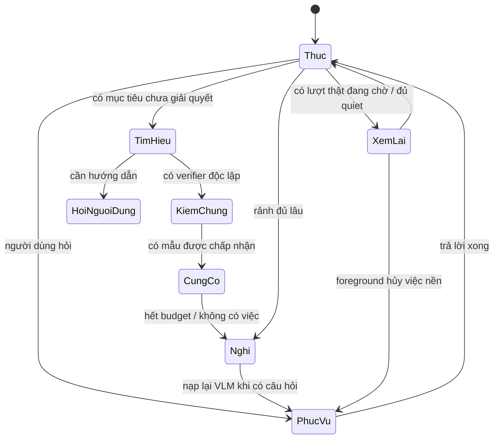

# Vòng thức, xem lại, củng cố và nghỉ — 14/11/2026

**Kết luận: GO kỹ thuật cho vòng vận hành; chưa có kết luận GO về lifelong intelligence.**
Đã nối vào gateway Hybrid và cài plugin Hermes. Normal chat vẫn dùng một model
`scarx-hybrid`; Debug/localhost hiển thị hoạt động thật. Không đổi ALIF H128,
quy tắc học, trọng số VLM, precision, context16K, scientific gates hay main.
GPU không cap RAM/commit theo phê duyệt; CPU vẫn4,5GB. Không Docker, LoRA hoặc
thí nghiệm mới trên R13. Ponytail không có trong inventory công cụ của phiên.

## Vấn đề đã sửa

- Trước đây không có scheduler thức/ngủ rõ ràng; heartbeat presence có thể làm
  hệ luôn tưởng vừa có hoạt động. Nay tách heartbeat khỏi tương tác thật.
- Cờ foreground đơn lẻ có thể được xóa khi một trong nhiều request kết thúc.
  Nay refcount + tín hiệu hủy trước learner lock; không cập nhật synapse hay
  rollback giữa lượt trả lời. Neural relevance cũng đi qua lock của learner.
- Web lookup từng giữ learner lock. Nay chỉ đặt chỗ ngân sách dưới lock,
  thực hiện I/O ngoài lock, rồi ghi nguồn; foreground không phải đợi network.
- Replay có thể lặp vô hạn cùng mẫu. Nay tối đa4attempts/mỗi revision trải
  nghiệm được chấp nhận, có khoảng cách60s, lưu ngân sách qua restart.
  Replay không tự thêm chính nó vào kho. RNG chọn mẫu và budget được commit
  cùng checkpoint; lỗi ghi DB khôi phục cả hai.
- Lời chào/xã giao và helper compact không tạo factual learning gap. TopicID
  VLM đề xuất bị loại khi lệch chủ đề theo bộ lọc từ vựng bảo thủ. Đây không
  phải semantic verifier và không sửa/xóa báo cáo lịch sử.
- Runtime progress guard cho phép dùng independent arithmetic verifier hoặc
  hỏi lại khi policy chưa đạt chuẩn chỉ đề xuất defer. Trace ghi riêng action
  do SNN đề xuất, action thực thi và người chọn; không gọi heuristic là learned policy.

## Cơ chế đang chạy

Đây là các chế độ phần mềm trên cùng hệ, không phải ba tầng neuron vật lý.

| Chế độ | Công việc và giới hạn |
|---|---|
| Phục vụ | Request được ưu tiên; giữ quyền độc quyền đối với cập nhật learner |
| Quan sát | Video/screen có ưu tiên; không tự unload VLM trong capture đang chạy |
| Xem lại | Sau30s không có tương tác thật, cadence60s; đọc một câu trả lời đã lưu, kiểm toán/sinh đề xuất có schema |
| Tìm hiểu | Xem memory trước; exact owner-approved public topic mới được tra web; native SearXNG khi bật |
| Kiểm chứng | Chỉ verifier độc lập đang có, thí dụ toán nguyên; không coi tự đồng ý hoặc snippet là đúng |
| Củng cố | Local ALIF micro-update từ mẫu đã chấp nhận, guard/transaction và bounded replay; không train VLM |
| Nghỉ | Sau180s rảnh và không có công việc hữu ích đang đủ điều kiện; giải phóng toàn bộ frozen VLM, giữ SNN/SSD/controller |
| Thức thủ công | Giữ/nạp VLM ngay, kể cả đang pause learning; CPU soft-pressure vẫn được ưu tiên |
| Tạm dừng học | Không có cập nhật nền; chat vẫn hoạt động và đánh thức VLM được |

Debug có **Tự động / Thức / Ngủ–củng cố**; mặc định tự động, không yêu cầu
người dùng bấm chạy để có trace. Tin nhắn luôn đánh thức, manual sleep không
khóa chat. Giải phóng VLM làm mất prefix cache và tạo chi phí cold reload.
SNN và nguồn gốc trải nghiệm vẫn resident/persistent. Không giữ số spike cũ
như “neuron đang nghĩ”: `active` về0 sau1,5s không có neural step;
`active_last_step` và timestamp được báo riêng.

`idle_cpu_fraction=0.10` hiện điều tiết cadence theo thời gian một quantum,
không phải OS CPU quota. Chưa có phép đo8giờ chứng minh CPU trung bình≤10%.
Không có autonomous LoRA hoặc ACT/deep reasoning đã đạt chuẩn.

## Nghiệm thu thật

Protocol trước chạy: [hybrid-cognitive-loop-engineering-v1](../../experiments/hybrid-cognitive-loop-engineering-v1.md).
Runner: [hybrid_cognition_acceptance.py](../../scripts/hybrid_cognition_acceptance.py).
Datastore mới, không copy hội thoại/trọng số học riêng của production; native
models/runtime hardlink chỉ đọc. Tất cả POST lab có nonce; Debug GET quan sát
được. Timing lab nhanh hơn production: quiet10s, reflection30s, rest20s,
replay interval2s và budget2. Không dùng mock thay câu trả lời hay cập nhật.

Run cuối: `20261113T181745Z-cognition-engineering-v1-fbe3aa` (UTC13/11, giờ VN14/11).
[Manifest/source hashes](../../runs/20261113T181745Z-cognition-engineering-v1-fbe3aa/manifest.json),
[trước restart](../../runs/20261113T181745Z-cognition-engineering-v1-fbe3aa/before_restart.json),
[sau restart](../../runs/20261113T181745Z-cognition-engineering-v1-fbe3aa/after_restart.json).
Raw SSE nằm nguyên trong receipts; journal lab private ở data-dir trong manifest.
`source/` giữ bytes nguyên vẹn qua Git bằng `-text`; runner từ chối chạy khi
source lệch manifest. Muốn tái lập lịch sử trên checkout khác, dùng source bundle
trong một bản sao cô lập và assets pinned, không ghi đè checkout/live datastore.

| Kiểm tra | Kết quả thực |
|---|---|
| Native VLM/vision numerical parity | Qua khi khởi tạo cả hai process lab |
| Mutation không có nonce |503 ở cả hai process; không đi vào learner/chat |
| Mục tiêu `12+3` | Scheduler tự review memory→machine verify15;1 local update,1 mẫu replay |
| Củng cố |2 replay được chấp nhận; tổng3updates/3hidden updates; replay_seen và số mẫu vẫn1 |
| Guard |3 accepted, không có rollback do regression trong mẫu nhỏ này; fault regression kiểm riêng bằng unitfixture |
| Nghỉ thật | VLM process kết thúc; conservative RAM toàn hệ3,825→1,483GB; dedicatedVRAM2,201→0,112GB |
| Đánh thức cold | Stream câu trả lời thật, TTFT1,515s |
| Nhường việc nền khi GPU warm | Actual review bị ngắt, hàng chờ giữ; TTFT0,172s; không update trong chat |
| Save/rollback | Full serialized state khớp byte ở cả hai process |
| Cold restart | Từng mảng neural, RNG, replay, reviewqueue, revision/budget khớp; paused learning vẫn trả lời |
| Thời gian |55,43s lượt đầu +10,39s process restart; không bao gồm stop/restore production |

Peak conservativeRAM3,853GB, privatecommit4,731GB và dedicatedVRAM2,201GB trong
lượt đầu. RAM bao gồm Hermes/process trees được liệt kê trong receipt; sharedGPU
cộng bảo thủ, có thể double-count. Không diễn giải thành guarantee4,5GB ở GPU.

Loss của action-policy trên cùng mẫu lần lượt2,53320 /0,000489 /0,000768;
weight movement và loss này không chứng minh học representation hay suy luận mới.
Trọng số recurrent có thay đổi thật, nhưng không có ablation/held-out retention
trong nghiệm thu engineering này.

**Giữ lỗi lịch sử:** prepared-only`83d75c` không chạy. Run`667a43` đã qua các
cơ chế nhưng probe POST bị Windows10053 khi đóng socket còn body chưa đọc;
receipt giữ failure, không đổi thành PASS, không chạy resume. Sửa probe sang
body rỗng rồi tạo run mới`fbe3aa`; không đổi thuật toán/gates/data để cải thiện điểm.
Không restore gateway như con của process đã được gán Windows lifecycle job;
outer shell `finally` đã restore production, tránh lỗi job-parent của lượt cũ.

**Lỗi chất lượng còn nguyên:** VLM trả lời sai rằng ALIF là tế bào limbic/amygdala
trong câu hỏi thử, đồng thời bị output cap96token. Đây là đầu ra thực được giữ;
không phải kiến thức mới đúng và không được biến thành training label. Review
được ngắt trong nghiệm thu nên chưa kiểm được nó tự nhận ra lỗi ngữ nghĩa này.

## Đã cài và những gì còn thiếu

- Gateway production được restore với datastore cũ, GPU uncapped, native SearXNG,
  learning bật/auto. Production vẫn0synaptic updates khi chốt;3updates lab
  không nhập vào trọng số của bạn.
- Plugin Hermes và API mapping đã cài có backup; source bytes được so khớp.
  Desktop loader vốn poll plugin trên disk; API Python đã import thì giữ cache.
  Computer Use xác nhận card mới trên cửa sổ thật. Lần bấm đầu gặp404 do API
  plugin cũ, đã dùng **Restart gateway** của Hermes, đợi backend ready rồi thử
  lại thành công: Thức nạp VLM, Ngủ nhả VLM, RAMUI3647→1549MB; cuối cùng đưa
  về Tự động. Không sửa Hermes core/build Electron hay đụng thí nghiệm peer.
- 105Pythonchecks qua, gồm4native CPU/NumPy parity, cộng4Nodecomposerchecks.
  Kiểm DBfault/concurrency là fixture kỹ thuật, tách khỏi inference thật.
- Chưa chứng minh hidden advantage, skill transfer, forgetting≤3/5điểm sau20
  chặng, learned autonomous policy hoặc retention dài ngày. Pilot LoRApolicy
  cũ vẫn NOTQUALIFIED, VLM frozen, không có adapter tự sinh.
- Chưa có deep reasoning ACT, semantic truth verifier, chất lượng chat/ASR
  đủ mạnh hoặc8giờ soak. Self-review sinh câu hỏi không tự sửa trọng số VLM.
- Log Hermes hiện còn lỗi auxiliary compression yêu cầu64K ở lượt dài, trong
  khi SCAR-X báo đúng16K. Nghiệm thu ở đây là lượt ngắn và lifecycle, chưa phải
  xác nhận long-session compression; không nâng giả context để che lỗi này.
- Probe sau triển khai đi qua `PublicWeb(local_search=True)` thật: native
  SearXNG trả3nguồn cho public topic `spiking neural network` trong0,984s,
  tất cả là observed, không có neural update. [Deployment receipt](../../runs/20261113T181745Z-cognition-engineering-v1-fbe3aa/deployment.json)
  giữ kết quả, trạng thái production và biên bản điều khiển GUI.

## Tra cứu và bảo trì

Một scheduler trong `src/scarx/hybrid/cognition.py`; `engine.py` giữ verifier/
learning transactions; `backends.py` giữ owned workers; `gateway.py` chỉ API.
Không thêm gateway, queue server, Docker hoặc daemon phụ. State scheduler
thuộc full checkpoint: intent, quiet/cadence, replay revision/budget, counters;
execution leases không phục hồi như tác vụ còn đang chạy sau crash.

Xem [localhost](http://127.0.0.1:8775), tab **Trace trực tiếp** hoặc Hermes
**SCAR-X Debug**. Các event `cognitive_phase`, `idle_review_*`,
`autonomous_action`, `sleep_replay_quantum`, `vlm_hibernated/resumed` ghi nguồn,
selector, loss/delta/guard và diễn biến thực; đây là telemetry, không phải
độc thoại nội tâm. Kết quả lab được publish lại với runID/thời điểm gốc, không
gán vào counters của live learner.

Fileconfig: `local/hybrid-v1/config.json`; timing tùy chọn đã whitelist là
`review_quiet_seconds`, `review_interval_seconds`, `consolidation_after_seconds`,
`consolidation_interval_seconds`, `sleep_replay_budget`, `rest_after_seconds`,
`release_vlm_on_rest`. Config được đọc khi gateway khởi động, không mở quyền
đổi kiến trúc/neural weights qua các trường này. Giữ default production khi
không có lý do đo lường khác.
