# Local ALIF credit: representation có tiến bộ, chưa thắng RAG

Ngày15/11/2026. **PIVOT tiếp; chưa đạt mục tiêu SNN mạnh hơn RAG.** Các lượt
mới sau yêu cầu autoGPU chạy forward/cập nhật synapse/fit readout trên CUDA0,
không fallbackCPU. CPU chỉ khởi tạo, đọc/ghi và kiểm toán dữ liệu. Không sửa
main, Hermes/liveweights hoặc R13; không scale, quantize, Transformer thay lõi,
LoRA mới hoặc nới tiêu chí. Đây là module phân loại ý định, chưa là kỹ năng
hội thoại, video hay tự học đa năng được đưa vào sản phẩm.

## Kết quả phân biệt được

| Phép đo | Kết quả thực | Kết luận |
|---|---|---|
| Prototype local, 3seed/20stage/240TEST |62,64%; BM25 78,47%; ridge83,33%|FAIL. Hidden-reset về18,06%, nhưng common-head DEV chỉ hơn frozen1,39pp, CI chứa0. Không coi resetdrop là đủ chứng minh representation tốt.|
| Signed output-error × forwardeligibility, DEVseed260113 |eta.20 đạt79,17%; meanforget5,83pp/worst30pp|Credit cải thiện rõ hơn prototype; chưa retentionPASS. Hai rate đã đăng ký, không mở sweep tiếp.|
| Signedcredit common-head, 3seed/120DEV |78,33% vs frozen62,50%; gain15,83pp, CI95%[8,60;22,78]|Bằng chứng có điều kiện trên DEV rằng hidden học biểu diễn phân biệt nhãn hữu ích. Không phải freshconfirmation hoặc tri thức mới trong VLM.|
| Protectedhidden common-head, cùng3seed |77,22% vs frozen62,50%; gain14,72pp, CI[6,11;23,33]|Có tín hiệu hidden hữu ích; chưa hơn signedcredit hoặc rawfeatures.|
| RawPCA64 + cùng ridge/224seenTRAIN |79,72%; signedhidden78,33%|Hidden chưa vượt biểu diễn encoder gốc; chênh−1,39pp, CI[−6,11;3,33]. Chưa đủ gain5pp so với đối chứng mạnh.|

Các khoảng tin cậy là paired bootstrap seed/chuỗi nguồn,10000resamples,
phân tầng6intent. Ba seed và120DEV đã dùng để nghiên cứu, không phải đảm bảo
tổng quát hóa hoặc bằng chứng population về ngưỡng forgetting nhỏ. Chỉ có
240chuỗi TEST độc lập ở nghiên cứu đầu; ba seed không biến thành720câu độc lập.

## Metaplasticity và fast/stable synapses

Quy tắc mới cập nhật importance từ bình phương tín hiệu localeligibility,
giảm tốc độ sửa synapse quan trọng, kéo nhẹ về trọng số ổn định và cập nhật
anchor chậm. Không nhập gradient toàn mạng. Chuẩn hóa trong mỗi neuron là
giả định về dendritic locality, rộng hơn một synapse sinh hóa độc lập. Đây là
thuật toán thích nghi, **không phải tái lập Synaptic Intelligence** vốn dùng
globalgradients trong source tác giả.

| Điều kiện | DEV cuối, trung bình3seed | Meanforget, trung bình3seed | Worstintent lớn nhất | Seed đạt cả acquisition/retention |
|---|---:|---:|---:|---:|
| Signedcredit, không protection|76,39%|8,06pp|40pp|0/3|
| Importance + slowanchor|74,44%|4,72pp|25pp|1/3|
| Cùng độ lớn update, không importance|65,83%|13,61pp|35pp|0/3|

Protection−normmatched tăng8,61pp accuracy, CI[1,39;15,83], sai khác L2 lớn nhất
5,96e−8. Lợi ích không giải thích chỉ bằng giảm độ lớn cập nhật trong đối chứng
này. So với không protection, accuracy giảm1,94pp, CI[−7,78;3,61]. Giảm quên có
đánh đổi acquisition; không chọn riêng seed260113 để tuyên bố thành công.

Chỉ dùng stable_in cuối để forward thật cho DEV đạt69,17/66,67/63,33% theo ba
seed, thấp hơn fastweights tương ứng80/70/73,33%. Chưa có lý do đưa cách dùng
slowweights đó vào inference. Đây là can thiệp cuối, không đo20stage retention
cho một hệ mới hoặc bằng chứng consolidation tự động đã hiệu quả.

## Dữ liệu, kiến trúc và giới hạn

Banking77 tác giả PolyAI, CC-BY-4.0, sourcepin57ec275d8078af65b7731c2a98be812d844a6d6b;
6intent phí/tỷ giá được chọn theo taxonomy trước khi xem điểm.240TRAIN/120DEV/
240officialTEST không trùng chuỗi chuẩn hóa. Mỗi seed thấy224TRAIN khác nhau
theo stream đã khóa, replay64; đối chứng retrieval giữ mọiTRAIN đã thấy, không
bị ép vào64mẫu. Các lớp cố định, không có taskID đưa vào neuron;20chặngstream
không phải đánh giá đầy đủ task-free lifelong learning.

Encoder Qwen0.8B nguyên BF16/F32 đóng băng và PCA64 fitTRAIN được chia sẻ với
mọi đối chứng. Lõi vẫn ALIF H128/fan8, FP32,8tick, recurrence giữ nguyên; học
ở hidden **input synapses**, chưa chứng minh learned recurrent/temporalrelations.
Credit mới dùng signederror từ fixedpooledreadout và eligibility đi xuôi, không
autograd/BPTT. Common-head ridge chỉ là probe nghiên cứu, hệ số fitGPU; không
biến nghiệm ridge thành tuyên bố mọi kết nối đều học bằng STDP.

Khóa thêm240chuỗi human-heldout từ phần officialTRAIN chưa sử dụng, seed280216,
loại toàn600chuỗi cũ; đây **không phải officialTEST mới**. Chưa embedding, dự
đoán hoặc học trên tập này. Không mở confirmation khi các gate DEV vẫn fail.
Không loại trừ dữ liệu công khai đã nằm trong pretraining của Qwen.

## Hồ sơ tái lập và lỗi giữ nguyên

```mermaid
flowchart LR
 D[Banking77 pinned / split8424b0] --> E[Native frozen features bec1b4]
 E --> C[Strong DEV controls05b216]
 C --> P[Prototype0748ea: FAIL]
 P --> H[Common-head b71d81: chưa rõ gain]
 H --> L[Signed credit501749: terminal report FAIL]
 L --> A[Raw DEV recovery ff274a: retention FAIL]
 A --> M[Protection d29a7b:1/3seed qua joint gate]
 M --> R[3seed representation6a6dff: hidden gain vs frozen]
 R --> N[Chưa vượt raw/RAG mạnh; PIVOT]
```

- [Protocol prototype](../../experiments/semantic-alif-local-prototypes-v1.md),
  [raw0748ea](../../runs/20261115T094617Z-semantic-local-ALIF-v1-0748ea/result.json),
  [audit9c7234](../../runs/20261115T095126Z-semantic-local-data-audit-v1-9c7234/result.json).
- [Protocol credit](../../experiments/semantic-alif-contrastive-credit-dev-v1.md),
  [raw501749](../../runs/20261115T100215Z-semantic-contrastive-credit-dev-v1-501749/),
  [recovered-component audit](../../runs/20261115T100547Z-semantic-credit-DEV-data-audit-v1-ff274a/result.json).
  Lỗi terminalnumpybool giữ exit1, không tạo lại resultgốc; đã sửa serialization
  và thêm regression. Không train lại chỉ để có report đẹp.
- [Protocol protection](../../experiments/semantic-credit-metaplasticity-dev-v1.md),
  [rawd29a7b](../../runs/20261115T101437Z-semantic-metaplasticity-DEV-v1-d29a7b/result.json),
  [auditfa2c42](../../runs/20261115T101809Z-semantic-metaplasticity-data-audit-v1-fa2c42/result.json).
  3846attempts gồm6GPUfixture +3840formalupdates; seed260113 baseline480updates
  tái dùng, không tính thành train mới.23766forwards/151,53s, sampled workerRSS
  peak572.792.832byte, sampledGPUfree tối thiểu3.006.267.392byte. Không phải
  peakRAM toàn hệ hay chứng nhậnCPU4,5GB/fullproduct.
- [3seed diagnostic](../../runs/20261115T101959Z-semantic-three-seed-diagnosis-v1-6a6dff/result.json),
  [auditbcf16c](../../runs/20261115T102212Z-semantic-three-seed-data-audit-v1-bcf16c/result.json):
  4488GPUforwards/23,45s,0ALIFupdates;15headcoefficients thỏa cùng phương trình
  ridge khi audit từ mảng đã lưu, không refitCPU.
- Encoder giữ resourceSTOP84f936/5bbf9f và lỗi cờ no-mmapd9584a. Sourceb12360
  thực dùng load-mode none/lazy-mode off; không trimworking-set/pagefile để
  làm giả số RAM. SolverGPU thiếuDLL20d178 giữFAIL344calls; recovery9383b3 dùng
  cùng hệ ridge với CGFP32 và residual được kiểm, không CPUfallback.
- AntigravityCLI đã thử Gemini3.8FlashHigh/efforthigh. Headlesscommand bị từ
  chối, không có peerreview hợp lệ; không bỏ quyền hoặc ghi thành agentapprove.

[Biểu đồ từ số đo thật](../../artifacts/20261115T101437Z-semantic-metaplasticity-DEV-v1-d29a7b/credit-retention-and-representation.png).
Trace kỹ thuật: [localhost8775](http://127.0.0.1:8775/?tab=trace); các sự kiện lab
không cộng vào neuralcounts live. Không mô phỏng nội dung suy nghĩ.

## Quyết định và phần chưa giải quyết

**Giữ nhánh nghiên cứu:** signederror eligibility là ứng viên tốt hơn positive
imprinting cho representation trên bộ này; metaplasticity/anchor là ứng viên
giảm forgetting nhưng chưa đủ. Không deploy các checkpoint này vào actionhead
Hermes: nhãn6intent không cùng nghĩa với6actions dù cùng kích thước.

**Loại cách kết luận:** weakreadout17–18% không là đối chứng đủ; frozenfeature
với readout mạnh đạt62,50%. Zero forgetting của không học không là PASS. Điểm
prototype TEST62,64% không được ghép với DEV78–80% thành cải thiện TEST.

**Ưu tiên kế tiếp:** phân biệt ảnh hưởng credit, độ đa dạng feature và readout
bằng TRAIN/DEV được khóa; phát triển selectiveupdate bảo vệ margin cũ thay vì
chỉ magnitudestate; chỉ mở một protocol mới có giả thuyết phân biệt được, không
thêm rate/seed để chọn may mắn. Khi acquisition≥65%, meanforget≤3/worst≤5 trong
mọi seed và có margin≥5pp/CI>0 so với đối chứng mạnh mới mở freshconfirmation.
Sau đó mới kiểm temporalrelations/video và actualactionoutcomes. Hiện chưa đạt
tiêu chí tiến tới việc tăng model hoặc tự động consolidation/LoRA trên live.
