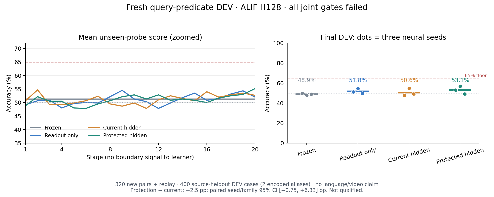

# Protection đã chạy trên dữ liệu mới: chưa đạt học và giữ kỹ năng

**Quyết định: PIVOT cho cấu hình này, không đưa vào Hermes.** Prototype importance
và anchor có tác động số học thật, nhưng chưa chứng minh học được quy tắc tổng
quát và giữ kỹ năng theo ngưỡng đã khóa. Không tăng neuron hoặc kéo thêm epoch
để biến kết quả thành PASS.

## Thử nghiệm đã thực hiện

[Protocol trước dữ liệu/đầu ra model](../../experiments/hybrid-predicate-retention-dev-v1.md),
[raw run032f30](../../runs/20261114T035022Z-predicate-retention-dev-v1-032f30/result.json).
12 cấu hình ghép cặp:3seed×4arm;20chặng,320 cặp query/record mới và320 lượt
replay cho mỗi arm,200probe và400finalDEV. Bốn nhóm: lọc giờ báo thức, giao khoảng
thời gian lịch, lọc thông điệp và chọn bản ghi đúng chủ sở hữu.

Đây là trạng thái/truy vấn được sinh bằng chương trình, với nhãn kiểm bằng SQL
và một predicate Python độc lập; không phải speech, chat tự nhiên hay benchmark
video. Max4records/owner nên không kiểm học top5ranking. API thực là input hợp
lệ; không cho neuron biết số chặng hoặc opaque taskID, không tính sẵn
same-owner/match cho nó. Query8tick rồi record8tick,64input/H128/FP32.

Neuron forward và local updates trênCUDA; không có backward/BPTT hoặc LoRA.
VLM và model live không tham gia huấn luyện. Bản frozen làm cùng lượng gọi
forward-sized mà không cập nhật; ba arm học có cùng thứ tự trải nghiệm và
reservoir replay đã xác minh khớp.

## Kết quả trên nguồn chưa học

| Arm | Seed260113 | Seed260137 | Seed260171 | Trung bình |
|---|---:|---:|---:|---:|
| Khóa học |49,75%|48,00%|49,00%|48,92%|
| Chỉ readout |51,25%|54,50%|49,50%|51,75%|
| Hidden hiện tại |47,75%|54,75%|49,25%|50,58%|
| Hidden + protection |53,00%|57,00%|49,25%|53,08%|

Protection−current trung bình+2,5pp. CI95% paired seed/family
**[-0,75;+6,33]pp**, không đạt≥5pp/lowerCI>0. Mẫu dương/âm cân bằng, chance50%.
SQL executable reference100% là oracle của các predicate này, không phải điểm
end-to-end LLM+RAG. Study không thay kết luận matchedRAG/SNN trước đây.

Không arm nào qua joint gate: acquisition sau lần giới thiệu kỹ năng, final
từng nhóm≥65%, meanforgetting≤3/worst≤5pp ở mỗi seed. Protection có mean/worst
peak-to-final decline:

| Seed | Mean decline | Worst decline | Đạt3/5? |
|---|---:|---:|---|
|260113|7,5pp|12pp|Không|
|260137|6,0pp|10pp|Không|
|260171|1,5pp|4pp|Có, nhưng accuracy49,25% và acquisitionfail|

Trường hợp thứ ba cho thấy **ít giảm điểm chưa có nghĩa giữ được kiến thức**:
model chưa đạt mức học được kỹ năng. Frozen cũng có decline0 nhưng chỉ gầnchance.
Khi acquisitionfail, các peak-to-final số này không được diễn giải như mất một
kỹ năng đã thành thạo.

## Chấm lại và các giới hạn dữ liệu/metric

[Auditor metric](../../runs/20261114T035022Z-predicate-retention-dev-v1-032f30/independent-metric-audit-v1.json)
tính lại920nhãn, toàn bộ curve/prediction/gate, replay và checkpoint:
640scoredupdates ở các arm học; một update bổ sung sau đó chỉ kiểm coldcontinuation,
không đi vào điểm final. ColdGPUrestore và nextupdate khớpbyte ở12cells.

Runner ban đầu chỉ bootstrap theo seed, dù protocol yêu cầu seed/family.
Giữ nguyên CIseed-only[0;+5,25]pp trong raw; auditor bổ sung CIđúng clustering
ở trên, không đổi phán quyếtPIVOT. Ba seed/một corpus chỉ là thăm dò, không phải
bằng chứng tổng quát về SNN hoặc một khoảng tin cậy của toàn năng lực.

[Audit encoder aliases](../../runs/20261114T035022Z-predicate-retention-dev-v1-032f30/encoding-alias-audit-v1.json)
phát hiện: tên chủ sở hữu disjoint nhưng **2/400finalcase** có inputvector giống
train do signedhash. Không có opposite-label exactcollision hoặc train−probe
overlap. Giữ fullmetrics gốc, thêm sensitivity loại2case trong artifact riêng;
không sửa dữ liệu sau khi thấy điểm hoặc coi toàn400input là hoàn toàn mới.
Đây là giới hạn của cách mã hóa, không phải model đã học được chủ thể mới.

Auditors do cùng Codex/orchestrator viết/chạy theo đường kiểm riêng; chưa có
peerreview bên ngoài. Thiếu uniformmagnitude-matched, commonreadout/hiddenreset
control vẫn chặn attribution ngay cả nếu pointscore cao hơn.

Auditors nhận `--output local/<tên-mới>.json` để chấm lại mà không ghi đè raw.
Regression sau thay đổi:248Python (gồm native/CUDA parity),13Node qua; riêng
fixture gửi trả lời HTTP/SQLite cũng qua. Đây là checks kỹ thuật, không phải
thêm seed hoặc bằng chứng cải thiện kỹ năng.

## Học thuộc một phần khác với học được quan hệ

[Fixed-state diagnosticbef36b](../../runs/20261114T041130Z-predicate-final-fit-v1-bef36b/result.json)
chỉ inference, không cập nhật hoặc calibration:640update checkpoint,320seen
và400finalDEV, giữ nguyên weights/importance/stats/replay/RNG.

| Arm | Accuracy trên320mẫu đã học, theo3seed | Trên400finalDEV |
|---|---|---|
| Readout |62,50 /63,44 /66,56%|51,25 /54,50 /49,50%|
| Hidden hiện tại |70,00 /70,94 /70,31%|47,75 /54,75 /49,25%|
| Hidden + protection |64,69 /62,81 /63,44%|53,00 /57,00 /49,25%|

Hidden có thể khớp một phần dữ liệu đã thấy, nhưng chưa chuyển thành quan hệ
áp dụng được cho chủ sở hữu và bản ghi mới. Protection giảm khả năng khớp mẫu
train và tăng nhẹ pointscore unseen; điều đó có thể chỉ là regularization/giảm
độ lớn cập nhật, chưa chứng minh importance hữu ích nhân quả.

Ở finalstate chỉ khoảng0,03–0,21% chiều feedback bị clip trên các mẫu đo.
Chưa có căn cứ quy toàn bộ lỗi cuối cho clipping diện rộng; không loại trừ
saturation trong những bước học trước. Diagnostic này không chứng minh nguyên
nhân duy nhất của forgetting hoặc không thể học bằng local rule khác.

## Tài nguyên, replay và quyết định tiếp theo

Wall868,266s<30phút. CumulativeLEARN20–37,6s/cell<cap120; số update/replay matched,
không phải cùng actualcompute. Peak researchprocessRSS623,7MB, commit643,0MB,
dedicatedGPU~91MB; đây là process-tree nghiên cứu, không tổngHermes/VLM. GPUmode
không caphostRAM; physicalfreeVRAM được kiểm theochặng, có thể bỏ sót đỉnh ngắn.
Không OOM/source/persistencefail. P0budgetdeviation350>300 vẫn là lịch sử riêng,
không được dùng study mới để đổi nó thànhPASS.

Ưu tiên tiếp:

1. Kiểm binding giữa query và record bằng counterfactual có thay truth nhưng
   giữ candidate. Không tiếp tục chỉ replay hoặc làm weights khó đổi hơn.
2. Kiểm encoder giữ thông tin/chủ thể/fieldtype; source-heldout chưa đủ nếu
   input còn aliases. A/B phải cùngD64/H128 và freshbank, không secretly đưa
   comparison/gold vào input rồi gọi là hiddenrepresentation.
3. Nếu cần kiểm learnability bằng BPTT thì chỉ nhánhcontrol đã được phép, tuyệt
   đối không nhập gradient/weights của control vào nhánh SNNlocal.
4. Không promote protection. Mục tiêu LLMSNN>RAG, tự chẩn đoán lỗi, đa năng và
   lifelong còn chưa được chứng minh. Lượt8h riêng vẫn tiếp tục đối chiếu bằng
   process/source/finalreceipt, không tính thời gian chạy như học kỹ năng.
