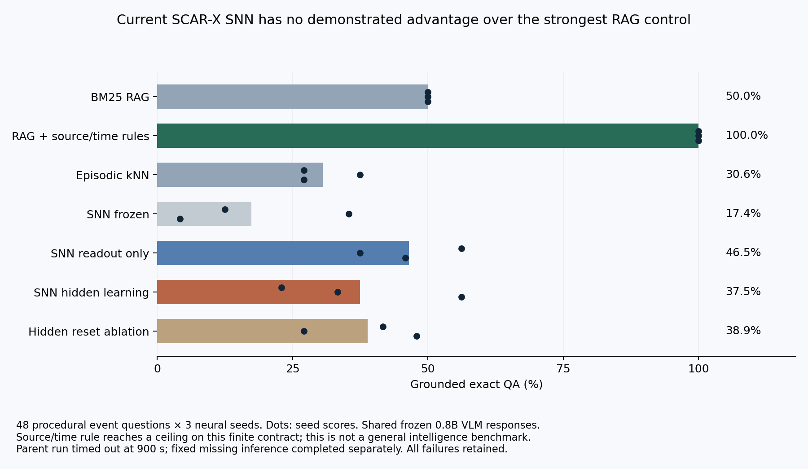

# SNN so với RAG, học từ lỗi và phần VRAM còn trống

**Kết luận hiện tại: PIVOT. Chưa chứng minh SNN hiện tại làm trợ lý mạnh hơn
LLM+RAG được thiết kế tốt. GPU thực sự được dùng; tăng VLM lên2B tiêu được phần
VRAM còn lại nhưng chưa đạt dự phòng cho vận hành hỗn hợp ổn định.**

Đây là kiểm tra theo yêu cầu sau bản sửa workspace/GPU, không đổi mastergates,
kiến trúcALIF hoặc trọng số model đang phục vụ. Không train/activateLoRA, không
merge main, không chạm activeR13. Ponytail không có trong inventory của phiên.

## Đối chứng đã làm

[Protocol DEV](../../experiments/hybrid-rag-snn-comparison-dev-v1.md),
[run và dữ liệu khóa trước học](../../runs/20261113T211216Z-hybrid-rag-snn-dev-v1-3e2e4c/manifest.json),
[kiểm lại từ output thô](../../runs/20261113T211216Z-hybrid-rag-snn-dev-v1-3e2e4c/independent-audit.json).

3seed260113/260137/260171,20chặng×24attempts/arm, cùng encoder64D/ALIFH128,
learningrule/guard hiện có. Có source-provenance/status/time, nguồn cũ bị thay,
claim mới chưa xác minh, mốc thời gian và câu thiếu bằng chứng.48queryheld-out
và8probe cố định, entity/querywording tách train/test. Nhãn từ synthetic event
contract, không từ model tự trả lời. Các positivepair được lặp3mẫu/stage để đủ
12positive/12negative; không gọi đó là24trải nghiệm độc lập.

Cùng frozenQwen3.5-0.8B, cùng prompt/precision/outputbudget, mỗi arm chọn một
nguồn hoặc abstain rồi VLM sinh JSON.198uniqueinputs thực; input trùng dùng chung
rawresponse theo requestSHA.1.008arm/seed/queryrecords không đồng nghĩa1.008mẫu
độc lập: vẫn chỉ48question×3neural seeds. Không đưa checkpointresearch vào live.

| Phương pháp | Đúng câu trả lời **và** nguồn | Điểm theo3seed |
|---|---:|---|
| RAG/FTS5-BM25 top1 |50,00% |50,00 /50,00 /50,00 |
| RAG + rulelọc nguồn/status/time |100,00% |100 /100 /100 |
| Kinh nghiệm kNN64mẫu |30,56% |27,08 /37,50 /27,08 |
| SNN frozen |17,36% |12,50 /35,42 /4,17 |
| SNN readout-only |46,53% |56,25 /37,50 /45,83 |
| SNN hidden+readout |37,50% |22,92 /33,33 /56,25 |
| Reset hidden sau khi học |38,89% |41,67 /27,08 /47,92 |

Rule biết contractprovenance nên chạm ceiling trong bài tổng hợp hữu hạn này.
Điểm100% không phải hiểu ngôn ngữ/video đa năng, và không làm bộ này đủ để chứng
minh SNN “mạnh hơn”. Tuy nhiên kết quả có thể bác bỏ khẳng định rằng candidate
hiện đã vượt bộ lọc nguồn đúng trên những loại lỗi đang gặp.

Chênh lệch hidden−readout là−9,03pp; exploratorypaired95%CI[−31,25;9,72] nên
không kết luận hidden luôn tệ hơn ở mọi tác vụ. Hidden−strongrule−62,50pp,
CI[−88,91;−33,33]. Hidden−reset−1,39pp, CI[−19,44;15,97]: không có bằng chứng
hidden mới giúp hơn trên bộ này. Bootstrap3seed/4family rất ít cluster, không
phải formalconfirmation. Không thayngưỡng≥5pp/lowerCI>0 để gọi thành công.

### Learning và retention

480attempts/seed/learnedarm; hidden được guard chấp nhận392/231/296lượt,
readout384/74/357. Input/recurrent weights thay đổi thực ở mọi acceptedhidden
update. Đây là bằng chứng synapse có học theo tín hiệu, **không phải bằng chứng
cập nhật đó tạo kỹ năng hữu ích**. Guard chỉ giữ tối đa16past-experience probes;
nó không bảo đảm mọi kiến thức cũ/tình huống mới không suy giảm.

Trên8probe thăm dò, hidden có meanpositiveforgetting37,5 /62,5 /25pp qua20chặng,
readout12,5 /62,5 /62,5pp. Tập nhỏ nên bước điểm mỗi family là50pp, không phải
ước lượngforgetting20kỹ năngthực. Dù vậy nó không qua gate3/5pp đã giữ nguyên.
Không dùng retention thấp của một model không học được gì để gọi lifelongPASS.
GPUcheckpoint/next update khớp ở cả9arm. PersistencePASS khác retentionPASS.

### Vì sao SNN chưa giúp?

- Encoder đang băm văn bản vào64chiều. Metadata`status/time/entity` của evidence
  chưa được đưa riêng vào `model.relevance`; hai bản ghi có text giống nhau nhưng
  provenance khác sẽ cho cùng feature. Testcounterfactual đã chứng minh invariant
  này; không chỉ là phỏng đoán từ điểm số.
- Credit chỉ là relevance đúng/sai ở readout với localeligibility. Nó không dạy
  VLM grammar, reasoning, đọc code hay hiểu nguyên nhân mọi lỗi công cụ.
- Inputhiddenplasticity làm representation trôi; readout/statistics và guard
  chưa giữ được hiệu quả. Resetablation chưa chứng minh hiddenfeature có lợi.
- VLM vẫn frozen. SNN chọn nguồn sai thì prompt đầu ra sai/thiếu; chọn đúng
  nguồn không bảo đảm model suy luận đúng trong những bài khác.

Vòng này kiểm current source-selector; không đánh giá hết tiềm năng của mọi SNN,
mọi RAG hay chứng minh không thể học liên tục bằng local learning. Không nên
tăng neuron hoặc nhập mô hình lớn rồi quy gain cho hidden learning.

### Lỗi ngân sách thí nghiệm giữ nguyên

Parentrun tự dừng tại900,032s:3seed/20stages/1008selections đã hoàn tất,
141nativeoutputs có trongraw, summary`native_calls=0` là bug gán biến chỉ sau
khi loopkếtthúc. Originalresult giữtimeout/0, không rewrite thànhPASS.
[Đăng ký bổ sung](../../experiments/hybrid-rag-snn-inference-completion-v1.md)
chỉ cho hoàn tất input còn thiếu, không train/rerank/retune.57calls mới trong9,5s,
tổng198; [receipt riêng](../../runs/20261113T211216Z-hybrid-rag-snn-dev-v1-3e2e4c/completed-inference.json).
Audit xác minh label, hash, rawresponse và metrics, ghi `registered_parent_budget_pass=false`.
Không gọi đây là run hoàn toàn tuân thủ900s hoặc formalPASS.

## “Tự thấy sai” cần được hiểu thế nào?

Một hệ có thể tự phát hiện tín hiệu lỗi quan sát được mà không cần có cảm giác
như người. Hiện đã có guards cơ học, post-turnreview và verifier toán; chưa có
bằng chứng neural policy tự chẩn đoán nguyên nhân rồi cải thiện tổng quát.

[Audit31toolcalls thật](../../runs/20261113T211216Z-hybrid-rag-snn-dev-v1-3e2e4c/real-tool-incident-audit.json)
nhận được streak3identicalwebcalls/results, cả31làweb_search. Đây là deterministic
detector, không SNN “hiểu ra”. Rawargs/hội thoại không được export, chỉ hashes.
Lặp cùng kết quả chứng minh không tiến triển quan sát được; không tự chứng minh
do thiếu dữ liệu, sai workspace, thiếu quyền, rate limit hay model yếu.

Luồng cần kiểm chứng tiếp:

1. Ghi symptom/đầu vào/action/result/cost với provenance, không coi “tự tin” là đúng.
2. Đặt giả thuyết nguyên nhân và thực hiện phép thử có giới hạn: cwd có đúng?
   tool đã nhận schema? source có tồn tại? output có bịspill/deny? có429không?
3. Chỉ gán feedback cho recoveryaction khi kết quả độc lập xác nhận có ích.
   Tự viết critique hoặc ngừng lặp không đồng nghĩa đã hoàn thành tác vụ.
4. SNN có thể học chọn source/action từ feedback đó; phải so với rule, replay,
   readout-only, frozen và kiểm tình huống mới/restart/forgetting.
5. Nếu chưa chứng minh neuraladvantage thì giữ heuristicguard để vận hành,
   policy mới chỉ shadow. Không tự train mọi phản hồi sai thành “kiến thức đúng”.

Literature cũng không cho phép mặc định SNN thắng: [Reflexion](https://arxiv.org/abs/2303.11366)
và [ExpeL](https://arxiv.org/abs/2308.10144) có đường cải thiện qua trí nhớ kinh
nghiệm/textfeedback mà không cập nhật weights. [Self-RAG](https://arxiv.org/abs/2310.11511)
huấn luyện hành vi retrieve/reflect trongLM; frozen0.8B hiện không tự có năng lực
đó. [E-prop](https://www.nature.com/articles/s41467-020-17236-y) là cơ chế phối hợp
eligibility/learning signals; nó không chứng minh semantic awareness trongSCAR-X.

## ~3GBVRAM nên dùng vào đâu?

Đã đo trực tiếp model lớn hơn thay vì cấp phát VRAM rỗng:
[native2Bprotocol](../../experiments/hybrid-native-2b-vram-probe-v1.md),
[nguồn và reference](../../runs/20261113T212018Z-native-2b-vram-v1-77a5fb/reference.json),
[actualprobe](../../runs/20261113T212018Z-native-2b-vram-v1-77a5fb/probe.json).

OfficialQwen3.5-2B revision`15852e8c16360a2fea060d615a32b45270f8a8fc`,
source4.548.221.488byte. NativeBF16/F32repack, không quantization/pruning;
source reference restoreF32tensors và exactparamhash không mismatch. Cả3native
probability cases qua. Đây là offlineCPUreference, không lén chạy production
neural trênCPU; khiprobe, VLM/vision/ALIF/ASR đềuCUDA.

| Ca thử2B | Output thật | Nhận xét |
|---|---|---|
|17+25 |42 |Đúng, TTFT0,140s |
|Currentportshort |9237 |Đúng, TTFT0,141s |
|Circlecolor |blue |Đúng trên fixtureảnh, TTFT0,328s |
|JADE-472/latestport |Code đúng, port9237, có codefenceMarkdown |Semantic đúng trên ca ngắn, strictJSONFAIL; không so ngang ca71Kcharcompact trước |

GlobalVRAM5499–5530MiB; samplingminfree388MiB trêncard6141MiB. Đây là đã dùng
gần đầyGPU, nhưng thiếu min512MiB dự phòng đã đăng ký và không đủ1050MiBfree
cho ASR+reserve. Không thử nhồi concurrentASR để làmWDDMspill. Unload nguyênVLM
rồi ASRCUDA chạy1,812s; **mixed_qualified=false**, không promote2B vào live.
Không gọi4casengắn là normalchat/code/video/8hqualityPASS.

Khuyến nghị thực tế:

- Phần lớn VRAM tăng thêm có giá trị hơn nếu dùng cho **VLM đủ năng lực** hoặc
  prefill/visionbuffers được đo, thay vì phình H128 khi learningmechanism còn fail.
- Không sử dụng100%VRAM như một KPI. Trong vận hành video/ASR có allocationđỉnh;
  chừa khoảng0,5–1GB là dự toánengineering ban đầu, phải đo trên workload thật,
  không phải bảo đảm hoặc chuẩn cố định cho mọi máy.
- Với2Bnative/16K hiện tại, cần thiết kế lại component scheduling/working buffers
  rồi kiểm lại mixedheadroom và8hsoak; không âm thầm giảm precision/context hay
  chuyển weights quaCPU/SSD để báo số đẹp. Cho đến đó giữ0.8Bproduction ổn định,
  all-neuralGPU/keepwarm;2B là candidateđãtải, không model thứhai cùng chạy.
- GPU-memorycapacity, GPUutilization và semanticquality là ba đại lượng khác
  nhau. ALIFH128GPU còn chậm hơnCPU trong microbenchmark trước; dùng GPUcho nó
  là tuân thủexecutionmode, không phải tự làm hidden thông minh hơn.

[Qwen official2Bconfig/card](https://huggingface.co/Qwen/Qwen3.5-2B) cung cấp
nguồn/checkpoint và thông số; sốVRAM/tốc độ ở đây từ máy thật, không suy từ
parametercount hoặc lấy publisherbenchmark làm điểmSCAR-X.

## Công việc còn mở

1. Representation cho metadata/quan hệ/sự kiện và creditassignment phải có lợi
   hơn mạnh nhất trong matchedcontrols, giữ acquisition/retention; chưa scaleSNN.
2. Verified-recovery feedback và machine-cause probes cần kiểm chứng đối với
   toolerrors mới, không chỉ repeatcounter. Chưa có autonomousneuralselfrepairPASS.
3. Chọn nativeVLM/runtimeprofile đủ headroom cùng video+ASR và normalHermes
   tool/context-use.2B thử ngắn có tín hiệu, chưa productionmixedPASS.
4.8hsoak/dài ngày vẫn chưa làm.30min trước là engineering smoke dài hơn,
   không chứng minh lifelongintelligence. AutomaticLoRA vẫn tắt/chưaqualified.

Không đổi ngưỡng thành công, không nhập researchcheckpoint vào live, không gọi
retrieval hoặc runtimeguard là neuron đã học kỹ năng mới.
