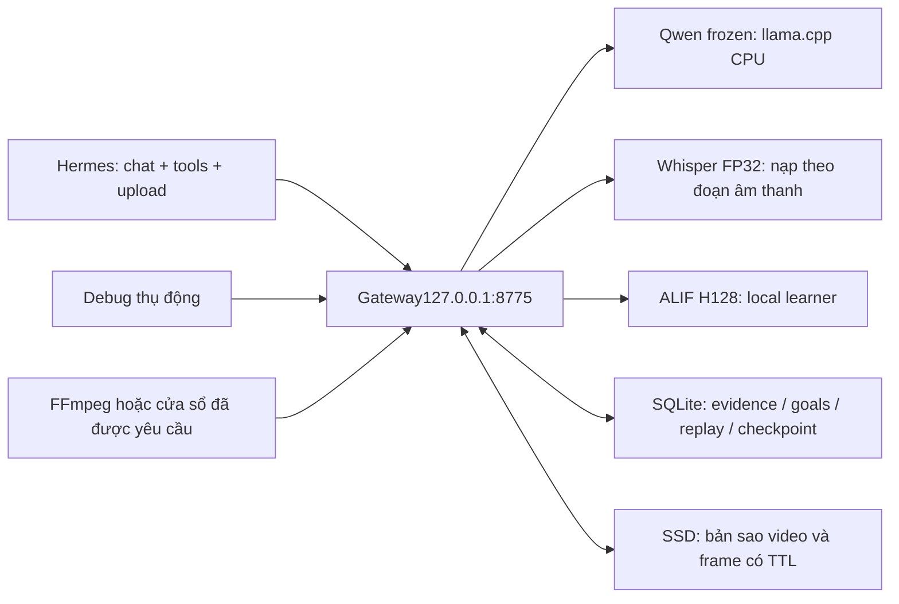

# SCAR-X Hybrid — vận hành và bảo trì

Đây là nhánh thử nghiệm được người dùng duyệt13/11/2026. Lõi SNN-only cũ và
thí nghiệm Gemini/R13 không bị thay. Master duy nhất vẫn là `docs/RESEARCH_PLAN.md`;
trang này mô tả vận hành, không thay các protocol/gates đã khóa.

## Cách dùng hiện tại

[Kiểm tra pipeline thực](PIPELINE_AUDIT_20261113.md): chat/tool/ảnh/persistence
đã chạy; sửa chọn ảnh đầu/cuối và faultisolationASR. Video21s mất31,66s,
ASRVi còn yếu; chưa đạt real-time/lifelongquality. TabDebug có đánh dấu coverage
chưa đủ. Lượt idle bị liveHermes preempt được ghi riêng, không gọi model tự học giỏi.

[Benchmark context16K/24K/32K](CONTEXT_BENCHMARK_20261113.md): cùng6bài đều2/6,
chưa tăng context. Ngân sách vận hành mới **4,5GB**, theo
[amendment](../../experiments/hybrid-v1-resource-amendment-4_5gb.md); receipts4GB giữ nguyên.

[Context, tự xem lại và đối chứng online](CONTEXT_REVIEW_AND_ONLINE_BENCHMARK.md):
reviewqueue sau lượt thật, trạng thái/blocker trongDebug, đọc nhật kýSSD phân
trang; không gọi review tự sinh là nhãn đúng hoặc weightlearning đã thành công.

1. Mở Hermes Desktop, chọn **SCAR-X Hybrid** trong bộ chọn model, dùng chat thường.
2. Đính kèm video bằng **Files…** của Hermes. Plugin chuyển file thành một nguồn
   quan sát local; tham chiếu được gửi bằng metadata nội bộ theo phiên, không
   chèn liên kết hoặc đổi nội dung câu bạn viết. Các khóa video cũ của plugin
   không được dùng lại. Cửa sổ đã dừng chia sẻ không tự theo sang lượt mới.
3. Muốn xem video đang phát: yêu cầu nhìn màn hình trong chat. Công cụ
   `scarx_video` liệt kê cửa sổ và quan sát đúng cửa sổ được chỉ định. Không có
   toolbarVideo/Screen riêng; model phải gọi đúng công cụ. Chưa chứng minh độ tin
   cậy chọn/callingtool của model0.8B trên yêu cầu tự nhiên đa dạng.
4. Chia sẻ trước khi phát đoạn cần hiểu. Hệ không thấy ngược quá khứ chưa được
   thu; cần tua lại đoạn đã bỏ lỡ. Systemaudio là toàn bộ loa đang phát, chỉ bật
   khi yêu cầu nghe video/audio; không dùng microphone. Dừng bằng công cụstop
   hoặc đóng cửa sổ nguồn. Khi model chưa hiểu công cụ, có thể cần nói rõ tên cửa sổ.
5. [Trace/debug](http://127.0.0.1:8775) và tabSCAR-X Debug tự hiện dữ liệu thật.
   Khi có câu hỏi chủ động, phần trả lời xuất hiện trong chat; lúc vắng không
   có toast/thông báo. Bỏ qua không là nhãn sai.

**Giới hạn thực tế:** chat đã chạy trong Hermes; video/screen pipeline chạy
thực nhưng câu hỏi video còn có câu sai và phiên âm tiếng Việt yếu. Chưa phải
trợ lý video dùng ổn định, chưa đạt lifelong/autonomous-quality gates.

## Một gateway, các worker do nó sở hữu



Chỉ8775 là cổng tích hợp công khai của sản phẩm.18776 là loopback nội bộ có key
tạm củaVLM; ASR dùng whisper-cli theo đoạn, không thêmHTTPservice. Không proxy chồng lên nhau; không Docker, Redis, cloud
teacher hoặc dịch vụ embedding. Plugin Hermes dùng endpoint có sẵn của Hermes,
không tạo thêm server. Source/service entrypoint ở cùng checkout được installer ghi.

Một ownerlock/data-dir, một learner xuyên restart; thiếu binary/model hoặc integrity
fail thì báo lỗi, không tự đổi sang cloud. Native workers bị dừng nếu gateway chết;
screenworker có watchdog và chỉ ghi nguồn được cấp. ASR nhường RAM trước VLM,
và khi dự toán audio vượt phần RAM còn lại, runtime tạm dỡ **toàn bộ VLM frozen**
để chạy ASR rồi nạp lại trước lần nhìn/trả lời tiếp. SNN/checkpoint không bị dỡ.
Đây là chuyển pha sensory component, không paging từng layer; có chi phíI/O và
mất prefixcache, được trace bằng`vlm_suspended_for_audio`/`vlm_resumed`. Vì thế
nên capture1× không đồng nghĩa nghe/nhìn mọi frame ngay lập tức. Frontiers và
skipped intervals được hiển thị; không có cam kết phân tích liên tục không trễ.

## Khởi động, dừng và khôi phục

Chạy từ root của worktree hybrid, không phải main gốc:

```powershell
python scripts/hybrid_service.py start
python scripts/hybrid_service.py status
python scripts/hybrid_service.py stop
```

Plugin tự nạp gateway khi cần và từ chối listener không đúngSCAR-X. Không mở
thêm`run_hybrid.py` khi owner còn sống. `run_app.py` tiếp tục là SNN-only gốc,
không cần chạy để dùng hybrid.

Cài lại adapter sau cập nhật source:

```powershell
python scripts/install_hybrid_hermes.py
python scripts/install_hybrid_provider.py
```

Installer giữ config/providers/secrets khác; backups trong`local/hybrid-v1`.
Hai sửa đổi Hermes được giới hạn: floor-context exception đúng route/model
và progressive disclosure của công cụ cho profileSCAR-X. Không khai64K giả,
không tắt tools, không thay agent/systemprompt. Những phiên cũ giữ snapshottools
cũ; **tạo chat mới** sau đổi cấu hình. Hermes update có thể thay anchors:
installer phải dừng để review thay vì patch mù. Có helper graceful gateway replace
khi cần nạp code mới; không dùng để dừng các thí nghiệm peer.

Checkpoint tự động giữ32bản mới; checkpoint người dùng lưu được pin trên SSD.
Save/load/rollback qua API hoặc Debug, không copy các fileSQLite đang mở.
Rollback neural/controller giữ audit/evidence nguyên bản. Sao lưu toàn bộ data-dir
khi gateway đã dừng để phục hồi cả database/WAL và nguồn media.

## Tổ chức source và state

| Thành phần | Vai trò |
|---|---|
| `hybrid/gateway.py`, `backends.py` | OpenAI-compatible stream/tool-calls, owned native workers |
| `engine.py`, `learner.py` | Goals, action authorization, ALIF eligibility, guards/replay |
| `store.py`, `ownership.py` | Transactions, full-state snapshots, single learning writer |
| `media.py`, `screen.py` | Filevideo1×, selected-window capture, raw TTL, reinspection |
| `public_web.py` | Exact approved public-topic queries, Wikipedia vi/en, bounded linked reads |
| `resources.py`, `gpu_memory.py` | Process-treeRSS/privatecommit and conservative sharedGPU accounting |
| `integrations/hermes/hybrid_plugin` | Normal-composer middleware, screen tool, learning question, Debug |
| `local/hybrid-v1` | Private weights, binaries, DB, source copies, per-install backups |
| `runs/*hybrid*` | Immutable engineering/reference/audit receipts, including failed attempts |

Trần4,500,000,000byte, ngưỡng nền4,250,000,000byte, bao gồm gateway/worker/capture/Hermes, cộng sharedGPU theo
PDH một cách bảo thủ (có thể double-count nếu không chứng minh được cùng trang).
WindowsJob áp aggregateprivatecommit lên worker tree; RSS được lấy mẫu50ms,
sharedGPU2s. Đây không phải hardphysical-RAM guarantee: vi phạm đã được ghi lại
và dừng worker, không xóa khỏi báo cáo. Không dùng pagefile/weightoffloading để
giả số thấp. Model gốc và GGUF là bản cùng precision; file định dạng khác không
được gọi là lượng tử hóa. KV/state là buffer làm việc hữu hạn, không là dung lượng
trí nhớ lifelong. Không có adapterLoRA trong bản này.
Ngân sách này không bao gồm OS hoặc thí nghiệmR13 độc lập mà người dùng đang
chạy; process tree và sharedGPU củaHybrid+Hermes được ghi rõ trong từng receipt.

## Tái lập từ máy chưa có assets

`pip install -e '.[hybrid]'` trong venv riêng. Scriptsetup tải bản pinned có hash;
không sửa môi trường Python của peer. Thứ tự: `hybrid_setup.py` → `hybrid_convert.py`
→ `hybrid_native_audit.py` → `hybrid_reference.py` trong reference-env → service.
Reference cần Transformers5.22.2 trong venv cô lập và Torch sẵn có; không được
import các dependency đó trong runtime. Whisper export đọc trực tiếpFP32;
converter upstream có đường FP16 trung gian nên không được dùng nguyên xi.
Reference loader phải khôi phục36tensorFP32 gốc trước đối chiếu. MTP auxiliary
head giữ trong export nhưng không được đường generate chuẩn của cả hai backend dùng.

Đọc [kết quả](../research/HYBRID_IMPLEMENTATION_20261113.md) trước đổi model,
precision, featureencoder hoặc learningrule. Updatebinary/model cần rehash và P0
mới, không tận dụng receipt cũ làm PASS cho phiên bản mới.
