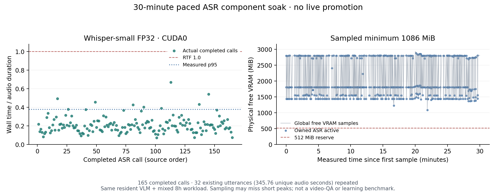

# Whisper-small FP32 đã qua kiểm độ bền thành phần 30 phút

**Có căn cứ tiếp tục tích hợp Whisper-small vào profileGPU; chưa thay ASRlive.**
Lượt pacedsoak đủ1.800,532s và worker thật đã thoát bình thường. Auditor độc lập
đường tính xác nhận source/hash, logCUDA0/FP32, transcript, timing, resource và
budget. Đây là thành phần dùng thêm VRAM có lợi ích phiên âm đã đo trước đó,
không phải bằng chứng SNN học tốt hơn RAG hoặc QA video đã đạt.

[Protocol](../../experiments/hybrid-whisper-small-paced-soak-v1.md),
[run292b32](../../runs/20261114T080220Z-whisper-small-soak-v1-292b32/result.json),
[audit data-only](../../runs/20261114T080220Z-whisper-small-soak-v1-292b32/independent-soak-audit-v1.json),
[protocolaudit](../../experiments/hybrid-whisper-soak-data-audit-v1.md).

| Phép đo thật | Kết quả |
|---|---:|
| Walltime |1.800,532s |
| Lượt ASR hoàn tất |165 |
| Lỗi / preemption |0 /0 |
| Audio đã xử lý, có lặp |1.808,60s |
| Fileaudio duy nhất / tổng duration duy nhất |32 /345,76s |
| RTFp95: wall xử lý / duration audio |0,37696 |
| Mẫu VRAM khi ASR còn sống |551 |
| PhysicalfreeVRAM thấp nhất đã lấy mẫu |1.086MiB |
| Trung vị latency20calls đầu / cuối |1,969 /1,891s |

RTF0,377 nghĩa là ở p95, xử lý một đoạn audio mất khoảng37,7%độ dài đoạn đó.
Chưa bao gồm mọi chi phí capture/video/QAtích hợp. Audio là32FLEURSDEV đã dùng,
lặp theo nhịp duration, không165mẫu mới, không30phút video đa dạng. Không lấy
chênh lệch latencyđầu/cuối làm kiểm định leak/drift hoặc tốc độ model khác.

## Resource và độ nguyên vẹn

Cùng nativeVLM39372/16K/CUDA vẫn giữ, private8hlab41904 đang chạy đồng thời.
Monitoroverlay giữ explicitroots35036/41904 cùng dynamicHermes35648/47768;
auditor kiểm union/membership từngheartbeat. Không unloadVLM hoặc đóng ứngdụng
khác để làm đủ VRAM. FP32export của small khớp receipt và executable/corpus
hashes; từng log thật cóCUDA0/ftype0, không silentlyCPUfallback hoặc hạprecision.

Peak nhómtiếntrình trong phép đo: RSS~5,510GB, privatecommit~10,959GB và
dedicatedGPU~3,856GB. Không cộng RSSvàcommit, không quy toàn nhóm thành riêng
Whispersmall, không coi số này chứng nhận CPU4,5GB. GPUmode được bỏ caphostRAM.
MinfreeVRAM1.086MiB chỉ là minimum đã lấy mẫu, chưa bảo đảm không có đỉnh ngắn
bị bỏ sót. Có concurrentbaseASR/vision/chat nên đây là mixedload, không isolated
ASRmicrobenchmark hoặc bằng chứng năng lượng.

Ledger hiện169attempts:1attempt bị charge ở preflightlỗi trướcspawn,3calls của
preflightđãqua và165calls dài. Tất cả≤256, không hoàn ngân sách hoặc reset theo
runID. Preflightlỗi67183e và backup/source của lượt sửalock vẫn được giữ.
32sourceIDs đều có một transcript variant trong lượt này; không suy thành mọi
nativegeneration luôn deterministic hoặc sourcepretraining không chứaFLEURS.

## Vì sao chưa đưa ngay vào Hermes?

Runtime hiện hardcode `whisper-base-f32.bin`; configasr_revision chưa chọn đúng
path/identity khác. Đổi tênfile hoặc chỉ sửa revision sẽ tạo báo cáo model sai.
[Kế hoạch tích hợp P0](../../experiments/hybrid-ASR-profile-integration-p0-plan-v1.md)
đã xác định resolver/config/identity/integrity và actualcalls cần kiểm.

Source của lượt8h554c19 vẫn khóa; chưa sửa backends/config/qualification hoặc
resources.py trước terminalaudit. Sau đó cần nối một resolver thật, giữ nguyên
filebase để rollback, kiểm smallGPUselection/log/resource và persistence, rồi
đo mixedprofilemới. Không thêm modelID/thêmgateway vàoHermes.

ComponentsoakPASS chỉ mở bước tích hợp. QAknownclip vẫn1/3 ở
[lượt trước/sau restart](VIDEO_COLD_MEMORY_20261114.md), và hiddenSNN chưa có
lợi thế transfer/retention đáng tin cậy. VLM frozen/LoRAtắt; câu hỏi về rule
history mới vẫn chờ duyệt, không có nhánh biến thể nào được train ngầm.

Các transcript/timing/rawreply và tiến độ8h tiếp tục hiện ở
[localhost](http://127.0.0.1:8775/?after=9673&tab=trace). Finalreceipt này không
được tính là local learning update hoặc một chứng nhận productiontoànhệ.
