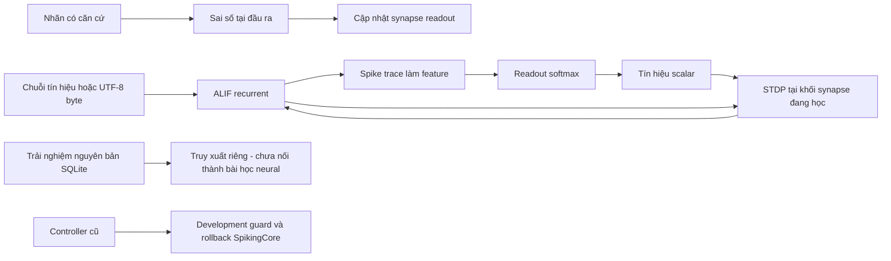

# 02 — Kiến trúc đã triển khai và ranh giới nghiên cứu

## Sản phẩm hiện hành: Generation 1, một core

“Fast / Deep / Idle” nay được xác định là ba chế độ của một core, không phải
ba mạng hay stack3lớp đã có. ACT/tự khám phá còn Proposed; xem tài liệu12/master.
Tab Hermes Hỏi để học dùng communication log riêng512tin; controller questions
và human feedback có nguồn, không phải thêm một neural readout/LLM. Log không
tham gia retrieval lúc generate hoặc tự trở thành factual target.

[UnifiedCore](../../src/scarx/neural/unified.py) có đúng một SpikingCoreALIF,
khởi đầu48, prototype cấp48–128. Các kênh text/ảnh/modality cùng đi vào
`W_in[H,D]`; cùng `W_rec[H,8]`, neuron state và readout `W_out[V+10,H]`.
Word/digit slices là đầu ra của cùng mạng, không
router sang hai model. [Generation](../../src/scarx/app/generation.py) điều phối
idle/foreground cùng core và full-session persistence. Runtime không reset
state; boundary dùng 12 tick settling. Training cũng dùng cùng cơ chế.

Output-local delta và scalar-modulated hidden eligibility không dùng backward.
G1 chưa có importance/metaplasticity hữu ích. Dialogue controller lưu input,
neural draft, nguồn feedback và lesson trong buffer hữu hạn. Foreground học
từng microstep giữa lượt; idle review so với nhãn rõ ràng và replay có guard.
Draft chưa xác minh chỉ dùng phát hiện bất nhất, không dùng làm target.
Rollback khôi phục fullstate tại chỗ, giữ object core duy nhất. Memory không
truy đáp án để thay neural output lúc generate. Controller hỏi là code điều phối,
không là năng lực ngôn ngữ/uncertainty đã được neuron học.
Trace là spikes/voltage/input/output/ΔW đo được, không lời giải thích nội tâm.
Hai seed joint training không qua greeting gate; general language/vision,
Experience-to-Skill và reasoning chưa chứng minh. Chi tiết [master](../RESEARCH_PLAN.md).

## Hồ sơ kiến trúc nghiên cứu và sản phẩm trước G1

Cập nhật docs 2026-11-09. Roadmap, gate và phê duyệt nằm trong [master plan duy nhất](../RESEARCH_PLAN.md). File này mô tả code hiện có; không thay thế kế hoạch chính. Không có thuật toán mới được triển khai trong lần cập nhật này.

**Bổ sung Product-first:** [Workbench MVP](../../src/scarx/app/state.py) và [web UI](../../src/scarx/app/web/) hiện dùng PlasticCore/LifelongLearner với cùng topology/rule. [ADR0005](../decisions/0005-product-first-mvp.md) cho phép UI/integration/tests dù researchgate chưa đạt. Nhãn builtinrule chỉ làm verifier, neural probabilities là nguồn prediction; SQLite search nằm riêng.

## Topology và hai phiên bản lõi

- [SpikingCore](../../src/scarx/neural/core.py): lõi Phase 2, ALIF phát xung theo ngưỡng. `neuron="rate"` là đối chứng analog, không phải nhánh SNN chính.
- [PlasticCore](../../src/scarx/neural/plasticity.py): kế thừa topology, dùng ALIF stochastic, eligibility score/STDP và importance; dùng cho Phase 2.1.
- Một quần thể hidden recurrent, không phải mạng nhiều tầng hidden: input dense `W_in[H,D]`; recurrence thưa theo incoming fan-in `W_rec[H,K]` với `indices[H,K]` cố định; readout dense `W_out[O,H]` cùng bias.
- Phase 2.1 giữ H=48, K=8, R=12 hàng plastic/episode. D=8,O=2 cho representation/lifelong, D=24,O=4 cho stress 20 context. Config mặc định H=64 và byte demo không phải cấu hình nghiệm thu Phase 2.1.
- K nguồn trong mỗi hàng được lấy ngẫu nhiên không lặp, có thể có self-connection. Chưa có Dale's law, vùng excitatory/inhibitory, neurogenesis hoặc cơ chế sinh hóa.
- Code hiện dùng ALIF; `adaptation_strength=0` biểu diễn LIF không thích nghi. Chưa có một implementation LIF độc lập được công bố là một baseline đã đánh giá riêng.
- “Block” hiện chỉ là nhóm hàng được cập nhật luân phiên; không được gọi topology là block-sparse có cấu trúc đã tối ưu CPU. Xem [giải thích đầy đủ trong master](../RESEARCH_PLAN.md#3-existing-architecture).

## Luồng dữ liệu

## Phương trình lõi Phase 2 và readout

Với spike cũ z, input x, recurrence thưa fan-in K:

`v <- leak*v + W_in*x + sum(W_rec*z[index])`

`threshold_adapted = threshold + adaptation_strength*a`

`z <- 1[v >= threshold_adapted]; v <- v-z*threshold_adapted`

`a <- adaptation_decay*a+z; feature <- decay*feature+(1-decay)*z`

Readout: `p=softmax(W_out*feature+b)`. Sai số `one_hot(target)-p` chỉ cập nhật synapse đầu ra; không nhân với W_out để truyền ngược.

Trace STDP theo hoạt động trước/sau, clipping [-5,5]. Hidden nhận một scalar `p[target]-reward_mean` hoặc reward do môi trường cung cấp, giới hạn [-1,1]. Rule này là heuristic reward-modulated STDP, không phải policy gradient đúng, e-prop hay bằng chứng tối ưu loss. Reward_mean dùng EMA.

Cập nhật `dw = clip(lr*modulation*eligibility - anchor*(w-w_stable))`. Chỉ khối hàng đang active được học; chuyển khối giữa các episode. Stable weights EMA sau replay; không bảo đảm chống quên.

## Cơ chế Phase 2.1 đã có

`PlasticCore.step` lấy spike Bernoulli với `p_spike=sigmoid((v-threshold_adapted)/0,4)` thay cho hard-threshold. Topology input/recurrent/readout vẫn giữ nguyên; spike và trace làm working memory hữu hạn.

Rule score tích lũy eligibility từ presynaptic voltage trace và residual `(spike-p_spike)/0,4` tại neuron. Scalar reward advantage ở cuối đoạn dùng `-loss` hoặc reward môi trường, trừ EMA baseline, clip [-2,2]. Không có vector error từ readout truyền ngược về hidden. Trace xấp xỉ, clipping và active block làm rule thành heuristic; chưa được chứng minh là gradient không chệch hoặc có credit assignment đủ tốt.

Metaplasticity điều chỉnh tốc độ thay đổi synapse theo importance, cùng lực kéo về stable weights. Importance từ magnitude tín hiệu local chưa biết kết nối nào thực sự có ích. `LifelongLearner` cập nhật stable anchors sau mỗi64update, một số mode decay importance mỗi32update. Đây là nhiều thang thời gian trong update, chưa phải offline Experience-to-Skill.

Readout dùng feature trace spike và output-local error để học ánh xạ. Readout có thể giải bài đơn giản dù hidden chỉ là reservoir ngẫu nhiên; do đó phải refit probe head độc lập và ablate hidden để công nhận representation learning.

`forward(sequence)` reset state mỗi episode; weights giữ qua episode/restart. Chưa có stream state chạy liên tục không reset. Eligibility được tích lũy trong đoạn, trọng số đổi sau đoạn; không học giữa một lượt generate của người dùng.

## Memory và complexity

- Input weights H×D, recurrence H×K, readout O×H. Recurrent indices int32; stable copies cho tất cả trọng số.
- Eligibility chỉ R×(D+K) với R là số hàng plastic active. Traces neuron O(D+H), state O(H); không tăng theo lịch sử.
- Mỗi bước có chi phí O(HD+HK+OH), vẫn tính dense input/readout. Đây chưa phải runtime event-driven chỉ tính khi có spike.
- Checkpoint neural lưu trọng số, stable state, reward baseline, bộ đếm, indices và traces; `plasticity-v1` còn có importance và hai RNG. Neural checkpoint có checksum và ghi tạm rồi replace. Các tệp learner/replay riêng chưa tạo thành atomic transaction toàn hệ thống.
- SQLite FTS5 dùng cache 8 MiB, mmap tắt; raw text giới hạn 1 MB/episode. Search trả snippet tối đa 4096 ký tự, `get(id)` trả nguyên văn.
- Prototype text dùng vocabulary 256 byte, chưa BPE, chưa huấn luyện ngôn ngữ. Không tự kết hợp search vào generate.

## Giao diện

| API | Hành vi |
|---|---|
| `SpikingCore.forward(sequence, track)` | Reset state rồi xử lý chuỗi, giữ weights |
| `SpikingCore.learn(target, mode, reward)` | Local update khi kết thúc đoạn, không backprop |
| `LearningController.learn(examples, guard, replay)` | Snapshot → update → development guard → accept/rollback |
| `save/load` | Đọc/ghi state đầy đủ; continuation tái lập |
| `rollback` | Khôi phục checkpoint; không tự xóa raw episodes |
| `EpisodeStore.observe/search/get` | Lưu và truy xuất, không được tính là học neural |
| `TextAgent.generate` | Sinh byte từ trọng số hiện tại; không học giữa lượt |

**Tích hợp MVP đã sửa:** `LearningController.rollback` dùng loader theo loại lõi, nên hỗ trợ PlasticCore; LifelongLearner có atomicbundle và đọc legacy. Workbench commit fulllearner/replay/RNG/counters với experience/history/active pointer trong cùng SQLite transaction. Fault update/commit khôi phục object gốc, interrupted process nạp committed generation. CLI nghiên cứu cũ vẫn phục vụ SpikingCore; Workbench là giao diện product cho plasticity-v1. Không có automaticconsolidation tổng quát hoặc text verifier.

## Phân công core, memory và controller

| Thành phần | Đã có | Chưa có / giả thuyết |
|---|---|---|
| Neural core | ALIF, local update, stable anchors, importance heuristic | Representation/credit assignment và học kỹ năng bền vững chưa đạt gate |
| Working memory | State và traces trong episode | Chính sách state xuyên episode chưa nghiên cứu |
| Episodic store | SQLite raw text, nguồn, hash, FTS5 | Liên kết trải nghiệm thành bài học neural tự động chưa có |
| Replay | Buffer chuỗi số bounded, reservoir/balanced và persistence | Chưa là semantic/procedural memory |
| Learning controller | Guard/rollback theo loader; MVP fullsession transaction, builtin-rule verifier và resource limits | Dữ kiện tự do, automatic idle consolidation và broader recovery UI chưa có |
| Semantic/procedural memory | Chưa có bằng chứng chức năng | Phải giải được trường hợp mới sau reset/restart, retrieval tắt |

Không có đường long-term memory → core đã huấn luyện để biến raw text thành kỹ năng. Retrieval chỉ trả dữ liệu. `verified` do bên nhập xác nhận, chưa có verifier độc lập tự động.

## Đề xuất tách khỏi kiến trúc hiện tại

[Master plan mục4](../RESEARCH_PLAN.md#4-proposed-extensions) đề xuất nghiên cứu usefulness-based importance, credit assignment local, ổn định readout và Experience-to-Skill. Chưa chọn rule mới, chưa thay topology, chưa sửa code. Bất kỳ đề xuất kiến trúc mới nào cần mô tả tính mới so baseline, tín hiệu học, state/RAM bổ sung, phần phải huấn luyện và thí nghiệm bác bỏ trước phê duyệt triển khai.

Hiện thiếu representation được học hữu ích, credit assignment, retention và generalization; chưa huấn luyện ngôn ngữ. Vì vậy lõi này chưa là hệ suy luận/ngôn ngữ đa năng. Nối memory hoặc replay không tự khắc phục giới hạn neural.

## Các phần chưa triển khai vì gate thất bại

Model ngôn ngữ 10M+, adaptive computation, iGPU, quantization, runtime C++ độc lập, đánh giá đa năng 600+ bài. C++ hiện có kernel Phase2 qua ctypes, được kiểm tra parity nhưng chậm hơn NumPy ở bài nhỏ đã đo; chưa có parity native cho PlasticCore Phase2.1. Những việc này không được ưu tiên trong Phase2.2; NO-GO cho mở rộng vẫn giữ nguyên.
