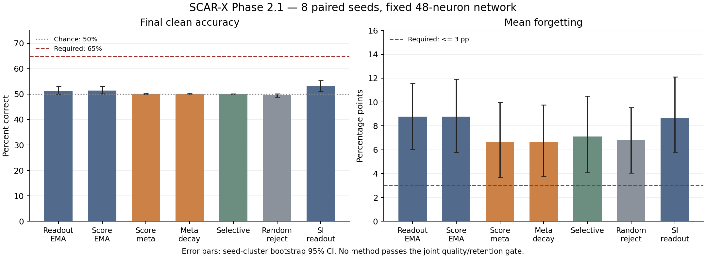

# 08 — Phase2.1: Lifelong Adaptive Intelligence

**Kết luận: PIVOT tiếp ở quy mô nhỏ; NO-GO cho mở rộng quy tắc/cấu hình hiện tại. Chưa có lợi thế continual learning đáng tin cậy so với các đối chứng đã chạy.**

Cập nhật ngày 2026-11-09. Mục tiêu 1M context đã bị loại bỏ. Giữ 48 neuron, local learning, RAM 2 GB, mean forgetting ≤3 điểm phần trăm và worst ≤5 điểm phần trăm. Không thay ngưỡng sau kết quả.

## Hồ sơ và thiết kế

- [Representation/replay factorial](../../runs/20261108T162931Z-phase21-v1-f3fa83/report.md): 3 development seeds, 8 confirmation seeds; lựa chọn cấu hình trước test.
- [Stream không task boundary](../../runs/20261108T163521Z-phase21-lifelong-v1-48ee0f/report.md): 7 methods×8 seeds,1280 trải nghiệm có noise, periodic consolidation.
- [Strict binding audit](../../runs/20261108T170757Z-phase21-binding-audit-v1-a64369/report.md): 8 seed mới, không chọn lại rule.
- [BPTT control riêng](../../runs/20261108T170812Z-phase21-bptt-control-v1-2d0010/report.md): 24trial; không thuộc nhánh SCAR-X.
- [Kiểm tra tái lập](../../runs/20261108T170909Z-phase21-reproduction-efdb4a/report.md): source snapshot, statistics và recorded-update schedule.
- Tổng 303 trial mới, ngoài audit lịch sử. CI bootstrap theo seed; task contrasts có Holm correction. Các condition dùng cùng seed là so sánh ghép cặp, không phải seed độc lập mới.

## 1. Vì sao Phase2 quên?

Toàn bộ15trial và checkpoint được kiểm lại. Full: acquisition ban đầu trung bình45.36%, final34.17%. Max-to-final forgetting22.29pp; diagonal-to-final11.20pp. Phần chênh11.09pp bao gồm các đỉnh xuất hiện sau lần học đầu và biến động; không quy hết cho nhiễu thống kê.

| Seed | Task0 sau học | Cuối stream | Khôi phục head cũ | Khôi phục hidden cũ | Nhóm replay bị thiếu/80 |
|---|---:|---:|---:|---:|---:|
| 17 | 72.66% | 26.56% | 71.88% | 27.34% | 15 |
| 29 | 82.03% | 32.81% | 82.81% | 32.03% | 17 |
| 43 | 75.00% | 35.16% | 75.00% | 34.38% | 16 |

Head overwrite là nguyên nhân nổi bật ở task0 được audit. Replay thiếu coverage; anchor EMA không chứa importance về mức hữu ích. Các context dùng permutation khác trên cùng head, tạo interference. Đây là counterfactual trên task0, không phải phân rã nhân quả cho mọi kỹ năng.

## 2. Hidden có học representation mới?

| Bài | Probe gain so với initial, pp [CI95%] | Accuracy trực tiếp | Holm p | Gate |
|---|---:|---:|---:|---|
| xor | 1.46 [-0.78; 3.71] | 49.76% | 0.5469 | False |
| order | 1.81 [0.49; 3.08] | 52.29% | 0.1641 | False |
| binding | -0.73 [-2.10; 0.54] | 72.71% | 0.5469 | False |

Score eligibility có tín hiệu nhỏ ở order, chưa vượt ngưỡng 5 điểm phần trăm và hiệu chỉnh kiểm định nhiều lần. Trọng số thay đổi thật chưa đủ chứng minh representation hữu ích. Không vượt ổn định đối chứng đảo dấu modulation.

**Lỗi thiết kế được phát hiện:** binding ban đầu có shortcut bag-of-values đạt75% lý thuyết. Giữ kết quả nguyên bản nhưng không tính đó là khả năng binding. Challenge mới buộc hai value đối nhau, giữ cùng số sự kiện/key/value. Đây là audit bổ sung sau khi nhìn kết quả, dùng seed mới và rule cố định.

Strict binding: probe=49.66 [47.51; 52.25]%; gain=-0.49 [-2.73; 1.71]pp; accuracy=50.20 [50.00; 50.59]%; bag-only=49.22 [47.31; 51.07]%; exact p=0.7109; pass=False.

Temporal permutation cố định có thể giữ hoặc biến đổi tín hiệu order, nên một lesion tăng điểm không chứng minh model hiểu quan hệ thời gian. Reset-state và OOD chỉ là chẩn đoán phụ.

## 3. Replay và consolidation với budget đối chiếu

Development chọn hidden=score, replay=reservoir, consolidation=none; time budget=0.077162s/stage đã khóa trước confirmation.

| Budget | Condition | Acquisition | Final | Mean forgetting | Train seconds | Updates |
|---|---|---:|---:|---:|---:|---:|
| updates | selected | 30.10% | 29.12% | 13.89pp | 2.397 | 1920.0 |
| updates | reference | 29.99% | 28.84% | 14.11pp | 2.419 | 1920.0 |
| updates | no_hidden | 30.28% | 29.07% | 14.20pp | 2.232 | 1920.0 |
| updates | no_consolidation | 30.10% | 29.12% | 13.89pp | 2.653 | 1920.0 |
| time | selected | 28.36% | 27.84% | 12.94pp | 1.553 | 1391.0 |
| time | reference | 27.20% | 27.12% | 11.30pp | 1.582 | 1258.6 |
| time | no_hidden | 28.66% | 28.38% | 12.14pp | 1.514 | 1291.4 |
| time | no_consolidation | 28.27% | 27.83% | 12.78pp | 1.579 | 1243.2 |

Cùng số cập nhật: bỏ EMA giảm forgetting khoảng 0,22 điểm phần trăm, quá nhỏ so với yêu cầu 5 điểm. Cùng ngân sách thời gian: lợi thế không còn ổn định. Acquisition quanh 30% (mức đoán ngẫu nhiên 25%) chưa thể gọi là giữ kỹ năng thành công. Balanced replay + metaplasticity có forgetting thấp trong development nhưng acquisition yếu; không chọn cấu hình chỉ vì quên ít.

Không so trực tiếp mức forgetting Phase 2 với Phase 2.1 như một cải thiện thuật toán: forward đã chuyển sang stochastic ALIF, độ dài episode và bộ đánh giá cũng khác. Chỉ các đối chứng trong cùng thiết kế mới hỗ trợ so sánh.

## 4. Stream không boundary, noisy feedback và plasticity

| Cơ chế | Final accuracy | Mean forgetting | TB mức quên tệ nhất mỗi seed | New-rule gain | Fresh-network gain |
|---|---:|---:|---:|---:|---:|
| readout_ema | 51.17% | 8.79pp | 16.50pp | -2.34pp | 4.10pp |
| score_ema | 51.42% | 8.77pp | 16.31pp | -1.81pp | 3.96pp |
| score_meta | 50.08% | 6.66pp | 14.11pp | 2.00pp | 6.30pp |
| meta_decay | 50.08% | 6.64pp | 14.55pp | 1.46pp | 6.30pp |
| selective | 50.00% | 7.11pp | 13.92pp | -1.37pp | 6.30pp |
| random_reject | 49.56% | 6.84pp | 14.06pp | 2.59pp | 6.30pp |
| si_readout | 53.16% | 8.66pp | 13.62pp | 1.07pp | 4.10pp |

| Primary contrast | Final accuracy gain, pp [CI95%] | Forgetting reduction, pp [CI95%] | Holm p |
|---|---:|---:|---:|
| metaplasticity | -1.33 [-2.96; -0.03] | 2.12 [-1.09; 5.34] | 0.4688 |
| importance_decay | 0.00 [0.00; 0.00] | 0.02 [-0.65; 0.76] | 1.0000 |
| selective_quality | 0.44 [-0.13; 1.20] | -0.28 [-3.73; 2.91] | 0.9375 |

Các cột trong bảng là trung bình theo seed; gate tuyệt đối được kiểm riêng trên mọi seed, không chỉ trung bình này. Không condition nào đạt toàn bộ ngưỡng. Metaplasticity/decay giảm số đo forgetting ở một số trường hợp nhưng accuracy gần mức đoán ngẫu nhiên 50%: chưa chứng minh giữ được kỹ năng. Importance dựa độ lớn tín hiệu có thể bảo vệ cả update nhiễu; chưa đo được importance nhân quả.

Selective learning được thêm metadata chất lượng không hoàn hảo; so với random-rejection để tránh nhầm ít update với học tốt. Kết quả chỉ áp dụng cho giả lập chất lượng nguồn này, không chứng minh hệ tự phân biệt chân lý. SI-readout là adaptation có khả năng học khác, không phải whole-network SI.

Probe cuối dùng đảo nhãn binding 64 mẫu; đó là thích nghi sang quy tắc xung đột, không thể đòi đồng thời giữ nhãn cũ cho cùng đầu vào. So mạng đã học với mạng mới còn phụ thuộc điểm khởi đầu; CI của chênh lệch rộng. Chưa đủ kết luận mạng mất plasticity lâu dài. Bài này vẫn kế thừa shortcut binding ban đầu, nên không được dùng chứng minh học quan hệ mới.

## 5. So với recurrent/backprop control

| Bài | BPTT accuracy trung bình |
|---|---:|
| xor | 50.00% |
| order | 70.51% |
| binding | 73.10% |

BPTT control dùng deterministic ALIF, nhánh local dùng stochastic ALIF; cùng kích thước và 512 mẫu, chi phí tính toán thực khác. Không suy diễn trực tiếp thành lợi thế phần cứng. Bài binding control cũng chịu shortcut đã nêu. BPTT cũng không giải được XOR ở ngân sách này: điều đó giới hạn khả năng phân biệt các cơ chế trên bài XOR, không chứng minh bài toán bất khả thi.

Đã so với replay reservoir/balanced, readout-only recurrent, EMA, local metaplasticity và output-local SI. Chưa tái lập MESU, BNN metaplasticity hay Continual Backprop đầy đủ trong cùng budget; không có cơ sở tuyên bố thắng các phương pháp hiện đại nói chung.

## 6. RAM, persistence và phán quyết

| Run | Peak RSS MB | Peak commit MB |
|---|---:|---:|
| phase21 | 47.66 | 66.33 |
| lifelong | 45.59 | 64.94 |
| binding audit | 42.78 | 61.67 |
| BPTT control | 630.18 | 1050.95 |

Trọng số, traces, importance, reward/RNG và replay continuation đã được kiểm tra. RAM quan sát trong trần 2 GB; đây là giám sát, chưa phải giới hạn cứng do hệ điều hành áp đặt. Không có kết luận về iGPU hoặc điện năng.

Các thí nghiệm đo ba thang: cập nhật trọng số nhanh mỗi trải nghiệm; EMA stable anchor mỗi 64 cập nhật; importance tăng hoặc giảm chậm hơn. Việc có ba thang thời gian chưa chứng minh cách phối hợp chúng là đúng. Importance từ độ lớn tín hiệu tăng kể cả khi nhãn nhiễu; protection có thể củng cố một trạng thái chưa học hữu ích. Đây là giả thuyết giải thích cần kiểm tra nhân quả tiếp.

**Có thể học tiếp không cần BPTT ở phạm vi hữu hạn; chưa chứng minh SCAR-X duy trì kỹ năng phức tạp lâu dài.** Capacity cố định không giữ vô hạn ánh xạ độc lập. Credit assignment scalar và chất lượng representation hiện là nút thắt; memory/replay không tự giải quyết chúng. Xem [phản biện giới hạn](07_LIFELONG_LIMITS.md).

**Quyết định:** PIVOT hẹp về importance gắn với mức hữu ích, ổn định readout và credit assignment/representation. NO-GO cho tăng model hoặc quảng bá lợi thế Lifelong của rule hiện tại. Không đổi ngưỡng, không huấn luyện ngôn ngữ, không mở rộng tham số.

Chưa đủ cơ sở nói SCAR-X vượt các phương pháp hiện có. Kết quả âm chỉ bác bỏ ưu thế của các quy tắc và cấu hình đã thử trong ngân sách đã công bố. Hệ hữu hạn có thể tiếp tục học bằng cách chọn lọc, tái sử dụng và quên có chủ đích; không thể bảo đảm giữ chính xác vô hạn kỹ năng độc lập trong dung lượng cố định.
