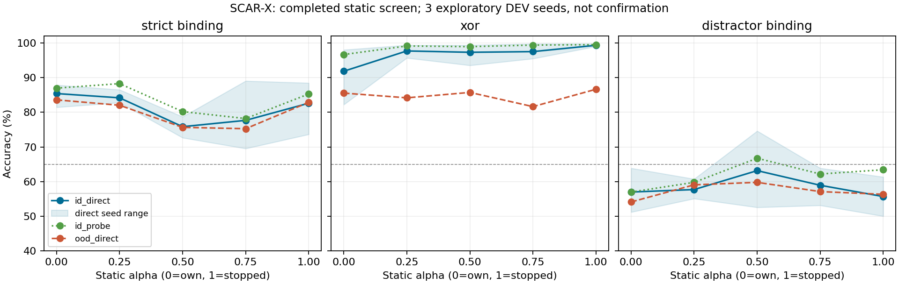

# ACR DEV — kết quả và phản biện, 12/11/2026

**ACR_SPECIALIZED_GAIN**; integrity `PASS`. Một nominee toàn cục `groups_up`, không chọn alpha theo task.
Đây là nghiên cứu ALIF H48 D8/fan8, không Transformer/BPTT/pretrained, không main/Hermes. Không gọi kết quả này là lifelong intelligence hay năng lực ngôn ngữ/vision.

## Provenance và continuation

Run `20261112T121634Z-acr-dev-v1-resume-59ced4`, source `c54ee689126a79e695df98eb81eb60053acc2621`; base93b5b96, equationsbc686500/peer607ffca. [Protocol gốc](../../experiments/acr-dev-v1.md) và [continuation](../../experiments/acr-resume-20261112.md).
Reused cells kiểm hash: 203; recursivechain `[{'run': '20261112T121634Z-acr-dev-v1-resume-59ced4', 'parent': '20261112T082034Z-acr-dev-v1-resume-ac9bba', 'cells': 203}, {'run': '20261112T082034Z-acr-dev-v1-resume-ac9bba', 'parent': '20261112T073944Z-acr-dev-v1-f947fb', 'cells': 55}]`.55cell đầu bị gián đoạn do credits; lượt sau hoàn tất203cell rồi mất worker khi tiếp tục phiên. Một preflight staleobserver dừng trước0newupdates và được giữ nguyên, ngân sách trừ thêm2s.
V3 copy203completecells, chỉ replay đúng một cell mất state từ initialcheckpoint byte-exact. Ít nhất128 và tối đa1.024lượt học của attempt cũ không được lưu là compute thừa, không seed độc lập. Đây là ngoại lệ phục hồi hành chính được ghi trước khi chạy, không đổi thuật toán/criteria. Remainingbudget trừ snapshotelapsed và120s uncertainty; không chứng nhận exact tổngwall của quãng worker mất giám sát.
Đủ 375 model records/375 expected, missing=0; invalid controls=0.
Accepted training trajectories có321.539updatecalls; cộng144diagnosticcloneupdates
trong worker và128..1.024uncheckpointedupdates đã mất. Audit/postprocess không
tạo learningupdates. Reusedcells không được tính thêm lần nữa.
Chấm lại 3,072,000 prediction entries; 375 checkpoint roundtrip; 6,000 direct replay và 1,920 probe qua eigensolver độc lập. Không có cập nhật học trong audit.
Ba seed DEV140011/140017/140023, không dùng lại12confirmationseeds hoặc bankR9. CI chỉ mô tả3seed; exact sign-test có p tối thiểu0,25. Không P1 certification, không fresh confirmation/P2.

## Direct và hidden representation — equal1.024updates

| Profile | Binding direct/probe | XOR direct/probe | Distractor direct/probe | Order direct |
|---|---:|---:|---:|---:|
| static_0 | 85.42%/86.98% | 91.86%/96.68% | 56.97%/56.97% | 100.00% |
| static_25 | 84.18%/88.28% | 97.72%/99.15% | 57.68%/59.77% | 99.87% |
| static_50 | 75.85%/80.21% | 97.33%/98.96% | 63.15%/66.73% | 97.59% |
| static_75 | 77.67%/78.19% | 97.53%/99.41% | 58.92%/62.17% | 97.72% |
| static_100 | 82.62%/85.29% | 99.35%/99.54% | 55.66%/63.41% | 99.61% |
| linear_up | 82.81%/81.97% | 97.33%/98.83% | 60.09%/65.30% | 99.54% |
| linear_down | 77.80%/81.84% | 98.18%/99.09% | 63.02%/66.93% | 99.74% |
| groups_up | 85.03%/88.54% | 98.11%/98.44% | 59.24%/60.48% | 100.00% |
| groups_down | 77.99%/79.17% | 98.70%/99.48% | 64.32%/67.06% | 99.93% |
| intrinsic | 83.66%/86.07% | 96.29%/98.11% | 59.64%/60.35% | 100.00% |
| readout_only | 62.96%/62.30% | 82.75%/83.27% | 52.67%/53.84% | 91.73% |
| state | 80.47%/84.18% | 99.09%/99.54% | 59.24%/59.77% | 99.87% |
| state_shuffle | 88.28%/89.39% | 96.61%/98.31% | 59.83%/61.52% | 99.93% |
| random_alpha | 84.70%/83.85% | 97.66%/98.57% | 58.20%/58.27% | 100.00% |
| state_signal_shuffle | 52.47%/53.97% | 76.82%/87.89% | 51.37%/54.43% | 94.86% |

Dữ liệu từng seed, OOD, norms/CPU và source path nằm trong `per-seed-results-v2.csv`;
cột model_index/path phân biệt hai trajectory norm-paired, không gộp chúng thành
baseline độc lập. Probe gain dùng frozen initial representation; readout budget
không đổi frozen probe. RAM columns là segment study peaks tại thời điểm ghi
row, không phải per-model isolated peak. V1CSV giữ nguyên, V2 thêm scope RAM.


Vùng tô là min–max ba seed, không phải confidence interval. Order ceiling không được tính là representation success.

## Nominee và điều kiện bắt buộc

| Task | Probe gain vs readout [95% mô tả] | Direct causal drop | OOD preserved | Direct65 |
|---|---:|---:|---|---|
| strict_binding | +26.24đ [+22.66đ;+30.08đ] | +33.59đ | True | True |
| xor | +15.17đ [+11.52đ;+17.58đ] | +41.02đ | True | True |
| distractor_binding | +6.64đ [-1.56đ;+12.50đ] | +8.20đ | True | False |

Joint shared-checkpoint guards: `{'strict_binding': False, 'xor': True, 'distractor_binding': False, 'order': False}`; order guard `True`. Pooled mixed training chưa là continual learning/P2, dù chỉ có một shared head trong joint environment.
Shuffle-margin qua 3/3; actual-norm margin qua 2/3; control regression `False`.
Norm control kiểm30.720bước; zero radius0; max relative physical norm error
9,9996632989e-6, tolerance1e-5. Invalid controls phải chặn advance, không loại
khỏi bảng để cứu điểm.
Norm radius=.5min(raw physical updates) trên hai trajectory thật; optimizer/RMS/momentum history vẫn riêng. Do đó kiểm amplitude không chứng minh chỉ hướng cập nhật là nguyên nhân duy nhất. EqualCPU so dual-stream ACR endpoints, không phải claim tiết kiệm CPU trước baseline single-stream gốc. Pair CPU được phân bổ một nửa cho mỗi row, không phải đo riêng từng model.

## Actual diagnostic traces và OOD stress

Đã kiểm 144 diagnostic clone tapes và 36 stressfiles, 41,472 stresspredictionentries; không thêm learningupdates. Replay stress dùng cùng pinned probe, không gọi đó là independent ridge proof. Mixture maxerror=0.0, reconstructedphysicaldelta maxerror=0.0.
Các clone được lấy từ finalcheckpoint với TRAINindices0/63/511/1023; không nhầm chúng với trajectory của đúng update index ban đầu. Full u/theta/spike/adaptation/own-stop-mixed eligibility/alpha/q, signal, delta, loss và prediction nằm trong NPZ.

| Profile / task | Alpha TB | Alpha std TB/tape | Corr alpha–spike | Cos own/stop signal-credit | Norm own/stop |
|---|---:|---:|---:|---:|---:|
| static_0 / strict_binding | 0.0000 | 0.0000 | undefined | 0.9066 | 7.7397/11.6649 |
| static_0 / xor | 0.0000 | 0.0000 | undefined | 0.8728 | 1.6504/2.7812 |
| static_0 / distractor_binding | 0.0000 | 0.0000 | undefined | 0.9142 | 7.6907/12.4457 |
| static_0 / order | 0.0000 | 0.0000 | undefined | 0.9062 | 0.0070/0.0118 |
| static_100 / strict_binding | 1.0000 | 0.0000 | undefined | 0.9259 | 8.7929/12.1696 |
| static_100 / xor | 1.0000 | 0.0000 | undefined | 0.8661 | 0.0866/0.1403 |
| static_100 / distractor_binding | 1.0000 | 0.0000 | undefined | 0.9264 | 6.9460/10.2334 |
| static_100 / order | 1.0000 | 0.0000 | undefined | 0.8500 | 0.0049/0.0099 |
| groups_up / strict_binding | 0.5000 | 0.2500 | 0.0151 | 0.9323 | 7.4862/10.4715 |
| groups_up / xor | 0.5000 | 0.2500 | 0.0187 | 0.8654 | 0.1616/0.2465 |
| groups_up / distractor_binding | 0.5000 | 0.2500 | -0.0189 | 0.9020 | 6.1512/9.8449 |
| groups_up / order | 0.5000 | 0.2500 | 0.0031 | 0.8709 | 0.0037/0.0078 |

Per-neuron48alpha và per-tickalpha means, adaptation correlations và per-seed rows ở mechanism-audit-v1.json; không suy ra consciousness từ điện thế hoặc spike.

### State-adaptive router — trace thật từ checkpoint C

Bổ sung 192 frozen rollouts trên 48 checkpoint C,0learningupdates và không dùng giá trị labels; độc lập kiểm q/alpha/permutation/mix trên cùng state. Metadata được đọc từ JSON có chứa prediction containers, không nhầm điều đó với đưa labels vào router. Không so phân phối alpha giữa các model đã học khác weights rồi gọi là matched.

| Router / task | Alpha TB | Temporal std/neuron | Corr alpha–spike | Corr alpha–adaptation |
|---|---:|---:|---:|---:|
| state / strict_binding | 0.2897 | 0.0932 | 0.4298 | 0.2818 |
| state / xor | 0.2989 | 0.0906 | 0.4847 | 0.3910 |
| state / distractor_binding | 0.2822 | 0.0956 | 0.4282 | 0.2052 |
| state / order | 0.3064 | 0.1141 | 0.5252 | 0.3617 |
| state_shuffle / strict_binding | 0.2977 | 0.1288 | 0.0250 | -0.0469 |
| state_shuffle / xor | 0.2988 | 0.1317 | 0.0449 | 0.0353 |
| state_shuffle / distractor_binding | 0.2956 | 0.1330 | 0.0079 | -0.1051 |
| state_shuffle / order | 0.3184 | 0.1573 | 0.0485 | 0.0711 |
| random_alpha / strict_binding | 0.2991 | 0.2311 | 0.0387 | 0.0181 |
| random_alpha / xor | 0.2900 | 0.2256 | 0.0443 | 0.0150 |
| random_alpha / distractor_binding | 0.2946 | 0.2261 | 0.0499 | -0.0007 |
| random_alpha / order | 0.3220 | 0.2375 | 0.0203 | 0.0603 |
| state_signal_shuffle / strict_binding | 0.2749 | 0.0976 | 0.5818 | 0.5016 |
| state_signal_shuffle / xor | 0.2811 | 0.0931 | 0.5399 | 0.4634 |
| state_signal_shuffle / distractor_binding | 0.2800 | 0.1056 | 0.6142 | 0.5214 |
| state_signal_shuffle / order | 0.2800 | 0.0940 | 0.5596 | 0.4939 |

Đây là fixed heuristic router có alpha biến thiên, không phải router đã học policy tối ưu. Correlation là mô tả; final-episode gating chưa chứng minh online weight updates từng tick. [Phân tích đầy đủ](ACR_ROUTER_ANALYSIS_20261112.md).

| Task / stress | Own direct/probe | Stop direct/probe | Nominee direct/probe |
|---|---:|---:|---:|
| strict_binding / heavy_noise | 76.30%/79.17% | 77.34%/75.00% | 80.99%/79.95% |
| strict_binding / moved_noise | 82.81%/88.28% | 83.33%/86.20% | 83.85%/85.42% |
| strict_binding / event_amplitude | 83.07%/84.90% | 82.81%/83.33% | 81.51%/83.59% |
| strict_binding / delay12 | 51.56%/57.81% | 59.38%/58.33% | 60.68%/57.81% |
| strict_binding / query_flip | 85.16%/88.02% | 83.33%/85.94% | 85.68%/85.42% |
| xor / heavy_noise | 86.46%/90.10% | 99.48%/98.18% | 95.57%/91.67% |
| xor / moved_noise | 90.36%/95.57% | 99.48%/99.74% | 97.92%/98.44% |
| xor / event_amplitude | 88.28%/91.41% | 96.35%/96.88% | 89.32%/90.89% |
| xor / delay12 | 79.43%/75.52% | 95.83%/80.73% | 77.60%/69.27% |
| distractor_binding / heavy_noise | 52.34%/55.73% | 51.82%/51.56% | 52.86%/56.77% |
| distractor_binding / moved_noise | 54.69%/52.86% | 54.17%/54.17% | 52.34%/53.39% |
| distractor_binding / event_amplitude | 55.73%/55.21% | 57.03%/59.11% | 56.25%/60.68% |
| distractor_binding / delay12 | 52.08%/46.88% | 54.43%/54.95% | 48.96%/52.08% |
| distractor_binding / query_flip | 54.69%/57.81% | 58.85%/69.53% | 59.64%/62.24% |
| order / heavy_noise | 100.00%/99.74% | 98.44%/97.40% | 99.48%/99.74% |
| order / moved_noise | 100.00%/100.00% | 99.74%/100.00% | 100.00%/100.00% |
| order / event_amplitude | 99.22%/99.22% | 100.00%/88.28% | 99.74%/100.00% |
| order / delay12 | 61.98%/57.29% | 74.74%/67.97% | 95.05%/79.43% |

Stress transforms giữ finalmarker, nhưng noise-amplification/shift còn biến đổi distractorpulses; không gọi toàn bộ chúng là noise-only. Queryflip là paired intervention cùng writes, không distribution query mới.

## Cơ chế và giới hạn

- Own và stopped giữ cùng hard ALIF forward. Khác nhau là reset Jacobian trong eligibility, có thể khác ngay cả khi hard spike chưa xảy ra vì surrogate slope khác0.
- Hai stream voltage/adaptation/filter độc lập; trộn sau filter. Endpoint0/1 đã khớp baseline exact, gồm optimizer/RNG/coldresume.
- Router state là heuristic cố định, không đọc task ID, loss/test label/accuracy. Cập nhật chỉ cuối episode nên alpha cuối mới trực tiếp ảnh hưởng update; alpha(t) không tự chứng minh học online từng tick.
- Random-alpha giữ phân phối alpha của chính state hiện thời rồi hoán vị; hai learner sau học có state khác nhau nên không tự coi marginal across-run là matched.
- Refit probe đo thông tin có thể đọc ra; direct causal drop và OOD mới giúp đánh giá kỹ năng usable. Truy xuất/SSD/LLM không tham gia benchmark.
- Bộ nhớ mảng bổ sung16.704B so baseline:4trace matrices12.288B và router/diagnostic arrays4.416B. Python/runtime/ZIP/buffers tính riêng trong measured process RAM.
V3 peak RSS 177.62MB/commit 220.55MB. Peak của các run gián đoạn chỉ là historical snapshot lowerbounds, không finalglobalpeak; xem progress gốc trong recursivechain. Không iGPU/điện năng suy diễn.

## Kết luận và đường đi tiếp

**PIVOT nghiên cứu; NO-GO promotion learner hiện tại.** Giữ prototype và bằng
chứng chuyên biệt, không mở rộng heuristicrouter để cứu điểm. State-shuffle
control tốt hơn state trên Binding là phản biện cần giữ, không chọn hậu nghiệm
control đó làm winner. Hiddenlearning có tín hiệu thật; chưa một learner tích
lũy kỹ năng bền vững. [Review cuối độc lập](ACR_STATISTICAL_HARNESS_REVIEW_20261112.md).

Capacity H48 chưa được chứng minh đủ. [Đề xuất H48/64/128](../../experiments/capacity-diagnostic-proposal-20261112.md)
chỉ là phép phân biệt dự kiến, chưa training. Tăng neuron có thể giúp capacity
nhưng không tự sửa learning signal/readout/forgetting; không kết luận SNN bị
giới hạn từ48neuron. Không lấy RAM thấp hoặc số neuron làm qualitycertificate.

Không thay gateP1/P2. Nếu có specialized/probe-only signal phải giữ đúng nhãn, không suy rộng thành cùng learner giữ kỹ năng lâu dài. Chưa có kiểm quên20context trong vòng này. Không merge/main/Hermes hoặc mở confirmation khi chưa có approval riêng.
Đối chiếu literature nằm ở nhánh codex/scarx-literature-first-20261112: e-prop/BrainTrace adapters và SI helper đã kiểm số học; reference DEV kết luận REFERENCE_MIXED. Không được tuyên bố literature thất bại nói chung từ một adapter/H48/budget duy nhất.

## Tái lập

```powershell
python -m pytest -q -p no:cacheprovider tests/test_acr.py tests/test_acr_study.py
# Original once-reserved study: scripts/run_acr_dev.py; final continuation: scripts/run_acr_resume_v3.py.
# Reproductions use a new isolated checkout; never delete old reservations or overwrite evidence.
python scripts/audit_acr_dev.py --run runs/20261112T121634Z-acr-dev-v1-resume-59ced4
```
Observer http://127.0.0.1:8771 tự đọc actual progress/answers/loss. Không mô phỏng suy nghĩ thành lời; scientific reports giữ source SHA/protocol/data/hash để truy vấn lại.

Khi tái lập read-only trong workspace có raw, dùng `--output audit-reproduced.json`
để không ghi đè audit-v1. Checkout mới có thể đổi LF/CRLF: `source-byte-bundle/`
khóa21executedsourcebodies chính xác từ codecommit và sourcehash, chỉ overlay
vào reproduction checkout MỚI; không nới checksum hoặc sửa checkoutlive.
`export_research_source_bundle.py` tái dựng từ Gitobject+EOL và xác minhhash,
không huấn luyện hoặc thay nguồn đang chạy. Tính reproducibility không có nghĩa
bitwise trên mọi NumPy/CPUversion chưa kiểm; environment thực đi cùng manifest.
