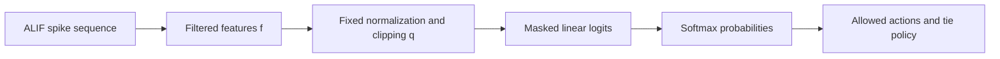

# Đặc tả trên giấy: bảo vệ core–readout, cho phép hidden đổi spike

Ngày15/11/2026. Theo đầu vào người dùng đánh giá spec880cd71b: nghiên cứu đúng
giao diện spike→feature→readout; chưa compiler/router/vùng synapse mới.
**MATHEMATICAL_DRAFT_ONLY**, không learner/guard đã triển khai hoặc chứng nhận
FP32. Không code, dataset, neural forward, fixture, train/refit/benchmark;
không sửa main/Hermes/ALIF hay ngưỡng. Master: [RESEARCH_PLAN](../RESEARCH_PLAN.md).

Đồng ý phản biện: giữ mọi spike mạnh hơn cần thiết cho một số hành vi. Chưa
suy ra guard yếu hơn sẽ giúp acquisition hoặc có lợi về tổng chi phí. Giữ
[spike-preservation spec](ALIF_INTERFACE_PRESERVATION_SPEC_20261115.md) làm
mốc toán so sánh, không triển khai nó như tính năng.

## 1. Giao diện thật trong source

[Core.step](../../src/scarx/neural/core.py#L94) lọc spike thành f;
[LocalALIF._forward_native](../../src/scarx/hybrid/learner.py#L173) đọc:

\[
f_T=\gamma^Tf_0+(1-\gamma)\sum_{t=1}^T\gamma^{T-t}z_t,
\quad q_i=\operatorname{clip}((f_i-\mu_i)/s_i,-5,5),
\]
\[
s_i=\max(\sqrt{\mathrm{var}_i},0.05),\qquad
\ell=W_o q+b,\qquad p=\operatorname{softmax}(\ell).
\]

Head action có6rows, relevance có2rows trên128features; headmask là một phần
contract. [decide](../../src/scarx/hybrid/learner.py#L206) chọn max probability
trong danh sách allowed và trả cả probability dictionary. Khi bằng điểm,
thứ tự allowed tác động tie; không tự thay bằng quy ước argmax khác.

## 2. Giả định và đối tượng cần giữ

Chỉ thay W_in trong mô hình xác định; giữ recurrence/topology, config, encoded
inputs, state đầu và lịch forward. Cố định readout/bias, μ/var, masks, allowed
và tie policy. Chỉ xét tập hữu hạn S có nguồn/trạng thái còn hợp lệ.

Tài liệu phân biệt ba contract **không đồng nghĩa**:

| Contract | Phải giữ | Có thể đổi |
|---|---|---|
| Feature | q'=q | Spike history hoặc f trước clipping nếu vẫn cùng q |
| Probability | p'=p của head cần bảo vệ | q theo những thay đổi readout không phân biệt được |
| Decision | Chọn đúng nhãn hợp lệ y | q/probabilities, nếu consumer cho phép |

Với consumer chỉ đọc nhãn, giữ spike⇒giữq⇒giữp⇒giữnhãn. Inclusion không có
nghĩa mọi lớp đều rộng hơn một cách strict trên model/input cụ thể. Consumer
đọc voltage, confidence/entropy, nhiều head hoặc trạng thái khác cần contract
tương ứng. Chỉ giữ argmax không giữ một controller dùng probability để hỏi/
hoãn. Không chuyển claim này thành toàn bộ VLM/Hermes không quên.

[LocalALIF.learn](../../src/scarx/hybrid/learner.py#L220) live sửa readout,
recurrent weights và μ/var. Đó không là nhánh W_in-only/frozen-consumer của
spec. Không sửa learner hoặc lén đổi normalizer để thỏa proof.

## 3. Điều kiện decision chính xác trong số thực

Cho old trajectory có nhãn đã xác minh y và old model đang trả lời đúng.
Gọi A là tập allowed có thứ tự cố định; y∈A. Với k∈A\{y}, đặt:

\[
a_{yk}=w_y-w_k,\quad
g_{yk}=\ell_y-\ell_k,\quad
\Delta q=q'-q.
\]

Vì W_o,b cố định:

\[
g'_{yk}=g_{yk}+a_{yk}^{\top}\Delta q.
\tag{D}
\]

Nếu y là unique winner, g'_{yk}>0 với mọi k≠y bảo vệ nhãn trên input đó.
Đây là hệ quả trực tiếp từ logit difference, không là thuật toán tìm ΔW hữu
ích. Với tie policy ưu tiên phần tử xuất hiện trước trong allowed, điều kiện
đầy đủ là g'_{yk}>0 nếu k đứng trướcy, và≥0 nếu y đứng trướck. Công thức strict
thường dùng là sufficient nhưng có thể từ chối cả reference có tie hợp lệ.

Những điều kiện này là tuyến tính trong Δq, **không tuyến tính nói chung
trong ΔW_in**. Không tự project weight update như thể Δq là tham số có thể
ghi trực tiếp. S có nhãn đúng chưa đủ: nếu old model trả lời sai, bảo vệ
spike/probability sai không là bảo vệ skill đúng. Correction có contract riêng.

## 4. Probability contract và khoảng không readout không nhìn thấy

Chọn row anchor của head Kclasses; A_o gồm các row w_k−w_anchor. Trong số thực
với finite logits và softmax đầy đủ của head:

\[
p'=p\iff A_o\Delta q=0.
\tag{P}
\]

**Lý do:** softmax không đổi khi cộng cùng scalar vào mọi logit. Ngược lại,
cùng p giữ mọi log(p_k/p_anchor), nên mọi logitdifference giữ nguyên.

rank(A_o)≤K−1. Do đó trên không gian feature liên tục128chiều, nullspace
có dimension≥123 cho head6lớp và≥127 cho head2lớp. Nếu bảo vệ cả hai head
trên cùng input bằng stacked differences, dimension≥122. Đây là cận đại số
trên q, không là số neuron rảnh hoặc dung lượng skill còn lại.

q bị clipping/miền reachable ràng buộc. Đặc biệt, với finiteT và f0 cố định,
spike nhị phân cho tập hữu hạn các f_T; không phải mọi vector trong nullspace
đều tạo được bằng một ΔW_in. Một không gian feature lớn không chứng minh
local learner tìm được đường tới đó hoặc một skill mới được học.

Ví dụ z=(1,0)→(0,1) giữ y=z1+z2 chỉ chứng minh khả năng output-insensitivity
trong một readout minh họa; chưa chứng minh chính ALIF hiện tại tạo được
chuyển đổi đó bằng rule đang dùng, dưới tất cả old constraints.

## 5. Một điều kiện đủ bằng bound feature change

Cùng f0, feature filter cho đẳng thức:

\[
\Delta f_{i,T}=(1-\gamma)\sum_t\gamma^{T-t}\Delta z_{i,t}.
\]

Clipping có Lipschitz1 theo từng tọa độ, vì μ,s cố định:

\[
|\Delta q_i|\le |\Delta f_i|/s_i.
\]

Nếu có bound **sound** |Δf_i|≤B_i, thì với các old strictmargins, điều kiện đủ:

\[
g_{yk}>\sum_i |a_{yk,i}|B_i/s_i\quad\forall k\ne y
\tag{B}
\]

giữ unique winner. Đây là triangle inequality; bỏ cancellation nên bảo thủ.
Tie dùng(D) hoặc bound có quy ước một phía phù hợp, không áp strictmargin
vào mọi reference rồi âm thầm loại ties khỏi metric sau khi thấy kết quả.

Nếu biết các tick có thể flip, có thể đặt B_i=(1−γ)Σ_tγ^(T−t)|Δz_it| hoặc
một upperbound của tổng đó. Không biết gì về flips thì có thể chọn bound
B_i=1−γ^T, thường quá thô để chứng nhận hữu ích; không nói luôn vô ích ở mọi readout.

**Khoảng trống chưa giải:** cần tạo B_i từ physical ΔW mà vẫn cho phép spike
đổi. Eligibility/surrogate slope không tự là một bound an toàn của forward
hardspike. Không dùng alignment tốt hoặc một Jacobian xấp xỉ thay chứng minh.

### 5.1 Sau spike đầu tiên đổi, công thức đơn giản cũ hết điều kiện

Với R cố định, các sai lệch forward thật tuân theo:

\[
\delta u_t=\lambda\delta v_{t-1}+\Delta W x_t+R\delta z_{t-1},\quad
\delta\theta_t=\beta\delta a_{t-1},
\]
\[
\delta a_t=\rho\delta a_{t-1}+\delta z_t,\qquad
\delta v_t=\delta u_t-\theta_t\odot\delta z_t-z'_t\odot\delta\theta_t.
\]

Đây là phân tích sai lệch forward, không là BPTT/RTRL candidate. Khi δz≠0,
recurrent input và adaptation có thể đổi ở các bước sau; không tiếp tục dùng
δu=Δwᵀr của **cùng old spike pattern** cho cả đoạn. Muốn interval/reachability
certificate phải bao phủ các đường ảnh hưởng này; chưa có implementation.

## 6. Miền behavior có thể không lồi, không đơn điệu theo bước

Với fixed inputs/states/config và W_in-only, mỗi **toàn bộ spike pattern** cho
một cell trọng số mô tả bằng halfspaces như spec trước. Trong cell đó, f/q/
logits cố định. Miền giữ behavior trên S là hợp các cell có hành vi đúng;
có thể không lồi hoặc không liên thông. Số pattern tối đa tăng theo2^(MH),
không đề nghị enumerate hoặc giải feasibility trong lượt này.

Phản ví dụ một tick/hai neuron trên giấy, với α∈[0,1]:

    h1(α)=0,1−α; h2(α)=−0,2+α; z_i=1[h_i≥0].
    y=z1+z2; reference y=1.

Giữ y khi α∈[0;0,1] hoặc[0,2;1], mất y khi0,1<α<0,2. Các h affine này có
thể viết bằng một W_in ray trong ALIF một tick, cùng threshold/state đầu;
không là số đo của H128. Nó cho thấy “bước lớn hơn thì chắc chắn kém an toàn
hơn” là sai trong lớp mô hình, không chỉ do lỗi số học.

Vì vậy binary search cho bước behavior-safe lớn nhất cần một tính đơn điệu
chưa có. Thu nhỏ bước và chấp nhận một điểm đã kiểm khác với chứng minh cả
đoạn hoặc tìm maximum. Điều kiện spike-cell cũ vẫn là sufficient innerregion;
ra ngoài nó chưa có nghĩa behavior đã sai. Chưa có search/guard mới được code.

Một chosen new spike pattern infeasible cũng chưa phủ nhận tất cả pattern
khác giải đúng task. Một hướng local bị chặn chưa chứng minh hết capacity.

## 7. Chi phí không biến mất khi guard yếu hơn

Ví dụ người dùng: M=100.000,H=128,d=64. Tích MHd là819.200.000 contribution
nhân–tích lũy cho cách kiểm dense đã mô tả; theo quy ước multiply+add≈2FLOPs
là khoảng1,6384tỷFLOPs, chưa tính overhead. Đây là phép đếm, không là timing,
GPUutilization, năng lượng hoặc benchmark trên máy.

Decision check rẻ sau khi có q', nhưng lấy q' có thể đòi replay model với
candidate trên toàn S, chi phí forward khoảng O(MH(d+fan-in)) cộng dynamics,
normalization/head, I/O/statecopies. Bound có thể tốn hơn hoặc lỏng; chưa có
phương pháp vừa rẻ vừa đủ chặt được xác minh. Không đoRAM/tốc độ hoặc mở
GPU/CPUmode trong lượt này.

Chọn subset chỉ bảo vệ subset; không giữ certificate cho phần đã bỏ. Các
cache/constraint removal chỉ giữ coverage nếu có chứng minh tương ứng. Quy
mô kho tăng thì cần budget/coverage/accounting rõ; không dùng random replay
như một proof giữ toàn bộ lịch sử. Cùng acquisition/forgetting gates vẫn áp
dụng khi có study được duyệt sau, không thay coverage hậu nghiệm để PASS.

## 8. Hoán vị neuron: đối xứng, không phải skill mới

Phép P trong tài liệu đúng cho forward **khi biến đổi nhất quán**:
W_in'=PW_in,R'=PRPᵀ,W_out'=W_outPᵀ cùng neuronstates/parameters theo P.
Hybrid còn cần μ'=Pμ,var'=Pvar để q'=Pq. Sparse indices phải đổi cả row và
định danh presynaptic; không chỉ permute mảng w_rec như một dense matrix.

Khi đó output không đổi trong số thực. Muốn trainingequivalence còn phải
ánh xạ eligibility/optimizer/stable/importance, gamma và block scheduler/
RNG interpretation thích hợp. Đổi neuron ID có thể đổi rows được học nếu
quên scheduler; đó không là bằng chứng Functional Recomposition hữu ích.

Đối xứng có ánh xạ cả learner/constraints/objective không tự mở thêm capacity
chức năng: các đường học tương ứng chỉ được tái tham số hóa. Một rule không
equivariant hoặc hardwarelayout có thể đổi hiệu năng, nhưng cần tách nguyên
nhân, chưa mặc định thêm skill/giảmRAM. P đầy đủ cũng đổiR/readout nên nằm
ngoài candidate W_in-only hiện tại; không thực hiện permutation trên model.

## 9. Số học, evidence và điều chưa chứng minh

- (D)/(P)/(B) là số thực. `decide` đọc probabilities đã castFP32; rounding,
  underflow hoặc ties có thể khiến thứ tự khác positive logitmargin lý tưởng,
  nhất là khi allowed bỏ headwinner. Chưa có numeric certificate cho backend.
- Labels đúng, còn hiệu lực và old prediction đúng là điều kiện chọn S trước
  phép đo; correction cần version/provenance. Không giữ sai để có lowforget.
- Cùng argmax không giữ calibration/confidence hoặc futurelearning trajectory.
- Local signal×eligibility chỉ tạo candidate; behavioral checker có memory là
  guard hệ thống, không phải synapse thuần local tự biết chức năng cũ.
- Chưa chứng minh có một update reachable vừa thay hidden vừa cải thiện task
  mới mà qua guard, càng chưa có lợi thế hơn readout/replay/RAG. Các đối chứng
  và physical update/acceptance/compute cần matched trong protocol tương lai.
- Chưa đăng ký runner/seeds/data/budget thực thi hoặc chạy symbolic/model
  fixtures; không gọi proof có điều kiện là xác nhận acquisition/retention.

## 10. Quyết định và nguồn

**ACCEPT câu hỏi core–readout cho nghiên cứu trên giấy.** Đã làm rõ contract,
điều kiện quyết định, probabilitynullspace và khó khăn về reachability/cost.
Chưa chọn behavioral guard làm learner hoặc thay spike guard trong runtime.
Chưa có architecture mới, Functional Recomposition hữu ích hoặc numerical
qualification. Giữ nguyên ALIF, model live, main và các số liệu/gate lịch sử.

[Functional regularisation](https://papers.neurips.cc/paper_files/paper/2020/hash/2f3bbb9730639e9ea48f309d9a79ff01-Abstract.html)
là prior art về bảo vệ output qua memorable examples; không nhập score hoặc
Gaussian-process machinery vào core. [Git Re-Basin](https://arxiv.org/abs/2209.04836v6)
là prior art về permutation alignment, không chứng minh có local ALIF rule
đạt mục tiêu này. Phạm vi đọc mới là abstract/metadata và source core hiện có,
kế thừa review trước; chưa full-repo audit hoặc novelty survey đầy đủ.

[Manifest](literature/sources/alif-readout-behavior-20261115.json) giữ hash đầu
vào, source/ranges, các giả định và giới hạn. Các ví dụ/nullspace/operationcount
là suy luận trên giấy, không phải neural measurements hay synthetic dataset.
