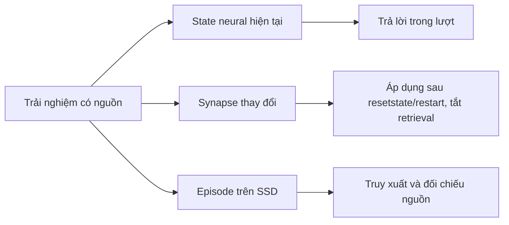
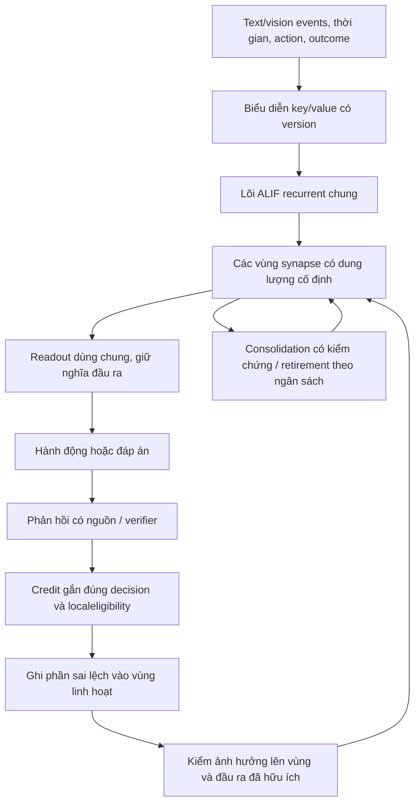

# SCAR-X: nghiên cứu sơ bộ và ma trận không gian kiến trúc

Ngày 15/11/2026. **Chỉ đọc nguồn, đối chiếu và thiết kế trên giấy.** Không chạy
learner, benchmark, inference, GPU fixture hoặc training mới; không cài package,
tải trọng số, gỡ model, sửa Hermes/main/R13. Quyết định hiện tại: **GO cho thiết
kế chi tiết; chưa GO cho một kiến trúc hay thí nghiệm mới.** Master duy nhất vẫn
là [RESEARCH_PLAN](../RESEARCH_PLAN.md).

**Hiệu chỉnh sau tự phản biện cùng ngày:** [bản phản biện và phân loại suy luận](ARCHITECTURE_SELF_CRITIQUE_20261115.md)
hạ ưu tiên triển khai B; chưa có bằng chứng gói chia vùng tốt hơn phương án tối
giản. Phân tích update vật lý, khả năng phân biệt input và bảo vệ đầu ra đi
trước ghép nhiều module. Không mở thí nghiệm hoặc thay đổi kết quả lịch sử.

## 1. Kết luận sơ bộ

SCAR-X cần phân biệt lỗi biểu diễn, credit, can thiệp khi ghi và tính ổn định
của đầu ra. Chưa có bằng chứng chỉ thay STDP, thêm replay, tăng neuron hoặc
thêm FAQ sẽ giải đồng thời các lỗi đã đo. **Một lõi ALIF chia vùng trong ngân
sách cố định, học phần sai lệch và bảo vệ activity/output** là ứng viên tổng
hợp để phản biện, chưa được chọn ưu tiên triển khai. Cần đặc tả phương trình
và so với phương án tối giản; **chưa đủ cơ sở gọi là mới trên thế giới, đã tốt
hơn hay giải được những vấn đề còn mở**.

Ba phát hiện làm thay đổi cách chọn hướng:

1. **HLOP-SNN đã có lateral Hebbian projection cho SNN.** Tự thêm phép chiếu
   trực giao không là đóng góp mới. Source được đọc còn có tăng subspace và
   merge theo task; learner chính trong nhánh OTTT vẫn gọi backward.
2. **Gated DeltaNet-2 đã tách erase/write; MoM/RIMs đã chia vùng nhớ.** Cần chỉ
   ra đường học cục bộ, persistence và bảo vệ đầu ra của biến thể ALIF; đổi tên
   những thành phần này không đủ tạo kiến trúc mới.
3. **SPIRE, preprint ngày 10/11/2026, gần ý tưởng tái dùng kỹ năng có residual.**
   Paper mô tả actor học trước mạch spiking có vòng nối cố định, trên bài điều
   khiển. Chưa xác minh repo/raw; không suy thành hidden-ALIF representation
   học ngôn ngữ. AFTER ngày 11/11 cũng là prior art về fast/slow correction, hiện
   phần abstract nói code sẽ được công bố.

## 2. Phạm vi đọc và mức bằng chứng

Đã khóa 17 repo theo commit và lấy 21 file code liên quan để đọc **các đoạn chọn lọc**,
không audit toàn bộ repo hoặc tái lập kết quả. README/paper là báo cáo tác giả;
source chỉ xác nhận đường tính được thấy, không xác nhận số đo hay độ đúng toàn
bộ. Hash, URL, license tìm được, đoạn đọc và ma trận có thể truy vấn ở
[hồ sơ nguồn JSON](literature/sources/architecture-design-space-20261115.json).
File upstream chỉ lưu trong `local/architecture-intake-20261115`; không import
hoặc phân phối lại code upstream trong runtime.

Các hồ sơ e-prop/BrainTrace/DECOLLE/SI đã có được
[tái sử dụng](literature/REUSE_DECISIONS_20261115.md); không chạy lại132 lượt reference.
Các nguồn MIRAS/Titans/NestedLearning được đọc từ paper và nguồn Google; **chưa xác
minh một implementation chính thức để tái lập**. Không coi các repo lucidrains
hoặc các repo tự nhận “reproduction” là code tác giả.

## 3. Nút thắt thực sự của SCAR-X

Các số dưới đây là số đo cũ, không có lượt mới trong intake này.

| Nút thắt | Bằng chứng đã có | Hàm ý thiết kế |
|---|---|---|
| Information/representation | Hidden học từ lỗi78,33% vs đóng băng62,50%; PCA gốc79,72%, cùng loại readout trên DEV | Có học hữu ích nhưng chưa vượt encoder+classifier mạnh; kiểm cùng information/head trước khi mở rộng |
| Interference | Protection: quên trung bình8,06→4,72 điểm, accuracy76,39→74,44%; chỉ 1/3 seed qua cả hai cửa | Gói importance/anchor có đánh đổi chưa qua gate; chưa tách lợi ích từng thành phần. Hướng ghi và ranh giới quyết định là giả thuyết cần đặc tả |
| Readout | Ghi đè readout nổi bật ở Phase2; probe mạnh đọc được feature mà head học online dùng kém | Bảo vệ hidden đơn độc không bảo đảm output cũ ổn định |
| Temporal/credit | Lượt semantic dùng 8 tick với input lặp, recurrent weights không học | Chưa chứng minh học quan hệ theo thời gian; không nhập điểm classification thành video reasoning |
| Useful actions | Toolbank cũ có oracle không hơn constant/RAG | Không quy tắc credit nào tạo action đúng khi mọi action khả dụng đều thất bại |
| Tích lũy kỹ năng | LoRA trên40 trường hợp đã biết có tiến bộ riêng, SNN transfer chưa xác nhận | Giữ attribution VLM/adapter, readout, neural memory và retrieval riêng |
| Video/ngôn ngữ | Có persistence; QA clip nhỏ còn sai, câu trả lời ảnh có hỗ trợ card thủ công | Encoder/decoder và hiểu nội dung là bài toán riêng, không được che bằng FAQ |
| Nguồn nhãn | Snippet, self-critique, novelty không là proof | Controller phải quản lý nguồn và quyền cập nhật; synapse không tự biết sự thật |

Nguồn nội bộ: [local credit/retention](../hybrid/LOCAL_CREDIT_AND_RETENTION_20261115.md),
[toolbank](../hybrid/P1B_MULTI_API_STOP_20261115.md),
[video](../hybrid/VIDEO_COLD_MEMORY_20261114.md),
[image workaround](../release/IMAGE_QUESTION_GROUNDING_20261115.md).
DEV đã dùng và TEST đã mở không được đổi vai trò để chọn kiến trúc.

## 4. Ma trận công trình: cơ chế nào giải phần nào?

“Có thể kế thừa” là đánh giá của intake này, không là điểm chất lượng SCAR-X.

| Nguồn chính | Cơ chế đáng đọc | Phù hợp khoảng trống nào | Ràng buộc/giới hạn khi chuyển |
|---|---|---|---|
| [e-prop](https://www.nature.com/articles/s41467-020-17236-y), [DECOLLE](https://arxiv.org/abs/1811.10766) | Tách eligibility đi xuôi và learning signal | Credit và local objectives | Không BPTT không đồng nghĩa synapse-local hoàn toàn; SCAR-X đã có biến thể, không xem đó là ý tưởng mới |
| [HLOP-SNN](https://arxiv.org/html/2402.11984v1), [code](https://github.com/pkuxmq/HLOP-SNN) | Hebbian lateral subspace, chiếu activity trace | Bảo vệ hướng input đã học | HLOP là cơ chế protection; source OTTT inspected vẫn backward, task-controlled allocation/merge; chưa là task-free local ALIF solution |
| [OWM](https://github.com/beijixiong3510/OWM) | Ma trận bảo vệ không gian input | Chống ghi đè có xét tương quan | Source TF dùng loss gradient toàn mạng; không copy vào nhánh local |
| [LOCO](https://arxiv.org/html/2602.22259v1) | Perturbation hai forward + low-rank cluster projection | Credit không BP và variance | Paper-level: chưa xác minh repo tác giả; hai forward/lần, scalar loss modulation; chưa chứng minh trên ALIF recurrent hiện tại |
| [CLP-SNN](https://github.com/elvinhajizada/CLP-SNN) | Supervised prototype allocation, rewardgate, metaplasticity | Học class mới nhanh từ feature tốt | Preextracted semantic features; simulator float và quantized/Loihi khác; prototype adaptation của SCAR-X đã FAIL, không lặp chỉ để đổi tên |
| [SoftHebb](https://github.com/NeuromorphicComputing/SoftHebb) | Competitive Hebbian feature learning | Diversity/representation cục bộ | Source có global max normalization của delta trong đoạn đọc; downstream classifier riêng; chưa là ALIF/noisy lifelong proof |
| [Mamba-3](https://github.com/state-spaces/mamba), [paper](https://arxiv.org/abs/2603.15569) | Recurrence biểu đạt hơn, MIMO/state tracking | Thiết kế trạng thái temporal | Trạng thái RNN đổi không là học synapse lâu dài; pretrained/backprop khác constraint. Decode source ghi H100-only tested ở pin đọc |
| [Gated DeltaNet-2](https://github.com/NVlabs/GatedDeltaNet-2) | Tách erase-key/write-value, update ma trận | Sửa một liên kết mà hạn chế nhiễu | Projections/gates được học qua training chuẩn; recurrent state không tự là trọng số bền qua phiên; code NC, không copy |
| [MoM](https://github.com/OpenSparseLLMs/MoM), [RIMs](https://arxiv.org/abs/1909.10893) | Sparse routing nhiều trạng thái/module | Giảm cross-context interference | Router vốn học end-to-end; module/persistentstate tốn RAM, router drift và reuse vẫn cần kiểm |
| [TTT](https://github.com/test-time-training/ttt-lm-pytorch) | Hidden state là learner, residual self-supervision | Bộ nhớ thích nghi khi đang xử lý | Có inner/outer optimization; cache trong source khởi tạo theo batch/sequence. Persist cache không tự là giữ kỹ năng vô hạn |
| [Titans/MIRAS](https://research.google/blog/titans-miras-helping-ai-have-long-term-memory/) | Neuralmemory, objective, retention và updatealgorithm | Khung phân tích không gian thiết kế | Chưa directlocal ALIFimplementation; surprise không là factualcorrectness; memory tốt không thay nền kiến thức |
| [NestedLearning/HOPE](https://research.google/blog/introducing-nested-learning-a-new-ml-paradigm-for-continual-learning/) | Nhiều tần số cập nhật, selfmodifyingmemory | Phân biệt các thang học | Phân cấp nhanh/chậm đã là priorart; training assumptions/compute không mặc nhiên fit laptop/localSNN |
| [Benna–Fusi](https://arxiv.org/abs/1507.07580), [cmplx-syn](https://github.com/jil095/cmplx-syn) | Trao đổi hai chiều giữa biến nhanh/chậm | Retention qua nhiều thang thời gian | Không tương đương EMA một chiều; thêm state mỗi synapse; model/toy/face recognition không là suy luận đa năng |
| [Loss of plasticity/CBP](https://www.nature.com/articles/s41586-024-07711-7), [code](https://github.com/shibhansh/loss-of-plasticity) | Thay unit ít hữu ích, chỉnh outgoing/bias/optimizerstate | Tránh mất khả năng học tiếp | Upstream vẫn BP; utility dùng activity+outgoing weights, không strict single-synapse. Không được reset neuron đang giữ skill |
| [GLE](https://arxiv.org/html/2403.16933v4), [code](https://github.com/unibe-cns/gle-code) | Neuron-local mismatch và prospectiveerror dynamics | Credit sâu/thời gian | Source có errortruyền xuống qua W; rate dynamics khác ALIF. Đổi sang nó cần thiết kế và duyệt riêng |
| [SPIRE](https://arxiv.org/html/2611.14840v1), [AFTER](https://arxiv.org/abs/2611.15215) | Contextinference, protectedsources/residual, fast/slowcorrection | Tái dùng skill/task-freeorganization | Rất gần “ghép kỹ năng”; paper mới, chưa code/rawaudit. SPIRE vòng motor cố định không chứng minh hidden representation học; AFTER giữexpert pretrained |
| [Engram](https://github.com/deepseek-ai/Engram) | Deterministic lookup, contextgating | Tách static patterns khỏi dynamic compute | Officialcode là demo với thành phần backbone mock; bảng lookup tốn storage, chưa học liên tục cục bộ |
| [Strata](https://github.com/Niko1221/Strata), [Siege-Ladder](https://github.com/MasherDon/Siege-Ladder), [original-weight Macstreaming](https://github.com/atbender/deepseek-v41-flash-mac-mini) | VRAM/RAM/SSD placement, cache/prefetch | Chạy weights lớn hơn RAM | Đây là runtime placement. Không tạo representation/credit mới; nhiều mode giảm precision/experts, bản gốc vẫn cần storage lớn |

### Ba điều source kiểm được khác với khẩu hiệu

**HLOP:** `modules/hlop_module.py:27–63` tạo/thêm/merge subspace;
`65–94` cập nhật lateralweights; `109–152` chiếu và học lặp. Script OTTT
`219–242/294–320/374–392` dùng taskcontrol và backward. Paper AppendixF nói rõ
chi phí, rankmanual và giới hạn class-incremental. Vì vậy không lấy claim
“nearly zero forgetting” thành chứng nhận ngưỡng 3/5 điểm task-free của SCAR-X.

**GDN-2:** source tính erase/write projections riêng; kernel đọc erase từ state
rồi cộng write và có geometryguard. Tách hai gates hay thêm stabilityguard đã
có tiền lệ. Ý tưởng chỉ có giá trị cho SCAR-X nếu quy tắc học gates/locality và
trạng thái bền được xác định, không chỉ chép recurrence vào một block mới.

**TTT/GLE/CBP/ANML:** source đã đọc thể hiện các dạng gradient/errortransport
và state khác nhau. Các từ “online”, “local”, “test-time”, “continual” không
tự cho phép bỏ qua đường tín hiệu. ANML học gating bằng meta-gradients; GLE
còn đổi dynamics. Không nhập chúng nguyên bản rồi nói đã giữ nguyên ALIFrule.

## 5. Ma trận không gian thiết kế cho SCAR-X

Các cột là lựa chọn, không phải grid được duyệt để chạy hết.

| Trục | Cách hiện tại/đơn giản | Lựa chọn đáng xét | Điều phải phân biệt |
|---|---|---|---|
| Nội dung input | Hash/PCAfeature của encoder đóng băng | Eventfeatures giữ entity/time/action/outcome; localpredictive objectives | Input khác byte chưa chứng minh học relation; encoderpretraining phải cùng đối chứng |
| Trạng thái | Một recurrentpopulation | Một graphALIF có boundedregions và trạng thái theo sự kiện | Chia vùng trong một core khác nhiều model độc lập; mask/taskID không được lộ nhãn |
| Đơn vị trí nhớ | Voltage/trace và synapse | Fast association, protectedslowweights, sourced episode | State, synapse, SSD retrieval là ba loại bằng chứng khác nhau |
| Learning signal | Scalar hoặc one-stepreadout error | Signedeligibility hiện có; local auxiliary prediction; perturbation | Auxiliarysignal/perturbation là giả thuyết khác; chưa được tự code/run |
| Hướng ghi | Chỉimportance từng weight | Activitysubspace/low-rank lateral protection | Importance theo đường chéo bỏ qua tương quan giữa các chiều; projection mạnh dễ chặn plasticity |
| Ghi/xóa | Một LR/decay chung | Gates riêng cho ghi mới, sửa association và retirement | Gate cần học/kiểm chứng; không dùng novelty hoặc confidence làm truth |
| Output | Sharedreadout dễ trôi | Outputlocalprotection và kiểm margin trên trải nghiệm cũ | Hiddenổn định mà head/router đổi vẫn có thể quên |
| Consolidation | Replay/EMA | Trao đổi nhanh–chậm có tín hiệu học; chuyển kiến thức có kiểm chứng | Copyweights/ôntemplate không tự thành skill generalization |
| Dung lượng | Số neuron cố định | Activate/reserve/reuse trong cap; mở rộng chỉ khi được duyệt | Tổng RAM còn cả trace/anchor/controller; growth không vô hạn |
| Tính toán | Tick cố định | Tăng tick khi kiểm tra thấy tiến bộ; halt khi bế tắc | Nhiều spike hoặc tick không tự là suy luận tốt hơn |
| Tính bền | Snapshot trọng số | Toàn state, key/version, routing, RNG, replay và pending credit | Reset/rollback phải giữ đúng nghĩa action và representation version |
| Tính đúng | Cờverified/nguồn tìm được | Verifier/outcome độc lập, giữ uncertainty và mâu thuẫn | Memory/controller quản lý chứng cứ; core không có oracle sự thật |

### Ba loại “nhớ” phải có phép đo khác nhau

Ma trận này không lấy độ dài token làm mục tiêu; tokenbuffer vẫn là giới hạn
kỹ thuật của decoder. Nó không đo được khả năng tích lũy và dùng lại kỹ năng.

## 6. Các đề xuất và quyết định ưu tiên

### A. Giữ ALIF hiện có, thêm protection theo không gian hoạt động

**Thay đổi trên giấy:** giữ signed error×eligibility, thêm lateralpopulation học
subspace; cập nhật hướng ít can thiệp lên hoạt động cũ, đồng thời bảo vệ readout.
Hạn chế rank/tổngstate; không gọi consolidate theo ranh giới task được cho sẵn.

**Giá trị:** chuyển từ “weight nào đổi nhiều” sang “hướng input nào bị phá”.
**Priorart gần nhất:** HLOP/OWM/LOCO; **không mới riêng về projection**.
**Câu hỏi còn mở:** fixed rank và không task boundary có duy trì acquisition và
shared output không, hay chỉ chặn học? Đây là hướng rủi ro thấp hơn để viết spec,
chưa là permission thử một HLOP adapter hoặc chạy PMNIST.

### B. Một core ALIF chia vùng, association nhanh và sửa phần sai lệch

**Đây là phác thảo kết hợp chưa được chọn ưu tiên triển khai.** Tự phản biện
cùng ngày yêu cầu làm rõ các ràng buộc tối giản trước khi ghép toàn bộ.

Các neuron vẫn theo ALIF; synaptic memory tác động lên dòng điện đầu vào và
đầu ra phải đến từ forward spikes thật. Không được dùng một cosine classifier
hoặc symbolic answer bridge bên ngoài rồi gắn nhãn “SNN đã suy luận”.

**Phân công:**

- Core học biểu diễn, association và dynamics có ích. Vùng linh hoạt học lỗi
  còn lại; vùng ổn định cung cấp kỹ năng được tái dùng. Mỗi vùng có read/write/
  protection state rõ ràng, không là adapter vô hạn cho từng bài.
- Memory lưu episode/bằng chứng/phiên bản, có thể gợi mẫu consolidation. Đọc
  được episode cũ không được chấm thành synapse học kỹ năng.
- Controller quản lý nguồn nhãn, pending credit, thời gian và RAM. Các guard
  đầu tiên là luật cố định; chỉ gọi router neural hữu ích khi có đối chứng.

**Điều cần khác một phép ghép tên:** quyết định viết mới, sửa cũ, giữ vùng và
tái dùng phải dựa trên cùng trạng thái causal credit/interference, có đường tác
động rõ tới shared output. Nếu các phần chỉ cộng điểm retrieval/readout mà hidden
không có lợi ích, coi giả thuyết kiến trúc thất bại.

**Những thành phần không mới:** routing đa kho(MoM/RIMs), residual/protected skill
(SPIRE/Progress&Compress), fast/slow(Benna–Fusi/HOPE), erase/write(GDN-2), projection
(HLOP). **Tính mới còn lại chưa được xác minh:** một cơ chế liên kết chúng theo
locality, state bền hữu hạn và shared output trong ALIF mà không cần task-ID.
Chưa có phương trình hoàn chỉnh hoặc proof cho cơ chế liên kết đó. Không gán
cho phác thảo này nhãn “kiến trúc đột phá” hoặc “đã giải forgetting”.

### C. Đổi sang dynamics dự đoán/lỗi kiểu GLE hoặc một optimizer học được

Có thể cải thiện credit ở mức nền tảng, nhưng GLE đổi dynamics và có feedback
transport; TTT/HOPE có training assumptions khác. **DEFER** theo constraint hiện
tại. Nếu muốn bỏ ALIF hay cho phép gradient đa tầng trong một nhánh đối chứng,
phải quyết định riêng. Hiện không có thay đổi như vậy.

### Quyết định lựa chọn

| Đề xuất | Giá trị trước mắt | Rủi ro chính | Trạng thái |
|---|---|---|---|
| A: subspace hữu hạn + readout protection | Sát forgetting đã đo, có source để phản biện | Saturation, task boundary ẩn, không đủ representation | Viết spec và phản ví dụ trước |
| B: core chia vùng + residual association | Nhắm tới retention, reuse và adaptive capacity; chưa chứng minh lợi ích thêm | Router drift, nhiều state, phối hợp chưa có rule đủ rõ | Ứng viên tổng hợp; hoãn chọn triển khai |
| C: dynamics/optimizer mới | Có thể thay credit sâu | Đổi gốc neuron/signal, training cost và ràng buộc | Giữ làm đối chiếu; chưa thực hiện |

## 7. Những phép phân tích cần xong trước khi mở thí nghiệm

### 7.1 Viết rõ điểm nào được bảo vệ

Giả sử neuron nhận vector trace \(x\) và hoạt động tuyến tính trước ngưỡng là
\(u=w^Tx\). Với basis cũ trực chuẩn \(Q\), phép chiếu lý tưởng
\(P=I-QQ^T\), candidate update \(\Delta w=\eta mPe\) sẽ không đổi
\(w^Tx_{old}\) khi \(x_{old}\) nằm hoàn toàn trong span(Q).

Đây là tính chất đại số có điều kiện, không là định lý SNN không quên:

- Trong ALIF, ngưỡng/reset có thể khuếch đại sai số nhỏ; projector thực là xấp
  xỉ và trace thay đổi theo recurrent state.
- Nếu recurrent weights, encoder, router hoặc readout đổi, giả định x_old bất
  biến có thể sai. Giữ input drive ở một neuron chưa giữ cả chuỗi spike/đáp án.
- Khi subspace chiếm hết không gian, P gần 0: không quên vì không học được gì.
- Nếu trace e khác input x, phải bảo vệ đúng đối tượng trong công thức, không
  đổi chỗ input/eligibility rồi giữ nguyên proof.
- Q cần trực chuẩn; basis Hebbian xấp xỉ chưa mặc nhiên thỏa điều kiện đó.
  Coordinate clipping, weight bounds, anchor hoặc momentum sau projection có
  thể phá tính trực giao; phải xét update vật lý cuối. Xem phản ví dụ D5/D7
  trong [bản tự phản biện](ARCHITECTURE_SELF_CRITIQUE_20261115.md).

Vì vậy spec phải nêu đồng thời điều kiện cho hidden và output, với phản ví dụ
cho boundary competition và representation drift. Guard từ replay/probe là một
đối chứng có tiền lệ GEM/A-GEM, không tự là đóng góp neural mới.

### 7.2 Định nghĩa association, skill và nhãn

Ví dụ nhớ rằng tên X đi với màu Y là association. Dùng quy tắc đã học cho tên,
cách diễn đạt, thứ tự và tổ hợp chưa gặp mới là skill transfer. Chưa có cơ chế
được chứng minh biến mọi episode thành quy luật hữu ích. Prediction error từ
sự kiện quan sát được có thể là mục tiêu self-supervision; nó không xác minh
mọi phát biểu ngôn ngữ trong episode.

### 7.3 Lập bảng locality của từng mũi tên

Phải liệt kê presynaptic trace, postsynaptic state, output error, state dùng chung trong khối,
reward/outcome và bên cấp nhãn. Normalization giữa nhiều neuron, basis dùng chung trong khối
hay feedback W_out.T đều cần được công bố. “Không gọi backward()” không chứng
minh một thuật toán không thực hiện gradient toàn mạng bằng tay.

### 7.4 Tính tổng state trước khi nói ít RAM

Với E synapse, S mảngFP32/synapse, B khối, d chiều key, r rank bảo vệ:

\[
M_{synapse}=4SE,\qquad M_{basis}=4Bdr,\qquad M_{assoc}=4Bd^2.
\]

Chỉ là công thức thiết kế; không phải số đo runtime. Ví dụ quy mô H128/input 64/
fan-in 8 hiện tại có E=9216. Nếu S=7, B=4,d=64,r=16 thì ba khoản lần lượt258048,
16384,65536byte. Chưa gồm readout, neurons, mọi buffer, checkpointcopies,
encoder/decoder, replay, Python/CUDA và OSclient. Lowrankbasis là xấp xỉ về
không gian bảo vệ; không được diễn giải là lossless/không có đánh đổi chất lượng.
State nhỏ không tự tạo nền kiến thức/ngôn ngữ lớn.

Không tăng model trong lượt này. Target2GB của nhánhSNN-only giữ là mục tiêu
nghiên cứu; CPU Hybrid 4,5 GB và GPU không đặt cap là các profile khác, không nhập làm một.

### 7.5 Các giới hạn kiến trúc phải thừa nhận

Một ngân sách state, synapse và SSD hữu hạn không lưu chính xác vô hạn trải
nghiệm độc lập. Học lâu dài phải có chọn lọc, khái quát hóa, thay thế và khả
năng báo quên/chưa biết. Muốn giữ nhiều hơn cần thêm dung lượng hoặc chấp nhận
mất chi tiết; đổi tên neuron/memory không loại được giới hạn này.

Quy tắc local tốt không tự sinh nền kiến thức ngôn ngữ/thị giác. Nếu dùng
encoder pretrained thì phải khai báo phần năng lực đi vào từ encoder; nếu học
từ đầu thì nguồn dữ liệu, mục tiêu biểu diễn và chi phí học cũng là bài toán
chưa giải. Một model nhỏ sinh sai kiến thức không được coi là đã sửa chỉ vì
policy chọn tool hoặc associative memory đạt điểm tốt hơn.

Ngược lại, inference có state cố định hoặc SSD streaming giúp vận hành gọn hơn,
nhưng bản thân hai cách đó không cung cấp nguồn nhãn đúng hay bảo đảm học kỹ
năng mới. Các ưu điểm phải được đo riêng trước khi cộng thành claim cho hệ.

## 8. Kiểm tính mới trước khi đặt tên

| Ý tưởng dự định gọi mới | Tiền lệ gần nhất | Điều còn phải làm |
|---|---|---|
| Fast/slow/idlelearning | CLS, Benna–Fusi, Progress&Compress, HOPE | Tách cơ chế cập nhật cụ thể khỏi scheduler |
| Nhiều module, chỉ bật một số | RIMs, MoM, contextgating/ANML | Localrouter, fixed budget, shared output và drift |
| LateralHebbianprojection | HLOP-SNN; LOCO là hướng perturbationrelated | Task-free/fixed rank/readout protection, không claim firstprojection |
| Ma trận nhớ cập nhật online | Fast weights, DeltaNet/GDN-2, TTT, MIRAS | Persistentassociation và learned skill attribution |
| Tái dùng skillcũ + học residual | SPIRE, compositionalCL, Progress&Compress | Chứng minh causalreuse trong domain mới, không chỉ chép output/module |
| Tự hỏi khi chưa biết | Activelearning/controller/memory có tiền lệ | Learnedpolicy phải vượt fixedpolicy cùng budget; không reward hỏi nhiều |
| Chạy model khổng lồ trên ít RAM | SSD expert streaming/Engram offload | Đủ storage, compatibility, quality vàlatency; không gọi là architecturelearning |

Tra cứu sơ bộ chưa loại trừ mọi paper/patent hoặc implementation tương tự.
Source GLE còn cóGPLv3/patent notice; GDN-2 dùng NVIDIA-NC. SoftHebb/OWM/ANML/
RIMs không thấy license ở thư mục gốc trong tree intake; không suy không cólicense ở mọi
thư mục con. Không có code upstream nào được tích hợp. Đây là ghi nhận nguồn,
không phải kết luận pháp lý về một sản phẩm tương lai.

## 9. Cửa kiểm chứng tương lai — chưa được thực hiện

Sau khi người dùng chấp nhận spec mới, mới đề xuất protocol nhỏ cần thiết:

1. Tách featurequality, local credit, protection và router bằng frozen/readout/
   hidden/shuffles/reset và common-head mạnh; không chỉ so với head online yếu.
2. Chia nguồn và relation/wording/taskfamily; benchmarktrần100% hoặc oracle
   không đủ utility thì không train. TESTcũ không dùng chọn kiến trúc.
3. Stream không đưa taskID/boundary; tách acquisition, final/transientforgetting,
   plasticity, forward transfer và causal rewind của skillnguồn.
4. So với sameencoder+strongRAG/episodicmemory và nonspikingrecurrent controls,
   tính cùng dữ liệu/updates/RAM/compute/I/O; ablationbudget phải minh bạch.
5. Giữ ngưỡng đã đăng ký: acquisition ≥65%, gain ≥5 điểm phần trăm/cận dướiCI95%>0;
   quên trung bình ≤3 điểm, mỗi nhóm ≤5 điểm sau 20 chặng; không đổi khi kết quả không thuận.
6. Lõi synapse phải giữ kiến thức sau resetstate/restart/tắtretrieval; đồng thời
   đo phần nào cần episode để dẫn nguồn. Skilltransfer chưa phải facts đúng.

Hiện **không đăng ký runner/seeds/budget thực thi mới**, không mở freshheldout,
không tải dataset, không chạy P0 “cho chắc”. Việc tiếp theo được đề nghị là
hoàn tất phương trình, bảng locality, accounting và kiểm novelty, rồi xin duyệt
protocol; không tự biến tài liệu này thành permission huấn luyện.

## 10. Chốt cho người dùng

Có hướng đáng theo: **ghi chọn lọc theo hướng hoạt động, bảo vệ readout, bộ nhớ
liên kết bền và tái dùng phần kỹ năng có ích**. Chưa có bằng chứng một kiến trúc
trong khảo sát đồng thời đạt suy luận đa năng, học hoàn toàn cục bộ, retention
lâu dài, tự khám phá đúng và nhỏ vàiGB trên máy này. Không có cơ sở hứa chỉ cần
ghép vài block là đạt năng lực của model thương mại.

Ma trận cho phép bỏ các phép ghép trùng và chọn một câu hỏi cơ chế rõ ràng.
Kết quả bàn giao là **thiết kế cần phản biện**, chưa là sản phẩm/model mới.
