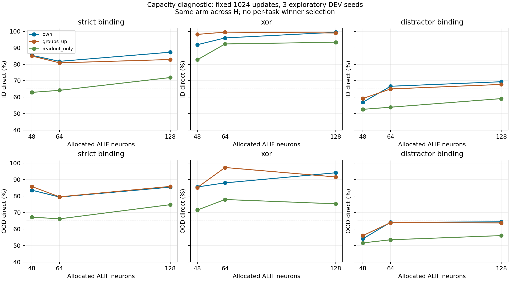
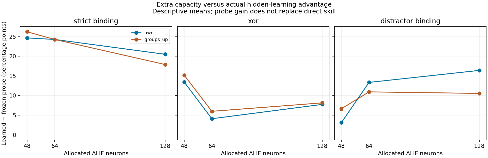

# SCAR-X — kết quả H64/H128, 12/11/2026

**CAPACITY_ONLY_SIGNAL**, integrity **PASS**. Đây là phép thử capacity DEV đã duyệt, không phải P1/P2/production hoặc năng lực chat/vision.
Nhãn capacity không phủ nhận hiddenlearning hiện có: nó phân biệt directgain khi thêmneuron với việc learned-vsfrozen advantage tăng đủ ởít nhất2nhóm. Phải đọc cả bảngdirect và ablation; không diễn giải CAPACITY_ONLY_SIGNAL thành “model không học synapse”.
Giữ ALIF hardspikes/sparsefan8/D8/O2, phương trình localeligibility và source readout/optimizer. Không Transformer/pretrained/globalBPTT/RTRLcandidate. Main/Hermes/live không thay.

## Phạm vi, số đo và tính đúng

Run `20261112T132737Z-capacity-dev-v1-160b6e`, source `691de7c02127b099a79a752fdd89a940a92b1331`, base22bb9781. [Protocol đã duyệt](../../experiments/capacity-h64-h128-approved-v1.md).
Đủ 252 records:204newjobs và48H48primary reuse; primary144records1024updates/cell, secondary108equalCPU0,5s. Không train lại H48primary hoặc chọn lại seed sau scores.
Ba DEVseeds140011/140017/140023, cùng frozenTRAIN1024/refit256/ID512/OOD512, calibration32TRAIN. HeldoutID/OOD là DEV đã mở, không freshconfirmation.
Mỗi task/seed được fit trên checkpoint riêng. Bảng không chứng minh một checkpoint
duy nhất giữ đồng thời tất cả kỹ năng; không ghép model trial thành bộ não sản phẩm.
Audit chấm lại 1,290,240 prediction entries, 27,648 labels, 252 checkpoint roundtrips; 4,032 direct replays và 1,728 probe bằng eigensolver độc lập. Không learningupdates trong audit.
Reviewer thực độc lập còn kiểm literalALIF replay, thresholdlabeloracle và
SVDprobe; [review cuối](CAPACITY_RESULTS_INDEPENDENT_AUDIT_20261112.md) xác nhận
252records và168contrasts. Acceptedhistory164.202updatecalls gồm115.050new và
49.152H48reuse; technicalP0/throughputfixtures riêng, không tính thành qualityseeds.
H48 adapter parity exact qua losses/weights/traces/optimizer/RNG; H64/H128 coldprocess tiếp đuôi episode rồi nextupdate exact. Native parity của sharedcore đã kiểm; không claim có kernel ACRnative mới.
Worker wall 996.40s; audit 25.74s. Peak ownedtree RSS 148.82MB / commit 191.15MB, dưới2.000MB. Windowscap `{'enforced': True, 'limit_bytes': 2000000000, 'kind': 'Windows per-process committed memory; shared pages monitored separately'}`; không GPU/iGPU/điện năng đo được.
ResourceMonitor flag hard_cap_enforced chưa nối receipt; dùng capreceipt thật cùng RSS/commit đo được. Committed memory không phải lượng swap. RAM includeobserver theo PID; arraybytes riêng bên dưới.

## Direct accuracy — cùng1.024updates

| H | Learner | Binding | XOR | Distractor | Order | Mảng adapter |
|---:|---|---:|---:|---:|---:|---:|
| 48 | own | 85.42% | 91.86% | 56.97% | 100.00% | 29,472B |
| 48 | groups_up | 85.03% | 98.11% | 59.24% | 100.00% | 46,176B |
| 48 | readout_only | 62.96% | 82.75% | 52.67% | 91.73% | 29,472B |
| 48 | groups_shuffle | 54.30% | 83.53% | 47.98% | 98.44% | 46,176B |
| 64 | own | 81.77% | 95.96% | 66.67% | 99.93% | 39,008B |
| 64 | groups_up | 80.86% | 99.48% | 65.04% | 100.00% | 61,280B |
| 64 | readout_only | 64.19% | 92.32% | 53.97% | 98.18% | 39,008B |
| 64 | groups_shuffle | 53.32% | 73.76% | 51.37% | 98.76% | 61,280B |
| 128 | own | 87.30% | 99.41% | 69.40% | 100.00% | 77,152B |
| 128 | groups_up | 82.88% | 98.96% | 67.77% | 100.00% | 121,696B |
| 128 | readout_only | 71.94% | 93.36% | 59.18% | 98.96% | 77,152B |
| 128 | groups_shuffle | 55.14% | 84.64% | 49.41% | 99.87% | 121,696B |

Mảng adapter H48Own/readout hiện tại khác số mảng của olddualtrace checkpoint được reuse; rawlegacy giữ nguyên và được ghi `reused_source_array_bytes`. Chỉscores/parity được reuse, không dùng CPU cũ làm singletracecost.



## Probe và OOD — không thay direct bằng probe

| H / learner | Binding probe | Binding OOD direct/probe | XOR probe | XOR OOD direct/probe | Distractor probe | Distractor OOD direct/probe |
|---|---:|---:|---:|---:|---:|---:|
| 48 / own | 86.98% | 83.59%/85.03% | 96.68% | 85.55%/89.19% | 56.97% | 54.10%/56.18% |
| 48 / groups_up | 88.54% | 85.81%/89.00% | 98.44% | 85.22%/90.89% | 60.48% | 56.05%/57.75% |
| 48 / readout_only | 62.30% | 67.25%/67.38% | 83.27% | 71.55%/68.62% | 53.84% | 51.63%/55.60% |
| 64 / own | 84.96% | 79.43%/82.68% | 97.79% | 88.02%/92.19% | 68.03% | 64.13%/64.78% |
| 64 / groups_up | 84.96% | 79.56%/81.77% | 99.67% | 97.33%/98.50% | 65.62% | 63.93%/65.89% |
| 64 / readout_only | 60.68% | 66.21%/66.60% | 93.68% | 77.93%/78.91% | 54.69% | 53.52%/53.91% |
| 128 / own | 88.28% | 85.42%/85.42% | 99.09% | 94.14%/95.90% | 73.24% | 64.39%/62.96% |
| 128 / groups_up | 85.68% | 85.87%/88.74% | 99.48% | 91.60%/93.36% | 67.38% | 63.74%/61.98% |
| 128 / readout_only | 67.77% | 74.80%/72.92% | 91.34% | 75.33%/73.05% | 56.84% | 56.05%/55.79% |

## Capacity gates theo cùng learner, không chọn riêng mỗi task

| H / learner | Direct gain>=2đ: số nhóm | Hidden advantage growth>=2đ: số nhóm | ID/OOD preserved | Order protected | Causal guard | Signal |
|---|---:|---:|---|---|---|---|
| 64 / own | 2/3 | 1/3 | False | True | True | False |
| 64 / groups_up | 1/3 | 1/3 | False | True | True | False |
| 64 / readout_only | 1/3 | 0/3 | True | True | False | False |
| 128 / own | 2/3 | 1/3 | True | True | True | False |
| 128 / groups_up | 1/3 | 1/3 | True | True | True | False |
| 128 / readout_only | 3/3 | 0/3 | True | True | False | False |

Hidden advantage growth = (probe learned−probe frozen) tạiH mới trừ cùngcontrastH48. Frozenrandomfeatures tốt hơn khi thêmneuron chưa phải hidden synapses học tốt hơn. Causalguard giữlearnedhead vàrevert hiddenweights; fullrevertrefitrecover frozenprobe phải exact.

**Giới hạn trần của chính contrast:** H48OwnXOR hidden advantage≈13,41đ;
H128frozenprobe≈91,34% nên ngay cảlearnedprobe100% chỉ còn advantage≤8,66đ,
tăng thêm≤−4,75đ. Gate yêu cầu+2đ growth vì thế không thể đạt trên XOR khi
baseline này đã tốt lên. Giữ nguyên gate/decision đã đăng ký, nhưng không dùng
thất bại đó để phủ nhận hiddenlearning hoặc lợi ích capacity. Futuremetric/
task tránh trần cần prereg riêng, không sửa tiêu chí sau scores.



| H / learner / task | Δdirect vsH48 [95% mô tả] | Δhidden advantage | Direct causal drop |
|---|---:|---:|---:|
| 64 / own / strict_binding | -3.65đ [-5.47đ;-0.39đ] | -0.39đ | +31.18đ |
| 64 / own / xor | +4.10đ [-2.15đ;+9.96đ] | -9.31đ | +42.58đ |
| 64 / own / distractor_binding | +9.70đ [-1.95đ;+24.22đ] | +10.22đ | +14.71đ |
| 64 / groups_up / strict_binding | -4.17đ [-10.94đ;+7.03đ] | -1.95đ | +29.30đ |
| 64 / groups_up / xor | +1.37đ [-0.78đ;+3.91đ] | -9.18đ | +36.20đ |
| 64 / groups_up / distractor_binding | +5.79đ [-6.45đ;+18.55đ] | +4.30đ | +13.48đ |
| 128 / own / strict_binding | +1.89đ [-4.69đ;+11.33đ] | -4.17đ | +32.88đ |
| 128 / own / xor | +7.55đ [+1.37đ;+17.19đ] | -5.66đ | +36.46đ |
| 128 / own / distractor_binding | +12.43đ [+4.88đ;+17.97đ] | +13.28đ | +18.68đ |
| 128 / groups_up / strict_binding | -2.15đ [-7.23đ;+4.49đ] | -8.33đ | +29.30đ |
| 128 / groups_up / xor | +0.85đ [-0.59đ;+3.12đ] | -7.03đ | +42.90đ |
| 128 / groups_up / distractor_binding | +8.53đ [+4.49đ;+13.87đ] | +3.91đ | +16.99đ |

Ba seed là3cluster, không252independenttrials. CI mô tả với3seed, exactsign p nhỏ nhất0,25; không significance/confirmation hoặc HolmPASS từ vòng này. Gates giữ nguyên trước scores.

## Equal-CPU secondary —0,5s học

| H / learner | Binding | XOR | Distractor | Order | Episodes min–max |
|---|---:|---:|---:|---:|---:|
| 48 / own | 51.04% | 64.84% | 49.02% | 98.76% | 162–208 |
| 48 / groups_up | 52.99% | 67.32% | 51.89% | 84.83% | 105–139 |
| 48 / readout_only | 54.43% | 70.12% | 52.73% | 87.17% | 163–203 |
| 64 / own | 55.08% | 81.64% | 55.27% | 95.90% | 149–225 |
| 64 / groups_up | 51.43% | 77.41% | 49.87% | 98.11% | 100–151 |
| 64 / readout_only | 58.72% | 83.40% | 50.98% | 95.57% | 152–222 |
| 128 / own | 56.84% | 73.70% | 52.28% | 97.92% | 138–183 |
| 128 / groups_up | 55.14% | 78.32% | 52.73% | 96.88% | 93–117 |
| 128 / readout_only | 64.13% | 82.75% | 51.43% | 96.16% | 148–198 |

Cutoff kiểm cuối episode, overshoot/CPU/counts đều ở raw. EqualCPU dùng108newcells, cảH48đo cùng hiện tại; không lấy số CPU của cacheddualtrace làm Owncost. Secondary không thay primary khi score bất lợi.

## Điều có thể và chưa thể kết luận

Own-reset H48→H128: Binding 85.42%→87.30%, XOR 91.86%→99.41%, Distractor 56.97%→69.40%. Đây là kết quả actual trên cùng dữ liệu/budget, không suy từ RAM trống.
- Đây là kiểm capacity hữu hạn, không kết luận “càng nhiều neuron càng thông minh”. Tăngneuron tạo thêm khả năng biểu diễn; chỉ learning/heldout/OOD/causalcontrols mới đo khai thác được nó.
- SameHinit giữa arms exact. CrossH chỉ pairedseed và cùngphânphối/initrule; weights/topology khácshape, RNGconsumption khác, không cùngprefixweights.
- Fan8/H làm mật độ recurrent đổi; gamma linspace được resample. Source Wout initstd0,03 và learningrate/per-coordinateclips giữ cố định nên aggregate logitvariance/updatevectornorm cũng có thể đổi khiH tăng. Thử nghiệm đo cùng sourcelearner ở cácsize, không tách mọi covariance thành purecapacitylaw; không rescale sau scores.
- Core R12 không có nghĩa chỉ12neuron học: inheritedresearchoptimizer cập nhật toàn bộH×16 hiddenweights. H64/128 cấp cố định mỗi trial, không tựgrow theo độ khó.
- P2 chưa chạy: chưa bằng chứngretention20context, acquisition/final65%,meanforget3đ/worst5đ. Không dùng score2nhãn để tuyên bố hiểu ngôn ngữ/ảnh hoặc ngangLLM.
- Nếu largerH chưa đạt vẫn không chứng minh architectureceiling: learning signal, readout/optimizer và data/updatebudget còn là nguyên nhân cần phân biệt.

## Bàn giao và tái lập

Branch `codex/scarx-capacity-h64-h128-20261112`, main giữ `e94ad1e7a4029d8d41c8e0e1aafc0fa3bf430541`. Prototype/researchonly; không merge/deploy. Không mởH256, freshconfirmation, P2 hoặc language từ lượt này.
```powershell
python scripts/build_native.py
python -m pytest -q -p no:cacheprovider tests/test_capacity.py tests/test_capacity_independent.py tests/test_native.py
python scripts/run_capacity_dev.py
python scripts/audit_capacity_dev.py --run runs/20261112T132737Z-capacity-dev-v1-160b6e
python scripts/verify_capacity_independent.py --run runs/20261112T132737Z-capacity-dev-v1-160b6e --require-complete
```
Runner/auditors từ chối overwrite; reproduction dùng checkout/output mới rõ ràng, không xóa reservation/raw hiện tại. Peer607ffca phải có ở siblingworktree review-gemini-r8-607ffca; oldH48evidence ở sibling scarx-acr-20261112 theo manifest.
Raw `runs/20261112T132737Z-capacity-dev-v1-160b6e/` có252records+CSV từngseed+source/data/reusehashes. Per-cell checkpoint/history/RNG, labels/predictions/interventions đầy đủ. H48cachedCPU được gắn scope riêng.

`source-byte-bundle/` tái dựng17executedsourcebodies từ pinnedGit+EOLhash, chỉ
overlay trong checkoutreproduction MỚI; không nới checksum hoặc sửa nguồn hiện
tại. Reusecopy giữ nguyên bytes và provenance; environment actual đi cùng
manifest, chưa claim bitwise trên mọi NumPy/CPUversion chưa kiểm.
Trace http://127.0.0.1:8773 tự đọc actualloss/update/output/H/resources; không Qwen/proxy hoặc lời nghĩ giả.
