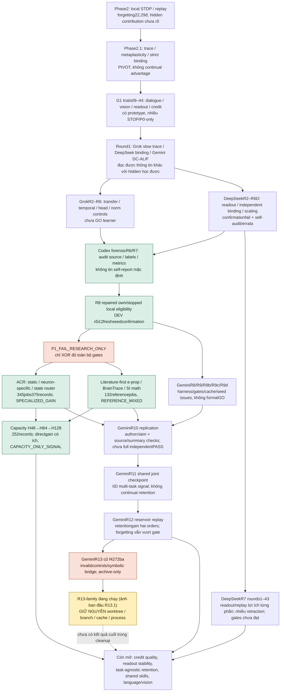
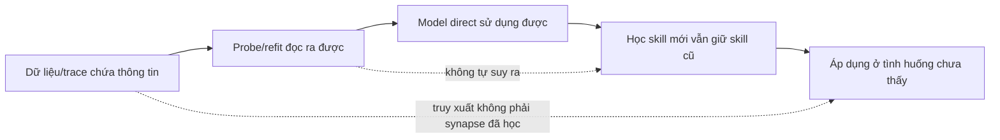

# Bản đồ thí nghiệm SCAR-X

Sơ đồ thể hiện **dòng câu hỏi và bằng chứng**, không phải mọi node là một
thí nghiệm độc lập hay một lần PASS. Các trial/seed chi tiết ở
[sổ thí nghiệm](EXPERIMENT_LEDGER.md) và [catalog](experiment-catalog.json).

## Ba phân biệt xuyên suốt

Các mũi tên là câu hỏi phải kiểm tiếp, không bảo đảm kéo theo nhau. Dữ liệu
replay/SSD, frozen random features, readout fitting và hidden plasticity phải
có đối chứng riêng. Số neuron, số config hoặc token không thay quality gate.

## Xem chi tiết theo cụm

- Foundation/G1: [reports01–44](EXPERIMENT_LEDGER.md#foundation-và-g1).
- Neural mechanisms: [Grok/DeepSeek/Gemini](EXPERIMENT_LEDGER.md#các-nhánh-tác-giả).
- Các phép đo đã kiểm gần nhất: [Codex R8/ACR/literature/capacity](EXPERIMENT_LEDGER.md#các-lượt-đã-kiểm-gần-nhất).
- Bản gốc và retractions: [archive index](archive/README.md).
- Active R13.1: protected; source và kết quả đang thay đổi không được copy vào
  một báo cáo “đã hoàn tất”.
