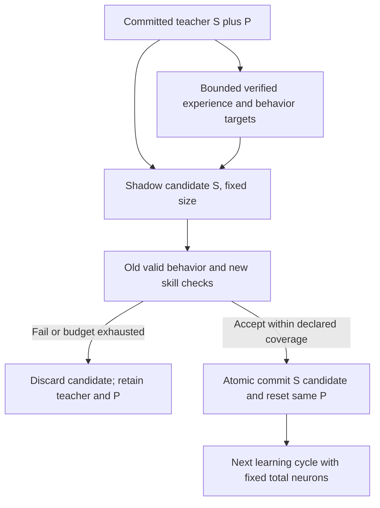

# Giải phóng vùng Plastic: chuyển hành vi vào S trước khi tái sử dụng P

Ngày15/11/2026. **Đặc tả toán và phản biện; không thực thi.** Giữ ALIF, topology,
tổng neuron128 làm điểm xuất phát minh họa của SCOPE v2; chưa chọn H_s/H_p.
Không train, neural forward, fixture, refit, dataset mới, TEST selection,
main/Hermes/model change, quantization, pruning hoặc giảm độ chính xác.

## 0. Quyết định

**GO cho bước phân tích khả thi hẹp của consolidation bằng local ALIF;
NO-GO triển khai/reset P hoặc claim lifelong architecture ở trạng thái hiện tại.**
Cơ chế cụ thể là chuyển hành vi từ teacher S+P vào một candidate S cùng kích
thước S, chỉ commit rồi tái sử dụng P nếu chức năng còn đúng đã được kiểm.
Đây là **adaptation của distillation/consolidation-and-reset kiểu Progress &
Compress**, không đặt tên kiến trúc mới. Replay/transaction là phần quản lý,
không được chấm như một phát minh local synaptic learning.

Đã chỉ ra một trường hợp chuyển chính xác, các điều kiện đủ trên tập hữu hạn,
và các phản ví dụ không thể chuyển. Chưa chứng minh local learner học được
student cần thiết hoặc việc kiểm rẻ hơn giá trị dung lượng giải phóng. Nếu
yêu cầu là giữ chính xác vô hạn kỹ năng độc lập với dung lượng cố định,
**NO-GO về nguyên lý**. Không diễn giải hai reviewer PASS của v2 thành số đo.

## 1. Nguồn và điểm xuất phát

Đọc toàn bộ [SCOPE-ALIF v2](SCOPE_ALIF_ARCHITECTURE_CANDIDATE_20261115.md),
§10 override, [spike contract](ALIF_INTERFACE_PRESERVATION_SPEC_20261115.md),
[behavior contract](ALIF_READOUT_BEHAVIOR_PRESERVATION_SPEC_20261115.md) và
[relation contract](ALIF_RELATION_UPDATE_SPEC_20261115.md). Giữ original/v2 và
review logs; không sửa verdict cũ. [Ma trận prior art và bằng chứng âm](SCOPE_ALIF_CAPACITY_PRIOR_ART_20261115.md)
ghi phạm vi đọc đầy đủ/đọc chọn lọc; không tuyên bố audit cả ROW repository.

Hai vùng S,P trong cùng graph, R_SP=0. S hiện chỉ được bảo đảm bất biến trong
giai đoạn cách ly. Học tiếp khi P hữu hạn cần phân biệt **không học được vì
credit/representation** với **không còn khả năng lưu thêm**. Số spike, RAM
đang trống hoặc update nhỏ không xác định được hai nguyên nhân đó.

Hiện chưa có checkpoint S đã được học/xác minh trên topology SCOPE. Điểm
H128mixed cũ không chuyển thành năng lực của S nhỏ hơn. Spec là giả thuyết
cho một candidate tương lai, không hướng dẫn reset P của model đang dùng.

### 1.1 Vì sao cần cho một phần S thay đổi trong candidate?

Nếu S và mọi head còn lại bất biến, sau reset P về cùng trạng thái/tham số
ban đầu và không giữ kiến thức ở nơi khác, toàn hàm inference quay về hàm
tương ứng cũ. Một kỹ năng chỉ nằm trong P không còn nơi lưu. Muốn bỏ phụ thuộc
P mà giữ kỹ năng đó phải chuyển thông tin vào S/head/state khác, hoặc có sẵn
redundancy làm P không cần thiết. Không thể chỉ đổi cờ “available capacity”.

Đề xuất vì thế chỉ nới **freeze S trong bản sao consolidation**, không nới
loại neuron, kích thước, precision, backward hoặc trần tài nguyên. Theorem
noninterference v2 không bảo vệ candidate S đang học. Bản teacher đã commit
vẫn nguyên; commit candidate cần functional verification riêng.

### 1.2 Không dùng toàn bộ graph làm readout mới cho mỗi task

Phạm vi tối giản có **một output contract K lớp cố định** và encoder chung.
Old/new skill khác nhau theo input/history được quan sát, không dùng task-ID
ẩn hoặc một head được oracle chọn. Hai head của v2 dùng như stable/active
versions của cùng contract; không tích lũy thêm một head mỗi task. Chưa tự
relabel action head Hermes thành relation head. Miền có output mới cần contract
khác và accounting khác; chưa được bao hàm bởi đề xuất này.

Đây còn thu hẹp v2: các old/new head độc lập tùy ý phải ánh xạ được về cùng
contract này; nếu không thì NO-GO cho adaptation tối giản, không ngầm thêm
oracle router. `LocalALIF` còn hardcode128/72 ở một số arrays/operations nên
candidate H_s cần wrapper nghiên cứu được đặc tả riêng; không phải gọi trực
tiếp learner hiện tại với một slice rồi đã có implementation đúng.

Nếu hai input/history giống hệt đòi nhãn khác mà không có context quan sát,
đó là thiếu thông tin hoặc conflict, không là vấn đề giải phóng P.

## 2. Cơ chế chuyển rồi tái sử dụng, không mở rộng graph

1. **Chọn điểm yêu cầu consolidation:** caller/controller dựa ngân sách học đã
   khóa và lỗi có căn cứ; chưa có detector “P đầy” được chứng minh. Kích hoạt
   không là bằng chứng saturation hoặc permission tạo nhãn.
2. **Pin teacher T:** snapshot đầy đủ S+P, heads, encoder/config/evidence
   version và replay. Teacher không được học trong giao dịch.
3. **Candidate C:** sao chép S với cùng H_s, SS topology, config, normalization;
   chỉ cho W_in^S và stable-output head/bias của bản sao được học. R_SS giữ
   nguyên trong adaptation tối giản. Không nhận z_P hay q_P lúc forward C.
4. **Chuyển hành vi:** C học từ input/output có căn cứ bằng output error ×
   eligibility như§4. Các skill còn hợp lệ và skill mới cùng tham gia;
   không chỉ lấy dữ liệu task mới rồi giả định cũ được giữ.
5. **Kiểm C độc lập với P:** trên coverage đã khai báo, old behavior, new
   acquisition và correction đúng đều phải thỏa. Dừng theo budget U_max đã
   định trước; fail giữ T nguyên, không tự lặp seeds/rates đến khi đẹp.
6. **Commit/release:** checkpoint mới chứa C thay S, P ở trạng thái reset đã
   xác định, topology cùng kích thước. Chỉ sau atomic commit mới bỏ dependency
   inference vào teacher P cũ. Không dùng SSD teacher để trả lời rồi gọi P
   đã chuyển kiến thức vào S.

Đây là thiết kế lifecycle, chưa có implementation hoặc phê duyệt chạy. Một
candidate tạm thời cần thêm memory nhưng không là thêm neuron cho năng lực
model phục vụ; toàn chi phí các bản sao vẫn tính vào peak RAM/VRAM.

## 3. Forward, state và topology

Với mỗi vùng Q∈{S,P}, giữ ALIF của core thật:

\[
u_t^Q=\lambda v_{t-1}^Q+W_{in}^Qx_t+R_{QQ}z_{t-1}^Q
+\mathbf1[Q=P]R_{PS}z_{t-1}^S,
\]
\[
\theta_t^Q=\theta_0+\beta a_{t-1}^Q,\quad
z_t^Q=\mathbf1[u_t^Q\ge\theta_t^Q],\quad
v_t^Q=u_t^Q-z_t^Q\odot\theta_t^Q,
\]
\[
a_t^Q=\rho a_{t-1}^Q+z_t^Q,\qquad
f_t^Q=\gamma f_{t-1}^Q+(1-\gamma)z_t^Q.
\]

Stable path p_S=softmax(A_S q_S+b_S); active teacher
p_T=softmax(U_S q_S+U_P q_P+b_T), với normalizer/clip đã pin.
Candidate C chỉ thực hiện phương trình S, p_C=softmax(A_C q_C+b_C).
Giữ kết nối SS thưa, không thêm P→S. R_PS và U_S là hai đường reuse khác nhau.

Mỗi training segment reset (v,a,z,f) và ephemeral e như source đã quy định;
không gọi episode reset này là continuous video memory. Khi serving stream
đang dang dở, thay S có thể làm state không tương thích: commit tại boundary
được công bố hoặc replay prefix còn lưu với cost/state rõ. Không dùng hidden
state cũ của S làm initialstate C rồi coi bằng nhau. Chưa giải warm streaming
migration với mất prefix; nếu cần contract đó thì chặn commit.

## 4. Target và quy tắc học local của candidate

### 4.1 Bằng chứng trước target

Giữ các kho có tổng kích thước bị chặn, không “64 mẫu mỗi task” tăng vô hạn:

- B_keep: input với chức năng cũ đã đúng, còn hiệu lực, teacher stable
  distribution được pin cùng nguồn xác nhận nhãn/contract.
- B_new: input/outcome mới được quan sát hoặc verifier/human feedback có căn
  cứ. Chỉ gọi là transfer từ P khi active teacher thực hiện đúng skill mới.
- B_corr: correction có scope/time/version và precedence đã xác định. Old
  target xung đột bị supersede đúng phạm vi; log cũ giữ để audit.
- B_check: coverage kiểm riêng, không dùng tạo update. Đây vẫn là guard/development
  exposure khi thử nhiều candidate; không được gọi là TEST độc lập mãi mãi.

Teacher probability là target **bảo toàn hành vi đã có**, không là bằng chứng
fact đúng. Nếu không có căn cứ cho correctness/hiệu lực, không cho nó thành
nhãn factual. Conflicting evidence chưa xử lý được thì defer. Provenance flag
`verified` đơn lẻ chưa đủ. Không dùng câu tự sinh, tự tin hoặc vote của chính
teacher làm oracle.

Ví dụ target r trên mỗi case, với κ khóa trước khi có study:

\[
r=\begin{cases}
p_{S,old}(x), &x\in B_{keep},\\
(1-\kappa)e_y+\kappa p_T(x), &x\in B_{new},\ T\text{ đúng theo bằng chứng},\\
e_{y_{corrected}}, &x\in B_{corr}.
\end{cases}
\]

Nếu consumer chỉ cần nhãn, hard y cho keep là một đối chứng ít ràng buộc hơn;
không mặc định soft-distillation luôn tốt. Nếu teacher mới sai, supervised
learning bằng y có thể vẫn cần, nhưng kết quả đó không chứng minh P→S transfer.
Không có task-ID/đáp án trung gian đúng được thêm cho candidate riêng.

Hai case cùng input/context có thể có cùng nhãn đúng nhưng probabilitytargets
khác nhau. Nếu contract đòi giữ cả hai distributions với tolerance không giao
nhau, consolidation vẫn bất khả thi. Phải đối chiếu target theo input/context/
version trước: old probabilitycontract còn hiệu lực không tự bị teacher mới
ghi đè, còn correction hợp lệ phải có precedence rõ. Nếu chưa reconcile được,
dừng; không average hai target mâu thuẫn rồi gọi là đã bảo toàn cả hai.

### 4.2 Objective và learning signal

\[
L_C=\sum_{x\in B_{fit}}\omega_x\,CE(r_x,p_C(x)),\qquad
\delta_x=\omega_x(r_x-p_C(x)).
\]

ω≥0 là trọng số coverage được khóa, không lấy độ tự tin làm nhãn. Dùng weights
và stats trước update để tính

\[
m_j=(A_C^\top\delta)_j\,
\frac{\mathbf1[|raw_j|<5]}{s_j},\qquad
raw_j=(f_j-\mu_j)/s_j,
\quad s_j=\max(\sqrt{var_j},0.05).
\]

Một lỗi Kchiều tại output được gửi một bước về hidden; đây là mức nới locality
đã công bố, không thông tin thuần riêng tại synapse. Không truyền backward
qua recurrent neurons hay time; L_C không có nghĩa rule dưới là exact gradient.

### 4.3 Eligibility tường minh, giới hạn không che giấu

Với input synapse w_ji của candidate S, p_ji,t=x_i,t và ψ là surrogate slope
đã pin trong learner.py. Giữ ba forward traces cho từng synapse:

\[
\widetilde E^v_t=\lambda E^v_{t-1}+p_{ji,t},\quad
E^z_t=\psi(u_j-\theta_j)(\widetilde E^v_t-\beta E^a_{t-1}),
\]
\[
E^v_t=\widetilde E^v_t-\theta_j E^z_t-z_j\beta E^a_{t-1},
\quad E^a_t=\rho E^a_{t-1}+E^z_t,
\]
\[
E^f_t=\gamma_j^e E^f_{t-1}+(1-\gamma_j^e)E^z_t.
\]

E^a ở vế phải là giá trị cũ theo thứ tự source; θ và z là bước hiện tại.
γ_j^e là eligibility filter đã khóa, không nhầm với γ lọc f. Nó là heuristic
local trace: bỏ cross-neuron recurrent sensitivities, không bảo đảm credit
đúng cho temporal task, không nhập một whole-network gradient bằng tay.
Ở adaptation này không train R_SS, nên không tự thêm/đổi recurrent trace gate.

Direction D_ji=m_j E^f_ji,T. Kế thừa smoothing/energy/physical clipping v2:

\[
b'_{ji}=0.9b_{ji}+0.1D_{ji},\quad
c'_{ji}=0.99c_{ji}+0.01D_{ji}^2,
\]
\[
\Delta_{ji}=clip\left(0.008\frac{b'_{ji}}{\sqrt{c'_{ji}}+10^{-4}},-0.01,0.01\right),
\quad w'_{ji}=clip(w_{ji}+\Delta_{ji},-3,3).
\]

New student head học output-local:
A_C'=clip(A_C+clip(0.04δq_Cᵀ,−0.025,0.025),−3,3),
b_C'=clip(b_C+clip(0.04δ,−0.025,0.025),−3,3).
Ký hiệu b_ji momentum ở trên khác b_C output bias. Constants giữ từ v2 để
phác learner, chưa là hyperparameters đã chứng minh tốt cho consolidation.
Không thêm HLOP/EWC/importance/EMA vào minimal adaptation để giấu attribution.

Normalizer C giữ cố định trong transaction; candidate learning state bắt đầu
từ cloned/pinned state với quy ước initialization rõ, không tự reset lịch sử
chỉ vì score xấu. Teacher không bị mutate. Proposed writer phải mask chỉ
W_in^S/head của clone và kiểm delta **sau** mọi clipping/weightbound; old proof
projection không áp dụng cho delta này.

## 5. Điều kiện nhận hoặc từ chối một lần chuyển

### 5.1 Có thể chứng minh có điều kiện trên coverage nào?

Với valid input x có teacher unique winner y, margin
g_T=ell_T,y−max_(k≠y)ell_T,k. Nếu max_k|ell_C,k−ell_T,k|≤ε và g_T>2ε,
C giữ nhãn trên x. Đây là cận đủ theo triangle inequality trong số thực.
Tie, allowed masks, confidence-triggered controller và consumer khác cần
contract riêng; không chỉ giữ argmax rồi bảo toàn probability policy.

Nếu consumer cần p, phải kiểm fidelity p_C so teacher với tolerance đã khóa.
MeanKL nhỏ không bảo đảm mọi case đúng. Coverage hữu hạn không bảo đảm toàn
không gian input. Chưa có certified interval/FP32/CUDA bound; sampled check
không được gọi là một global guarantee.

### 5.2 Chính sách commit trên giấy

Tất cả điều kiện sau là nghĩa vụ, chưa có kết quả PASS:

1. Teacher active có acquisition trên dữ liệu chưa dùng học và source skill
   đã có bằng chứng; không transfer một P chưa hữu ích.
2. Candidate S-only giữ những contract cũ còn đúng trong coverage, correction
   được chấm theo evidence mới, skill mới vẫn đạt acquisition đã đăng ký.
3. **Can thiệp release thật:** kết quả C khi không được đọc bất cứ weight/state/
   logits/episode của teacher P phải đủ; kiểm tiếp sau checkpoint/restart.
   Không đo P=0 chỉ trước khi đổi normalizer/head/controller.
4. ResetP lên checkpoint mới không làm output stable đổi; old and new skill
   cùng đi qua stable head. Next-cycle skill acquisition phải được kiểm riêng
   nếu muốn nói giải phóng **dung lượng hữu ích**, không chỉ reset arrays.
5. Resource/time/rollback/source coverage và các ngưỡng khoa học giữ nguyên.

Nếu fail bất cứ điều kiện nào: **không reset P**, teacher checkpoint tiếp tục
là phiên bản hợp lệ. Không tự đổi H_s/H_p, số neuron, dtype, gate hoặc chọn
seed đẹp. Không lấy việc giữ nguyên teacher không học làm retentionPASS.

Spec chưa khóa ε,κ,U_max hoặc data/seed execution; không đủ làm protocol chạy.
Các giá trị cần định trước một study được duyệt, không chọn bằng TEST cũ.

## 6. Trường hợp chuyển được chính xác và giới hạn của nó

Giả sử trên toàn miền contract, **normalized/clipped** features thỏa
q_P=Aq_S+c. Teacher logit khi đó có thể viết:

\[
U_Sq_S+U_Pq_P+b_T=(U_S+U_PA)q_S+(b_T+U_Pc).
\]

Nếu head mới này nằm trong shape/bounds/precision cho phép, P có thể bỏ khỏi
đường inference chính xác trong số thực. Đây là **linear folding/redundant
feature transfer đã biết**, không hidden learning hoặc kiến trúc mới. Cần
global relation trên miền, không chỉ regression fit vài mẫu. Nó chỉ ra rằng
release không luôn bất khả thi, nhưng không đáp ứng claim học representation.

Nếu chỉ có affine relation ở rawfeatures mà clipping khác, công thức không
tự đúng. U_S+U_PA còn có thể vượt weightbound3; không nới bound rồi gọi cùng
learner. Trường hợp cần S thay hidden không được giải bằng đẳng thức này.

Vì vậy adaptation phải so với **readout-only folding/distillation cùng S**.
Chỉ khi hidden C học có lợi hơn, có can thiệp causal và transfer ngoài mẫu,
mới gọi là hidden consolidation hữu ích. Chỉ giảm phụ thuộc P ở readout vẫn
là một thành quả kỹ thuật hợp lệ nhưng chưa đạt mục tiêu hidden của SCAR-X.

### 6.1 Một witness cần hidden thay đổi, không chỉ readout folding

Ví dụ tồn tại trên giấy, không là task benchmark mới hoặc kết quả training:
input có hai bit a,b, một tick từ state0. Teacher có một neuron hữu ích ởS
với W_in=(1,0) và một neuron ởP với W_in=(0,1), recurrence đóng góp0. Với
threshold0,65, z_S=a,z_P=b. Những neuron này có thể nhúng vào graph cố định
đủ fan-in bằng các row/slot khác không đóng góp output; không chọn split
một-neuron hoặc thay tổngH128 của SCOPE để chạy.

Lấy feature_decay0,92, μ=0 vàscale0,1 cố định như một state hợp lệ: q_S=0,8a,
q_P=0,8b. Teacher binary head có ell0=0 và
ell1=1,25(q_S+q_P)−0,5, nên decision là OR(a,b). StableS head chỉ có
ell1=1,25q_S−0,5; trên miền cũ b=0 nó đúng và trùng teacherprobabilities.
Mọi weights/bias trong witness đều trong bounds±3.

CandidateS thay đúng weight từ inputb: W_in=(1,w), còn head/normalizer,
threshold/state/R giữ nguyên. Với0,65<w≤3, neuronS biểu diễn OR(a,b).
Trên mọi input cũ b=0, current/spike/features/probabilities vẫn chính xác
như trước; trên input mới(0,1), output từ0 chuyển thành1. Trên(1,1) cũng
đúng OR, nhưng probabilities teacher hai-spike khác candidate một-spike:
witness bảo vệ oldprobability và newdecision, **không** newfullprobability.

Readout-only trên frozenS không thể làm việc này: (0,0) và(0,1) có cùng q_S
nhưng nhãn khác nhau. Đây là khác biệt representation có thể chứng minh,
không phải gain do fit một head mạnh hơn. P sau đó có thể reset mà OR vẫn
nằm trong S. S đã có một hướng có ích chưa dùng; không tạo dung lượng từ0.

Local rule có thể tạo hướng cần thiết trong witness, dưới lịch học nêu rõ:
freeze head/normalizer, bắt đầu learning traces tại0, và lặp case mới(0,1)
với hard verified label1 (κ=0), xen kẽ oldkeep với target oldprobability.
Ở case mới, m_S>0, ψ(u−θ)>0 và E^f_(S,b)>0 trong khoảng w∈[0;0,75]. D_b>0;
momentum/energy bounded và clipping giữ bước d_b>0. Trên khoảng hữu hạn này,
các đại lượng đó cho một cận dưới bước d_b dương ở mỗi lần case mới xuất
hiện, nên sau hữu hạn lần w vượt0,65 trong số thực. Inputa=0 ở case mới
cho D_a=0; oldkeep có δ=0 và momentum_a ban đầu0, nên weighta giữ nguyên.
Không tính một số updates/timing thực; không suy từ surrogate thành exact
gradient. Learning signal ở đây chỉ chứng minh hướng/sign có ích trong case
cực đơn giản; head được khóa là một mask phân tích, không chính sách learner
mặc định cho mọi task. Source `learn()` hiện tại không thực hiện mask này.

Viết rõ cận dùng ở lập luận hữu hạn: trên khoảng w vừa nêu có
0<D_min≤D_b≤D_max<∞ và C_max=max(c_init,D_max²). Ở mỗi case mới,
b'_b≥0,1D_min, c'_b≤C_max, nên bước trước weightbound ít nhất
min(0,01;0,008×0,1D_min/(sqrt(C_max)+10^-4))>0. Weightbound3 chưa chặn
khi w≤0,75. Điều kiện case mới tiếp tục xuất hiện là thiết yếu; đây không
là cam kết số mẫu/thời gian học hoặc một cận cho task bất kỳ.

W_in(1,w) vẫn có thể tiếp tục drift lên bound sau khi nhãn đúng vì crossentropy
còn error; một future stopping/guardbudget cần được khóa riêng. Teacher không
phải groundtruth của input mở: y_OR ở đây là semantics do ví dụ định nghĩa.
Không dùng witness để tạo data hoặc mở một campaign OR/recall100%.

Giới hạn quan trọng: không temporalcredit, không continuousvideo, không
chứng minh từ randominitialization, S gần capacity hoặc nhiều releasecycles.
Khi S không còn biểu diễn được union, C1 vẫn bác bảo đảm tổng quát. Đây là
existence witness cho một cơ chế có điều kiện, không là validation SCAR-X.

## 7. Reset P là tái sử dụng, không tăng dung lượng vô hạn

Sau commit C, cùng H_p neurons và cùng số kết nối được khởi tạo theo version
seed đã pin; không xóa neuron/edge hoặc hạprecision. State v/a/z/f và traces
của P reset theo initialization; energy khởi tạo như source. Counter tổng
đời model/log accepted–rejected không reset để làm giả retention/updates.
S/head mới cố định trong safe learning phase tiếp theo, R_SP vẫn không có.

Stable output không đọc P. Active head cho chu kỳ kế tiếp có U_S bắt đầu từ
head stable và U_P initializer nhỏ đã khóa, chỉ là candidate path chưa được
dùng làm output stable. Zero U_P cùng silentP có thể khóa signal, xem§9.
Không dùng một head vĩnh viễn mới cho mỗi cycle hoặc giữ một snapshotP để
truy vấn ở inference; làm vậy chỉ chuyển tăng trưởng sang nơi khác.

### 7.1 Giới hạn thông tin hữu hạn

Với D tham sốFP32 và mọi persistent states/controller có tổngB bits hữu hạn,
chỉ có hữu hạn state phân biệt. Để ghi chính xác nhãn của Nkeys độc lập,
mỗi key một trongKclasses, cần phân biệt K^N hàm: tối thiểu Nlog2K bits trong
tổng bộ nhớ giữ kiến thức. Không có lifecycle nào làm bất đẳng thức này mất.
Thêm SSD/replay cũng phải tính vàoB và I/O; nếu SSD tăng vô hạn thì không là
hệ bộ nhớ hữu hạn nữa.

Reuse có thể giúp nếu task thực sự chia sẻ cấu trúc; knowledge sửa/lỗi thời
có thể được thay theo provenance. Không có bằng chứng mọi trải nghiệm mở
có thể được đưa vào S hữu hạn mà không đánh đổi. Đầy P không chứng minh S
còn dư, reset không tự tăng expressive capacity của S hoặc cảH.

## 8. Bốn thành quả khác nhau và bằng chứng cần có

| Thành quả | Phép phân biệt cần thiết, chưa chạy |
|---|---|
| Bảo vệ output | Oldvalid accuracy/probability/consumer contract sau update, correction policy rõ |
| Học skill mới | Acquisition trên wording/history/relation chưa gặp, weights học có lợi so controls |
| Reuse skill cũ | Cùng data/compute, source learned S giúp hơn S-shuffle/random/no-use; tách R_PS và U_S |
| Release capacity | Skill vẫn ở S-only sau P reset/restart; một cycle học tiếp còn được, tổng memory không tăng |

Giữ normalizer/codec/interface cho control. Same-budget replay-only, readout-only,
original all-plastic ALIF và adaptation P&C có matched extra updates là đối
chứng cần xét khi thiết kế sau. BP/BPTT chỉ control riêng; không đổi learner
chính để đạt score. Chi phí teacher, guard và replay cũng tính cho candidate.
Không bắt một FSMoracle100% phải thua5pp; task cần có headroom và phân biệt
đúng giả thuyết, như bài học actionbank/relocationtoy.

## 9. Tự phản biện bằng phản ví dụ

**C1 — Student nhỏ không chứa nổi teacher.** Một tick, hai teacher neurons
mã hóa hai inputbit độc lập thành bốn spike patterns. Một linear4class head
có thể chọn bốn nhãn riêng ở bốn đỉnh; ví dụ logit_b(z)=2bᵀz−||b||² với
b∈{0,1}². Student một neuron có tối đa hai spikevalues, f0/T cố định, head
deterministic nên tối đa hai outputdistributions: không phân biệt đủ bốn nhãn.
Không có amount distillation nào chữa được lớp student đó. Đây là phản ví dụ
cho bảo đảm chuyển tổng quát, không chứng minh H_s cụ thể hiện tại đã hết.

**C2 — Guard hữu hạn bỏ skill hiếm.** Hai hàm cùng mọi output trênB_check nhưng
khác tại x* chưa quan sát. C có thể qua guard rồi mất kỹ năng x*. Replay/validation
hữu hạn không thành chứng nhận toàn bộ lịch sử hoặc inputspace. Muốn guarantee
global cần miền hữu hạn vét hết hoặc proof bao phủ khác, có chi phí tương ứng.

**C3 — Teacher sai tự được củng cố.** Nếu t(x) chọn lớp sai và chỉ giảmKL(t||C),
student được thưởng vì chép sai. Vì vậy teacher logits không thay evidence,
correction không được vừa giữ oldtarget vừa ép newlabel tại cùng condition.

**C4 — Meanloss che lỗi lớn.** N mẫu có N−1 mẫu fidelity rất tốt và một rare
case sai; average loss có thể nhỏ. Gate cần worstgroup/coverage phù hợp,
không dùng averageKL để miễn forgetting3/5pp hoặc confidence contract.

**C5 — Local credit chết.** U_P=0 và P không phát spike khiến output delta
không tạo hidden signal m_P, đồng thời update U_P theo q_P có thể bằng0.
Clip raw ngoài[-5,5] còn cho clipderivative0. Điều này có thể cản học dù còn
capacity. Không gọi nó là dung lượng đầy; initialization và signal phải phân
biệt, không lén đổi sau scores. Cross-neuron credit thiếu cũng chưa được sửa.

**C6 — Reset mọi array chưa làm nextskill học được.** P reset nhưng input
encoder alias hai case, actionbank không có action tốt hoặc S features vô
dụng: nextcycle vẫn thất bại. Released arrays không là useful plasticity.

**C7 — Dời knowledge sang head/SSD.** Một head/task hoặc archive teacher được
truy xuất cho mọi query cho retention tốt nhưng tổngstate tăng theo nhiệm vụ.
Không đạt fixedbudget hoặc claim skill đã vào S. Schema/versionmetadata cũng
có chi phí, không được bỏ khỏi accounting.

**C8 — Drift nhiều chu kỳ.** Nếu mỗi transfer chỉ bảo đảm ε so teacher ngay
trước, worst-case lệch sau n lần có thể tới nε. Giữ mỗi bước có vẻ nhỏ không
giữ chức năng ban đầu. Anchor hợp lệ lâu dài/coverage phải theo lifetime,
không chỉ teacher gần nhất. Không nới gate sau khi thay reference.

**C9 — Reset R_PS sau khi S đổi.** Downstream P cũ có thể đọc sai S mới dù
head stable vẫn đúng. Reset làm mất P cũ chỉ được phép nếu **mọi skill còn
cần** của nó đã chuyển; không “chỉ giữ oldS skill” rồi bỏ newskill. Tương lai
newP phải học interface anew; chưa có guarantee reuse nhanh.

**C10 — Probability đúng, closed-loop khác.** Replay inputs cũ không bao phủ
observations do policy mới tạo; latency/controller/video sampling đổi cũng
có thể làm userbehavior khác. Open-loop qualification chưa là toàn Hermes
ổn định. Chưa có online safety/qualityclaim.

**C11 — Hoán vị không tạo skill.** Đồng thời permute neuronstates, parameters,
indices, readout/normalizer/optimizer tạo cùng hàm có thể chỉ đổi tọa độ.
Không tự giảm load kiến thức hoặc mở expressive functions mới. Nếu claim
reorganization, cần so learning/compute với permutationequivalent baseline.

**C12 — Fit cũ và fit mới riêng không có nghiệm chung.** Ví dụ cùng x đòi
class0 vàclass1, không context: mỗi task fit riêng được, union không fit.
Nếu là correction hợp lệ thì supersede đúngscope; nếu vẫn đồng thời yêu cầu
cả hai, fail contract trước khi đổi neuralarchitecture.

## 10. RAM, compute, checkpoint và rollback

### 10.1 Không dùng arraybytes để chứng nhận toàn runtime

E=H(d+k), H128,d64,k8 cho E=9.216 hidden synapses. Một layoutFP32 upperbound
cho weights+stable và6mảngtrace/energy/importance là8×4E=294.912bytes, chưa
head, indices, state, runtime. SCOPE hiện chưa có implementation memorylayout;
đây là accounting minh họa, không measuredpeak hoặc split96/32.

Nếu C_bytes là toàn neural checkpoint đã tính đủ, teacher+candidate resident
cần khoảng2C_bytes; encoding/checkpoint/rollbackcopies có thể đẩy tới4C_bytes
hoặc hơn tùy implementation. Không nhân bản VLM như teacher; teacher ở đây
là bản ALIF nhỏ. Không giả copytorch/runtime miễn phí.

Replay FP32 tối đa (B_fit+B_check)T_maxd×4bytes, kèm provenance/labels/
probability targets và padding/sequenceoffset. Ví dụ64+64records,T256,d64:
8.388.608bytes inputarrays. Cỡ đó chỉ là dự toán mảng, không giấy phép lấy
64mẫu đại diện cho mọi kỹ năng hoặc chọnbudget sau dữ liệu.

M_peak = neuralcopies + replay/targets + scratch + serialization + process/
GPUallocator/native runtime + các tiến trình thuộc profile. Giữ mục tiêuSNN
2GB; Hybrid CPU4,5GB và GPUhostRAMkhôngcap là profile lịch sử khác. ĐoRAM,
commit/dedicated/sharedVRAM riêng khi có implementation, không giấu OOM/swap.
Không thay thiết bị/cap hoặc hạ precision trong phân tích này.

### 10.2 Chi phí thời gian

Một forward T ticks thưa khoảngO(TH(d+k)), candidateS làO(TH_s(d+k)).
Teacher target có thể cache theo checkpoint/inputhash nhưng cache không miễn
weight-version/evidence validation. U consolidation updates tốn ít nhất
O(U T H_s(d+k)) cùng trace/head; guard kiểm B_check thêm O(B_check T H_s(d+k))
mỗi lần kiểm. Không còn theorem freezeS để bỏ toàn bộ cost kiểm trong release.

Phải tính cả newP learning, consolidation, rejectedattempts, guard, serialization
và audit khi so bằng compute. “Idle” chỉ đổi lịch, không làm cost biến mất.
Không phép đo tokens/s, điện năng, CUDAutilization hoặc benchmark mới ở đây.

Để release đáng nghiên cứu, compute/latency/memory phải tốt hơn đối chứng rẻ
nhất đáp ứng cùng chức năng; không chỉ bằng chứng vừaRAM. Chưa có số đo cho
break-even. Tối đaU_max/candidatecount/timebudget khóa trước; không retry vô hạn.

### 10.3 Giao dịch và khôi phục

Checkpoint có format/schema/codec/evidence revision, S/P IDs, indices/masks,
mọi weights/stable/importance, state v/a/z/f, e_v/e_a/e_f, smoothing/energy,
normalizers/heads, allRNG, replay selection/coverage, pendingcredit/controller,
phase/cursor/counters và teacher reference. Pin dependencies và bytes/dtypes.

Chỉ giữ số generations hữu hạn: teacher trướccommit, candidate pending và
committed mới theo policy rõ; SSD không tích lũy weights/task để né fixedbudget.
Historical research artifacts không thuộc policy xóa mới này và không bị đụng.
Atomicmanifest commit cả S', resetP, stats/head/controller tương ứng. Crash
giữa copy/reset phải khôi phục nguyên generation, không mixedS/P. Không load
state schema tương thíchshape nhưng sai nghĩa head/evidence. Kiểm bound/mask.

Rollback learner trả đầy đủ weights, RNG, replay/controller/phase và không
quên counters/journal; nó không đảo side effect ngoài máy. Pause giao dịch
khi có input mới, không commit một streamstate đã lỗi thời. Các nghĩa vụ này
chưa được code/test; scope docs không là permission chạy fixture.

## 11. Điều kiện bác bỏ và thứ tự quyết định sau này

| ID | Điều kiện bác bỏ đã có thể nêu trước dữ liệu | Hành động |
|---|---|---|
| F0 | Existing S topology/contract không cho tín hiệu phân biệt task hoặc oracle không có headroom | NO-GO study đó trước train |
| F1 | Chỉ có linearfold/readoutgain, hidden không thêm ích lợi | Không claim hidden consolidation; giữ kết quả kỹ thuật đúng phạm vi |
| F2 | Student S cùng capacity không chứa được union required behavior hoặc quaU_max chưa fit | Không reset P; NO-GO adaptation này trên family đó |
| F3 | Oldvalid/correction/newskill không cùng qua gates trước và sau reset/restart | Không commit; không hạ tolerance hoặc bỏ nhóm |
| F4 | Tắt teacherP/archive/retrieval làm mất skill | Không có release vào S như claim |
| F5 | Một cycle chuyển được nhưng cycle tiếp không học hoặc 20stage vượt forgetting | NO-GO lifelong claim; chưa capacity release hữu ích dài hạn |
| F6 | Same-budget replay-only/readout-only/dense control tốt ngang hoặc hơn, CI không đủ gain | Chưa có lợi thế của hidden adaptation |
| F7 | Total memory/head/checkpoint/archive tăng theo task ngoài cap, hoặc consolidation không trong budget | NO-GO tài nguyên; không đổicap/precision để cứu |
| F8 | Chỉ pass một nhóm/seed đẹp hoặc dùng oldTEST cho tuning | Không qualification; giữ failedprotocol và dừng |

Ngưỡng dự án không đổi: acquisition≥65%, gain≥5pp/cận dướiCI95%>0 so với
đối chứng mạnh tương ứng; sau20chặng meanforget≤3pp, worstgroup≤5pp cùng
acquisition. Đây chưa là protocol hoàn chỉnh; cần đăng ký source/splits/budgets/
seeds/tolerances và userapproval trước khi code/chạy. Không suy gate gain trên
oracle100% hoặc tái sử dụng TEST cũ để chọn thiết kế.

Thứ tự nghiên cứu hợp lý ở mức giấy: kiểm representability của S cho một
family chưa trần; tách fold/readout với hidden transfer; xác định bounded
coverage/correction; phân tích physical update và coldstate transaction. Nếu
không vượt prerequisites, dừng trước học, không ghép HLOP/rewiring/compiler
để làm đề xuất trông mạnh hơn. Không tự mở một lượt train trong yêu cầu này.

## 12. Phán quyết cuối cùng

Có cơ chế **định nghĩa được**, không cần tăng neuron hay đóng băng thêm module:
relearn có mục tiêu chức năng vào S, kiểm hợp đồng, rồi reset/reuse chính P.
Nó buộc phải cho S cập nhật trong shadowtransaction; không thể giữ theorem
freezeS và đồng thời hứa chuyển mọi kiến thức mới vào S bất biến.

Nhưng đây là một adaptation có điều kiện của prior art, **chưa có bằng chứng
khả thi thực nghiệm cho SCAR-X**, chưa là Functional Recomposition tổng quát.
Current blockers: student feasibility, weak local temporalcredit, coverage
cost/soundness, stale consumer/correction và same-budget advantage. Hai PASS
review v2 chỉ nói spec nhất quán, không giải bất kỳ blocker nào ở trên.

**GO: phân tích khả thi/đặc tả hẹp này. NO-GO: resetP, implementation/training,
product hoặc lời hứa continual intelligence khi chưa có phép kiểm được duyệt.**
Nếu mục tiêu nghiên cứu tiếp đòi một kiến trúc mới đã bảo đảm học vô hạn hoặc
giữ tuyệt đối mọi skill độc lập dưới2GB, kết luận là **NO-GO**, không đổi tên
consolidation thành phát minh mới để tránh giới hạn.

[Prior art](SCOPE_ALIF_CAPACITY_PRIOR_ART_20261115.md) và
[manifest nguồn/phạm vi](literature/sources/scope-alif-capacity-release-20261115.json)
giữ các bước đọc, hash và các giới hạn. Không có model execution trong tài liệu.
