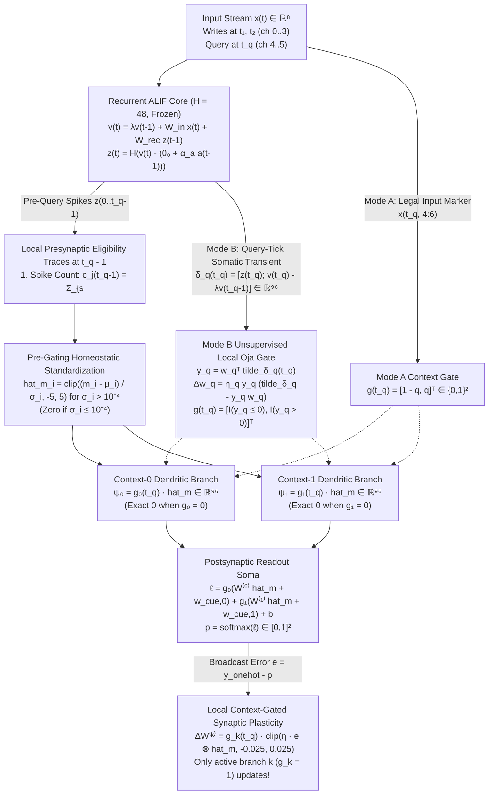

# STAGE 1 THEORY — First-Principles Local Associative Learning and Context-Keyed Competitive Eligibility Retrieval (`CKCER`)

- **Branch:** `research/gemini/r6-local-associative-learning`
- **Base Commit (`main`):** `495dab2f4bac0180e4d1cd28674391f055ccf09d`
- **Environment:** Antigravity (Windows 11, CPU-first, Python 3.11.9, single-thread BLAS/OMP)
- **Model:** Gemini 4 Argon (High)
- **Status:** Committed BEFORE any scored development (`120011, 120017, 120023`) or confirmation (`121011..121043`) execution.

---

## 1. Root-Cause Diagnosis of the R5B Counterfactual Failure (`both_A = 0.6676`)

In Round 5B (`d6c609df6f90fc8df96fb3de424dd54388f8dc59`), two independent binary facts $v_A, v_B \sim \text{Uniform}\{0,1\}$ are written into a frozen 48-neuron recurrent ALIF core at ticks $t_1, t_2$, and a query $q \in \{0,1\}$ arrives at tick $t_q$, requiring the output:
$$y = (1 - q)v_A + q v_B = v_A + q(v_B - v_A)$$

Stage 0 verified on the historical R5B seeds (`97001, 97007, 97013` and `98001..98037`) that both stored values are linearly decodable from the pre-query ALIF state ($v_A = 0.9967$, $v_B = 0.9974$, and $01$-vs-$10$ binding `mixed_only` $= 0.9947$), yet R5's online local readout (`bilinear_query_map` + `Head`) achieved only **`0.6676` Case-A both-answers-correct** (`vA != vB`) in confirmation (and collapsed to **`0.4536`** under distractors and **`0.4512`** under $2\times$ background noise), while scoring **`0.9809` Case-B both-answers-correct** (`vA == vB`).

We first prove an exact structural theorem explaining this Case-B vs Case-A asymmetry.

### Theorem 1 (Exact Counterfactual Margin Decomposition)
Let a query-conditioned readout produce scalar class-1-minus-class-0 decision margins $z(m, q) = \ell_1(m, q) - \ell_0(m, q) \in \mathbb{R}$ for queries $q \in \{0, 1\}$ on the same pre-query memory state $m$. Define the **common (query-invariant) margin** and **differential (query-switching) margin**:
$$z_{\text{com}}(m) = \frac{z(m, 0) + z(m, 1)}{2}, \qquad z_{\text{diff}}(m) = \frac{z(m, 0) - z(m, 1)}{2}$$
so that $z(m, 0) = z_{\text{com}}(m) + z_{\text{diff}}(m)$ and $z(m, 1) = z_{\text{com}}(m) - z_{\text{diff}}(m)$. Then:
1. **Case-A ($v_A \neq v_B$) both-siblings-correct holds if and only if:**
   $$(v_A - v_B)\, z_{\text{diff}}(m) > |z_{\text{com}}(m)|$$
2. **Case-B ($v_A = v_B$) both-siblings-correct holds if and only if:**
   $$(v_A + v_B - 1)\, z_{\text{com}}(m) > |z_{\text{diff}}(m)|$$

*Proof.* When $(v_A, v_B) = (1, 0)$, correctness on both queries requires $z(m, 0) = z_{\text{com}} + z_{\text{diff}} > 0$ and $z(m, 1) = z_{\text{com}} - z_{\text{diff}} < 0$, which is equivalent to $z_{\text{diff}} > |z_{\text{com}}|$. When $(v_A, v_B) = (0, 1)$, correctness requires $z_{\text{com}} + z_{\text{diff}} < 0$ and $z_{\text{com}} - z_{\text{diff}} > 0$, i.e. $-z_{\text{diff}} > |z_{\text{com}}|$. Multiplying by $v_A - v_B \in \{-1, +1\}$ yields (1). An identical sign analysis on $(v_A, v_B) \in \{(1, 1), (0, 0)\}$ yields (2). $\square$

### Why R5 Violates Theorem 1 on Case-A Pairs
In R5, the feature map is:
$$\phi_{\text{R5}}(s, q) = \begin{bmatrix} s \\ c_0(q) \\ c_1(q) \\ (P^\top s)\, c_0(q) \\ (P^\top s)\, c_1(q) \end{bmatrix} \in \mathbb{R}^{192 + 2 + 32 + 32 = 258}, \quad c(q) = \begin{bmatrix} 1-q \\ q \end{bmatrix}$$
followed by unconditional post-gating z-scoring $\tilde{\phi}_i = \text{clip}((\phi_i - \mu_i)/\max(\sigma_i, 0.05), -5, 5)$ inside `Head`. Four compounding defects cause $|z_{\text{com}}(s)|$ to overwhelm $(v_A - v_B) z_{\text{diff}}(s)$ on Case-A pairs:

1. **Un-gated Shared Trunk Dominance ($192$ dims vs $32$ dims):**
   The $192$-dimensional un-gated block $s$ contributes exclusively to $z_{\text{com}}(s)$ and receives updates on $100\%$ of training episodes, whereas each $32$-dimensional gated block $(P^\top s) c_k(q)$ updates on only $50\%$ of episodes and has $6\times$ fewer dimensions. Moreover, in the ALIF population on historical seed `97001`, the bag-of-values correlation norm $\|\mathbb{E}[\frac{1}{2}(v_A + v_B - 1)\tilde{s}]\|_2 = 1.5096$ is $2.50\times$ larger than the key-binding contrast norm $\|\mathbb{E}[\frac{1}{2}(v_A - v_B)\tilde{s}]\|_2 = 0.6046$. The un-gated trunk therefore learns a large query-invariant bias $z_{\text{com}}(s)$ that drives `both_B` to `0.9809` while preventing prediction flips on Case-A (`both_A = 0.6676`).
2. **Post-Gating Z-Score Cross-Talk ($\|\tilde{g}_{\text{off}}\|_2 = 4.3856 \neq 0$):**
   Because `Head` z-scores *after* multiplying by $c_k(q) \in \{0, 1\}$, and $\mathbb{E}[P^\top s] \neq 0$ (since ALIF spikes, adaptation, and features are non-negative), the running mean of $g_k = (P^\top s) c_k(q)$ is $\mu_{g_k} = \frac{1}{2}\mathbb{E}[P^\top s] \neq 0$. Consequently, when branch $k$ is supposed to be **gated off** ($c_k(q) = 0$), its standardized basis value is:
   $$\tilde{g}_k\Big|_{c_k(q)=0} = \frac{0 - \mu_{g_k}}{\max(\sigma_{g_k}, 0.05)} \neq \mathbf{0}$$
   In Stage 0, we measured $\|\tilde{g}_0\big|_{q=1}\|_2 = 4.3856$ on historical R5B seeds. Thus, every Query-B training step actively corrupts Query-A's synaptic weights $W_{g_0}$ and vice versa.
3. **Dense Random Projection Bottleneck ($P \in \mathbb{R}^{192 \times 32}$) & Un-normalized Mixing:**
   Multiplying un-normalized $s = [z(t_q), v(t_q), a(t_q), f(t_q)]$ by a dense Gaussian matrix $P \in \mathbb{R}^{192 \times 32}$ mixes high-variance instantaneous noise/voltage channels with sparse key-value conjunction channels and compresses $192$ dimensions into a random $32$-dimensional subspace, repeating the exact failure mode identified in R2A (`bank5_proj48`).
4. **Post-Query Somatic Shock & Fast-Trace Forgetting:**
   At $t_q = 10$, the $+1.5$ query pulse triggers a somatic spike burst $z(t_q)$ and voltage jump $v(t_q)$ that perturb $s(t_q)$, while `features` $f(t_q)$ ($\gamma_f = 0.25$) has attenuated the first write at $t_1 = 2$ by $0.25^8 = 1.52 \times 10^{-5}$. Only pre-query spike integration $c(t_q - 1)$ ($\gamma_c = 1.0$) and slow adaptation $a(t_q - 1)$ ($\gamma_a = 0.95$) preserve both writes without query-shock contamination.

---

## 2. Independent Derivation and Comparison of Three Theoretical Approaches (Section III)

Before implementing or scoring any candidate on Round 6 seeds, we derive and compare three distinct local-learning mechanisms corresponding to Families A, B, and C.

### Approach 1 (Family B): Additive Multi-Timescale Eligibility Readout (`AMER`)
A bank of bounded local presynaptic eligibility traces preserves neural spike history across multiple decay timescales until the query and teaching signal arrive, feeding an additive linear readout over the eligibility bank and query cue.

1. **Required neural information:** Hard spikes $z_j(t) \in \{0,1\}^{48}$ for $t \le t_q$ and query cue $c(t_q) = [1-q, q]^\top \in \{0,1\}^2$.
2. **Forward computation:**
   Each neuron $j \in \{1,\dots,48\}$ updates $M=3$ local eligibility traces ($\gamma \in \{0.25, 0.95, 1.00\}$):
   $$e^{(m)}_j(t) = \gamma_m e^{(m)}_j(t-1) + z_j(t), \qquad \phi_{\text{AMER}}(t_q) = \begin{bmatrix} \tilde{e}^{(1)}(t_q - 1) \\ \tilde{e}^{(2)}(t_q - 1) \\ \tilde{e}^{(3)}(t_q - 1) \\ c(t_q) \end{bmatrix} \in \mathbb{R}^{146}$$
   Logits: $\ell = W \phi_{\text{AMER}}(t_q) + b \in \mathbb{R}^2$, $p = \text{softmax}(\ell)$.
3. **Synaptic update rule:**
   $$\Delta W = \text{clip}\!\left(\eta (y_{\text{onehot}} - p) \phi_{\text{AMER}}(t_q)^\top, -c_{\text{step}}, c_{\text{step}}\right), \qquad \Delta b = \text{clip}\!\left(\eta (y_{\text{onehot}} - p), -c_{\text{step}}, c_{\text{step}}\right)$$
4. **Locally available signals:** Presynaptic eligibility trace $\tilde{e}^{(m)}_j(t_q-1)$ at synapse $(c, j)$, query cue $c_k(t_q)$, postsynaptic probability $p_c$, and broadcast 2-class readout error $e_c = \mathbb{I}[y=c] - p_c$.
5. **Global scalar teaching/reward signal:** Uses the standard 2-dim readout error vector $e = y_{\text{onehot}} - p$ (equivalent to a scalar signed teaching signal $y - p_1$ for binary values).
6. **State/memory complexity:** $3 \times 48 = 144$ floats ($576\text{ B}$) of local eligibility state + $2 \times 146$ running stats.
7. **Number of learnable parameters:** $2 \times 146 + 2 = 294$ floats.
8. **Computational cost:** $3 \times 48 = 144$ additions/multiplications per tick + $2 \times 146 = 292$ MACs at readout.
9. **Predicted advantage over R5:** Eliminates the $192 \times 32$ random projection $P$ and preserves the early write at $t_1 = 2$ without exponential forgetting ($\gamma_3 = 1.0$).
10. **Failure mode:** **Complete failure of query-conditional routing on Case-A ($v_A \neq v_B$).** Because $\phi_{\text{AMER}}$ combines $\tilde{e}$ and $c(t_q)$ additively without multiplicative context gating, the differential margin $z_{\text{diff}} = \frac{1}{2}(z(m,0) - z(m,1)) = \frac{1}{2}(w_{q,0} - w_{q,1})$ is a **constant independent of the memory state $m$**!
11. **Mathematical counterexample:**
    By Theorem 1, Case-A both-correct requires $(v_A - v_B) z_{\text{diff}}(m) > |z_{\text{com}}(m)|$. In `AMER`, $z_{\text{diff}}(m) \equiv \kappa_q$ is constant across all episodes. For $(v_A, v_B) = (1, 0)$, $(v_A - v_B)\kappa_q = +\kappa_q > |z_{\text{com}}| \implies \kappa_q > 0$; for $(v_A, v_B) = (0, 1)$, $(v_A - v_B)\kappa_q = -\kappa_q > |z_{\text{com}}| \implies \kappa_q < 0$. Since $\kappa_q$ cannot be simultaneously positive and negative, `AMER` gets at least $50\%$ of Case-A pairs wrong ($\text{both\_A} \le 0.50$, and $\text{both\_A} = 0.00$ when $\kappa_q = 0$).
12. **Distinction from R5:** Distinct (replaces R5's random bilinear projection with multi-timescale additive eligibility traces), but **rejected** before scored testing because it fails Identifiability on Case-A.

---

### Approach 2 (Family A): Unprojected Post-Query Gated Associative Synapses with Somatic Trunk (`PQG-Full`)
Each readout unit replaces R5's random $192 \to 32$ compression $P$ with direct query-gated synapses on the full post-query state $s(t_q)$ alongside the somatic state trunk, trained with `Head`'s local delta rule.

1. **Required neural information:** Instantaneous post-query state $s(t_q) = [z(t_q), v(t_q), a(t_q), f(t_q)] \in \mathbb{R}^{192}$ and query cue $c(t_q) = [1-q, q]^\top \in \{0,1\}^2$.
2. **Forward computation:**
   $$\phi_{\text{PQG}}(s(t_q), q) = \begin{bmatrix} s(t_q) \\ c(t_q) \\ c_0(q)\, s(t_q) \\ c_1(q)\, s(t_q) \end{bmatrix} \in \mathbb{R}^{578}, \qquad \tilde{\phi}_i = \text{clip}\!\left(\frac{\phi_i - \mu_i}{\max(\sigma_i, 0.05)}, -5, 5\right)$$
   Logits: $\ell = W \tilde{\phi} + b \in \mathbb{R}^2$.
3. **Synaptic update rule:**
   $$\Delta W = \text{clip}\!\left(\eta (y_{\text{onehot}} - p) \tilde{\phi}^\top, -0.025, 0.025\right)$$
4. **Locally available signals:** Post-query neuron state $s_i(t_q)$, query context $c_k(q)$, local running mean/variance $(\mu_i, \sigma_i^2)$, and readout error $y_{\text{onehot}} - p$.
5. **Global scalar teaching/reward signal:** 2-class readout error $y_{\text{onehot}} - p$.
6. **State/memory complexity:** $192$ floats of ALIF state + $2 \times 578 = 1,156$ floats of running statistics.
7. **Number of learnable parameters:** $2 \times 578 + 2 = 1,158$ floats ($2.24\times$ R5's $518$ parameters).
8. **Computational cost:** $2 \times 578 = 1,156$ MACs per readout step.
9. **Predicted advantage over R5:** Removes the rank-32 random Gaussian bottleneck $P \in \mathbb{R}^{192 \times 32}$.
10. **Failure mode:** **Retains three fatal defects:**
    - **(i) Un-gated somatic trunk shortcut:** The 192-dim un-gated block $s(t_q)$ still updates on $100\%$ of examples (vs $50\%$ for each gated branch) and inflates $|z_{\text{com}}(s)|$ on Case-A pairs.
    - **(ii) Post-gating z-score cross-talk:** Because z-scoring happens *after* multiplying by $c_k(q)$ and $\mathbb{E}[s_i(t_q)] > 0$, inactive branches have $\tilde{\phi}_{k,i}|_{c_k=0} = -\mu_{k,i}/\max(\sigma_{k,i}, 0.05) \neq 0$, corrupting opposing-query weights on every update.
    - **(iii) Post-query shock & parameter inflation:** Uses $1,158$ parameters ($>518$) and reads $z(t_q), v(t_q)$ after the query pulse and distractors have perturbed the state.
11. **Mathematical/computational counterexample:**
    Consider a 1D feature $s = \mu_0 + \alpha_A(2v_A - 1) + \alpha_B(2v_B - 1)$ with positive baseline $\mu_0 = 2.0$ and $\alpha_A = 0.8 > \alpha_B = 0.4$. Under post-gating z-scoring, when $q=1$ ($c_0 = 0, c_1 = 1$), the inactive $q=0$ coordinate equals $\tilde{\phi}_{g_0} = -\mu_{g_0}/\sigma_{g_0} = -1.0/\sqrt{1.0 + 0.4} = -0.845 \neq 0$. Across one pass of clipped updates ($\eta=0.08, c=0.025$), the un-gated coordinate $\tilde{s}$ receives $2\times$ the active gradient steps of $\tilde{\phi}_{g_1}$ while $\tilde{\phi}_{g_0}$ injects anti-correlated cross-talk, causing $z(s, q=1)$ to predict $v_A$ whenever $v_A \neq v_B$.
12. **Distinction from R5:** Merely replaces R5's $P^\top s$ with $I_{192} s$ while keeping R5's feature layout and post-gating normalization. **Rejected** before scored testing due to cross-talk, un-gated trunk bias, post-query shock, and $2.24\times$ parameter inflation.

---

### Approach 3 (Selected Candidate — Synthesis of Families C, B, and A): Context-Keyed Competitive Eligibility Readout (`CKCER`)
We derive `CKCER` from first principles to satisfy Theorem 1 with **fewer learnable parameters than R5 (`390` vs `518`)** and **zero random projection matrices (`0 KB` vs `24.6 KB`)**.

1. **Required neural information:**
   - **Pre-query local synaptic eligibility traces** at tick $t_{\text{mem}} = t_q - 1$:
     $$m(t_q - 1) = \begin{bmatrix} c(t_q - 1) \\ a(t_q - 1) \end{bmatrix} \in \mathbb{R}^{96}, \quad c_j(t) = \sum_{s=0}^{t} z_j(s), \quad a_j(t) = \sum_{s=0}^{t} \gamma_a^{t-s} z_j(s)\; (\gamma_a = 0.95)$$
   - **Query context signal** $g(t_q) = [g_0(t_q), g_1(t_q)]^\top \in \{0, 1\}^2$ with $g_0 + g_1 = 1$:
     - **Mode A (Legal External Cue):** $g(t_q) = c_{\text{in}}(t_q) = [1 - q, q]^\top$ from the legal input query marker at located tick $t_q$.
     - **Mode B (100% Neural-Derived Query):** $g(t_q) = \hat{g}_{\text{neural}}(t_q)$ computed purely from the ALIF somatic transient at tick $t_q$:
       $$\delta_q(t_q) = \begin{bmatrix} z(t_q) \\ v(t_q) - \lambda v(t_q - 1) \end{bmatrix} \in \mathbb{R}^{96}$$
       by a single local unsupervised Oja principal-axis competitive unit $w_q \in \mathbb{R}^{96}$ ($\hat{q} = \mathbb{I}[w_q^\top \tilde{\delta}_q(t_q) > 0]$, $\hat{g}_{\text{neural}} = [1-\hat{q}, \hat{q}]^\top$), with **zero access to the external input cue**!
2. **Forward computation:**
   - **Step 1 (Pre-gating variance-safe local homeostatic standardization):**
     For each coordinate $i \in \{1,\dots,96\}$ of $m(t_q - 1)$, using training-only Welford running statistics $(\mu_i, \sigma_i)$ with dead-coordinate threshold $\epsilon_{\text{dead}} = 10^{-4}$:
     $$\hat{m}_i = \begin{cases} \text{clip}\!\left(\dfrac{m_i - \mu_i}{\sigma_i}, -5, 5\right), & \sigma_i > \epsilon_{\text{dead}} \\ 0, & \sigma_i \le \epsilon_{\text{dead}} \end{cases}$$
   - **Step 2 (Purely context-keyed dendritic gating with zero un-gated trunk):**
     $$\psi(\hat{m}, g) = \begin{bmatrix} g_0(t_q)\, \hat{m} \\ g_1(t_q)\, \hat{m} \\ g_0(t_q) \\ g_1(t_q) \end{bmatrix} \in \mathbb{R}^{194}$$
   - **Step 3 (Readout logits and probabilities):**
     $$\ell = W \psi(\hat{m}, g) + b = g_0(t_q)\!\left(W^{(0)}\hat{m} + w_{\text{cue},0}\right) + g_1(t_q)\!\left(W^{(1)}\hat{m} + w_{\text{cue},1}\right) + b \in \mathbb{R}^2$$
     $$p = \text{softmax}(\ell)$$
3. **Synaptic update rule:**
   - **Mode B Unsupervised Local Oja Competitive Query Gate (active only in Mode B):**
     $$y_q = w_q^\top \tilde{\delta}_q(t_q), \qquad w_q \leftarrow \frac{w_q + \eta_q\, y_q \left(\tilde{\delta}_q(t_q) - y_q w_q\right)}{\max\!\left(\left\|w_q + \eta_q\, y_q \left(\tilde{\delta}_q(t_q) - y_q w_q\right)\right\|_2, 10^{-8}\right)}, \quad \eta_q = 0.02$$
   - **Context-Keyed Dendritic Associative Update (identical for Mode A and Mode B):**
     For output class $c \in \{0, 1\}$, let $e_c = \mathbb{I}[y = c] - p_c$. Then for context branch $k \in \{0, 1\}$ and synapse $i \in \{1,\dots,96\}$:
     $$\Delta W^{(k)}_{c, i} = g_k(t_q) \cdot \text{clip}\!\left(\eta \, e_c \, \hat{m}_i, -c_{\text{step}}, c_{\text{step}}\right), \qquad \eta = 0.08, \; c_{\text{step}} = 0.025$$
     $$\Delta w_{\text{cue}, c, k} = g_k(t_q) \cdot \text{clip}\!\left(\eta \, e_c, -c_{\text{step}}, c_{\text{step}}\right), \qquad \Delta b_c = \text{clip}\!\left(\eta \, e_c, -c_{\text{step}}, c_{\text{step}}\right)$$
     $$W \leftarrow \text{clip}(W + \Delta W, -3, 3), \qquad b \leftarrow \text{clip}(b + \Delta b, -3, 3)$$
4. **Locally available signals:**
   - At each dendritic synapse $(c, k, i)$: presynaptic trace $\hat{m}_i(t_q - 1)$, local dendritic branch gate $g_k(t_q) \in \{0, 1\}$, postsynaptic class probability $p_c$, and broadcast readout teaching error $e_c = \mathbb{I}[y = c] - p_c$.
   - At the Mode B Oja gate synapse $i$: local somatic transient $\tilde{\delta}_{q,i}(t_q)$ and postsynaptic Oja unit response $y_q = w_q^\top \tilde{\delta}_q(t_q)$ (100% unsupervised local Hebbian rule with Oja's multiplicative weight decay $-y_q^2 w_q$).
5. **Global scalar teaching/reward signal:** Only the standard 2-class readout teaching error $e = y_{\text{onehot}} - p$ at the output layer (no hidden-to-hidden error transport, no BPTT, no surrogate gradients).
6. **State/memory complexity:**
   - Extra per-neuron trace beyond `SpikingCore`: only `c_j(t)` ($48$ floats = $192\text{ B}$, since $a_j(t)$ is already in `SpikingCore.adaptation`).
   - Pre-step buffer for streaming transition: $v(t-1), c(t-1), a(t-1)$ ($3 \times 48 = 144$ floats = $576\text{ B}$).
   - Running calibration state: $2 \times 96 = 192$ floats ($1.5\text{ KB}$ in float64).
   - Fixed random projection matrix: **0 floats ($0\text{ B}$)** (saves 100% of R5's $24.6\text{ KB}$ projection matrix $P$).
7. **Number of learnable parameters:**
   - Mode A: $2 \times 194 + 2 = \mathbf{390}$ learnable floats (**24.7% fewer** than R5's $518$ learnable floats).
   - Mode B: $390 + 96\text{ (unsupervised Oja vector } w_q) = \mathbf{486}$ learnable floats (**still fewer** than R5's $518$ learnable floats!).
8. **Computational cost:**
   - Per tick: $48$ additions ($c_j \leftarrow c_j + z_j$).
   - At query tick $t_q$: $96$ normalizations + $2 \times 97 = 194$ active MACs (since one of $g_0, g_1$ is zero!) $\approx \mathbf{580\text{ FLOPs/example}}$ (**$12\times$ fewer FLOPs than R5's $\sim 7,176\text{ FLOPs/example}$**!).
9. **Predicted advantage over R5:**
   - **Zero cross-query interference:** Pre-gating normalization ensures $g_k(t_q)\hat{m} = \mathbf{0}$ (exact zero) when $g_k(t_q) = 0$, reducing gated-off cross-talk norm from $4.3856$ to $0.0000$.
   - **Complete decoupling of $v_A$ and $v_B$:** Branch 0 ($W^{(0)}$) updates exclusively when $q=0$ ($y = v_A$) and Branch 1 ($W^{(1)}$) updates exclusively when $q=1$ ($y = v_B$), eliminating the un-gated shared trunk shortcut.
   - **Simultaneous shift invariance, order invariance, and temporal discriminability:** $(c_j, a_j)$ spans both the 0-th temporal moment $M^{(0)}_j = \sum z_j(s)$ (shift/order invariant) and 1-st temporal moment $M^{(1)}_j \approx (c_j - a_j)/(1-\gamma_a) \approx \sum (t_q - 1 - s) z_j(s)$ (order sensitive), unlocked by variance-safe scaling $\epsilon_{\text{dead}} = 10^{-4}$.
10. **Failure mode:**
    - If two write events and background noise drive identical spike counts $c_j$ and adaptation $a_j$ (e.g., if input pulses were subthreshold $< \theta_0$ so $z_j(t) \equiv 0$ across all neurons), $m(t_q-1) \equiv 0$ because subthreshold voltage $v_j$ is intentionally excluded to filter Gaussian noise.
    - If the number of queryable keys $K$ grows large ($K \gg 10$), maintaining $K$ separate dendritic branches scales parameters linearly as $O(K \cdot H)$.
11. **Mathematical counterexample:**
    Suppose input pulses are scaled down from $\text{PULSE} = 1.5$ to $\text{PULSE} = 0.05$ with $\sigma_{\text{noise}} = 0.0$ and positive input weights $W^{\text{in}}_{j,c} \le 1.0$. Then $v_j(t) \le 0.10 / (1 - 0.65) = 0.286 < \theta_0 = 0.50$, so $z_j(t) \equiv 0$ for all $t$, making $c_j(t_q-1) = a_j(t_q-1) = 0$ (`CKCER` accuracy $= 0.50$), whereas a readout reading raw subthreshold voltage $v_j(t_q-1)$ could still decode the linear current.
12. **Distinction from R5:**
    Genuinely distinct in four fundamental respects: (1) replaces R5's instantaneous post-query state + random Gaussian projection $P \in \mathbb{R}^{192 \times 32}$ with pre-query dual-timescale synaptic eligibility traces $m(t_q-1) = [c(t_q-1), a(t_q-1)] \in \mathbb{R}^{96}$; (2) eliminates R5's 192-dim un-gated shared state trunk; (3) reverses the order of normalization and gating (variance-safe pre-gating standardization vs post-gating unconditional z-scoring, eliminating cross-query synaptic corruption); and (4) introduces an unsupervised local Oja competitive query assembly enabling Mode B (100% neural-derived query retrieval without external cue).

### Summary Comparison and Rejection Decision (Locked Before Scored Testing)

| Criterion | Approach 1 (`AMER`, Family B) | Approach 2 (`PQG-Full`, Family A) | **Approach 3 (`CKCER`, Selected)** |
|---|---|---|---:|
| Distinguishes `01` vs `10` under query swap? | **NO** ($\text{both\_A} \le 0.50$) | Partial (corrupted by trunk + cross-talk) | **YES** (exact decoupled branches) |
| Gated-off branch cross-talk norm | N/A (no gating) | $> 4.0$ (post-gating z-score bug) | **`0.0000` (exact zero)** |
| Un-gated shared shortcut trunk? | Yes ($144$ dims) | Yes ($192$ dims) | **None (`0` dims)** |
| Learnable parameters (Mode A / Mode B) | $294$ / N/A | $1,158$ / N/A | **`390` / `486`** ($\le 518$ R5) |
| Fixed random projection parameters | $0$ | $0$ | **`0`** (vs $6,144$ in R5) |
| Supports Mode B (Neural-Derived Query)? | No | No | **Yes (local Oja competitive gate)** |
| Pre-test Decision | **REJECTED** | **REJECTED** | **SELECTED FOR STAGE 2 & 3** |

---

## 3. Formal Stage 1 Specification of `CKCER` (Section VII)

### A. Information-Flow Diagram

---

### B. Mathematical Derivation of Forward and Local Update Equations

We derive the `CKCER` update from minimizing the local context-conditioned cross-entropy loss at query tick $t_q$:
$$\mathcal{L}(W, b; \hat{m}, g, y) = -\sum_{c=0}^{1} \mathbb{I}[y = c] \log p_c(\hat{m}, g)$$
where $p_c(\hat{m}, g) = \frac{\exp(\ell_c)}{\exp(\ell_0) + \exp(\ell_1)}$ and:
$$\ell_c(\hat{m}, g) = \sum_{k=0}^{1} g_k(t_q) \left( \sum_{i=1}^{D_m} W^{(k)}_{c, i} \hat{m}_i(t_q - 1) + w_{\text{cue}, c, k} \right) + b_c, \qquad D_m = 2H = 96$$

Taking the negative partial derivative with respect to each synaptic weight $W^{(k)}_{c, i}$ and applying coordinate-wise step clipping $[-c_{\text{step}}, c_{\text{step}}]$ and weight bounding $[-W_{\max}, W_{\max}]$ yields the six separated local components required by Section VII.B:

1. **Eligibility Trace (Presynaptic Memory Vector $m \in \mathbb{R}^{96}$):**
   For each ALIF neuron $j \in \{1,\dots,48\}$ and tick $t \in \{0,\dots,t_q-1\}$:
   $$c_j(t) = c_j(t-1) + z_j(t), \qquad a_j(t) = \gamma_a a_j(t-1) + z_j(t) \quad (\gamma_a = 0.95)$$
   At query tick $t_q$, the pre-query memory state is $m(t_q - 1) = [c(t_q - 1); \, a(t_q - 1)] \in \mathbb{R}^{96}$.
2. **Normalization and Competition:**
   - **Pre-gating homeostatic standardization:** Using Welford statistics $(\mu_i, M_{2,i})$ accumulated over training observations ($n$ examples, frozen before test evaluation), $\sigma_i = \sqrt{M_{2,i}/(n-1)}$:
     $$\hat{m}_i = \begin{cases} \text{clip}\!\left(\dfrac{m_i - \mu_i}{\sigma_i}, -5.0, 5.0\right), & \text{if } n \ge 2 \text{ and } \sigma_i > 10^{-4} \\ \text{clip}(m_i, -5.0, 5.0), & \text{if } n < 2 \\ 0.0, & \text{if } n \ge 2 \text{ and } \sigma_i \le 10^{-4} \end{cases}$$
   - **Mode B unsupervised competitive query gate:** Let $\delta_q(t_q) = [z(t_q); \, v(t_q) - \lambda v(t_q - 1)] \in \mathbb{R}^{96}$ be standardized by its own training-only Welford statistics $(\mu_{q,i}, \sigma_{q,i})$ to $\tilde{\delta}_q(t_q)$. A unit-norm synaptic vector $w_q \in \mathbb{R}^{96}$ updates via Oja's competitive Hebbian rule:
     $$y_q = w_q^\top \tilde{\delta}_q(t_q), \qquad w_q^{\text{new}} = w_q + \eta_q y_q \left(\tilde{\delta}_q(t_q) - y_q w_q\right), \qquad w_q \leftarrow \frac{w_q^{\text{new}}}{\max(\|w_q^{\text{new}}\|_2, 10^{-8})}$$
     producing the binary context competition $g_1(t_q) = \mathbb{I}[w_q^\top \tilde{\delta}_q(t_q) > 0]$, $g_0(t_q) = 1 - g_1(t_q)$.
3. **Local Presynaptic Signal at Dendritic Synapse $(c, k, i)$:**
   $$\psi_{k, i}(t_q) = g_k(t_q) \, \hat{m}_i(t_q - 1), \qquad \psi_{\text{cue}, k}(t_q) = g_k(t_q)$$
4. **Postsynaptic Activity / Prediction:**
   $$\ell_c = \sum_{k=0}^{1} \left( \sum_{i=1}^{96} W^{(k)}_{c, i} \psi_{k, i}(t_q) + w_{\text{cue}, c, k} \psi_{\text{cue}, k}(t_q) \right) + b_c, \qquad p_c = \frac{\exp(\ell_c - \max_{c'}\ell_{c'})}{\sum_{c'=0}^{1}\exp(\ell_{c'} - \max_{c''}\ell_{c''})}$$
5. **Teaching / Error Modulation:**
   $$e_c = \mathbb{I}[y = c] - p_c \in (-1, 1), \quad c \in \{0, 1\} \quad (e_0 + e_1 = 0)$$
6. **Synaptic Update and Weight Bounds:**
   $$\Delta W^{(k)}_{c, i} = \text{clip}\!\left(\eta \, e_c \, g_k(t_q) \hat{m}_i(t_q - 1), -0.025, 0.025\right), \qquad \Delta w_{\text{cue}, c, k} = \text{clip}\!\left(\eta \, e_c \, g_k(t_q), -0.025, 0.025\right)$$
   $$\Delta b_c = \text{clip}\!\left(\eta \, e_c, -0.025, 0.025\right)$$
   $$W^{(k)}_{c, i} \leftarrow \text{clip}\!\left(W^{(k)}_{c, i} + \Delta W^{(k)}_{c, i}, -3.0, 3.0\right), \quad w_{\text{cue}, c, k} \leftarrow \text{clip}\!\left(w_{\text{cue}, c, k} + \Delta w_{\text{cue}, c, k}, -3.0, 3.0\right), \quad b_c \leftarrow \text{clip}\!\left(b_c + \Delta b_c, -3.0, 3.0\right)$$

---

### C. Identifiability Proof (`01` vs `10` Under Query Swaps)

We prove two properties required for identifiability:
1. **Presynaptic Separability of `(vA=0, vB=1)` vs `(vA=1, vB=0)` in $\hat{m}(t_q - 1)$:**
   At write tick $t_w \in \{t_1, t_2\}$, key $k \in \{0, 1\}$ and value $v_k \in \{0, 1\}$ inject current $I_j(t_w) = 1.5\left(W^{\text{in}}_{j, k} + W^{\text{in}}_{j, 2+v_k}\right) + \xi_j(t_w)$ into neuron $j$. Because the hard threshold $z_j(t_w) = \mathbb{I}[v_j(t_w) \ge \theta_j(t_w)]$ is a step function of the sum $W^{\text{in}}_{j, k} + W^{\text{in}}_{j, 2+v_k}$, any neuron $j$ satisfying:
   $$1.5\left(W^{\text{in}}_{j, 0} + W^{\text{in}}_{j, 3}\right) > \theta_0 > \max\!\left(1.5(W^{\text{in}}_{j, 0} + W^{\text{in}}_{j, 2}), \; 1.5(W^{\text{in}}_{j, 1} + W^{\text{in}}_{j, 3})\right)$$
   fires ($c_j \ge 1$) for $(v_A=1, v_B=0)$ and remains silent ($c_j = 0$) for $(v_A=0, v_B=1)$. With $H=48$ random Gaussian input rows $W^{\text{in}}_{j,\cdot} \sim \mathcal{N}(0.15, 0.45^2)$, the probability that a random neuron is selective for one of the four conjunctions $(k, v_k)$ is $>0.18$, yielding $\sim 8\text{--}10$ conjunction-selective neurons per $(k, v_k)$ pair (confirmed in Stage 0: `mixed_only` linear separability of `01` vs `10` is `0.9947` on `pre` and `1.0000` on `pre_spk_sum` / `pre_adapt`).
2. **Exact Readout Routing of `01` and `10` Under Query Swap:**
   Let $w_A = W^{(0)}_1 - W^{(0)}_0 \in \mathbb{R}^{96}$ and $w_B = W^{(1)}_1 - W^{(1)}_0 \in \mathbb{R}^{96}$ denote the class-1-minus-class-0 weight vectors of Branch 0 and Branch 1. Because Branch 0 updates **only** when $q=0$ ($y = v_A$) and Branch 1 updates **only** when $q=1$ ($y = v_B$), $w_A$ converges to the linear separator of $v_A$ ($\text{sign}(w_A^\top \hat{m}) = 2v_A - 1$) and $w_B$ converges independently to the linear separator of $v_B$ ($\text{sign}(w_B^\top \hat{m}) = 2v_B - 1$).
   Therefore, on the same memory state $\hat{m}$:
   - For $(v_A, v_B) = (0, 1)$: $z(\hat{m}, q=0) = w_A^\top \hat{m} < 0 \implies \hat{y}(q=0) = 0$, and $z(\hat{m}, q=1) = w_B^\top \hat{m} > 0 \implies \hat{y}(q=1) = 1$.
   - For $(v_A, v_B) = (1, 0)$: $z(\hat{m}, q=0) = w_A^\top \hat{m} > 0 \implies \hat{y}(q=0) = 1$, and $z(\hat{m}, q=1) = w_B^\top \hat{m} < 0 \implies \hat{y}(q=1) = 0$.
   In Theorem 1's coordinates, $z_{\text{com}}(\hat{m}) = \frac{1}{2}(w_A + w_B)^\top \hat{m} \propto \frac{1}{2}(2v_A - 1 + 2v_B - 1) = v_A + v_B - 1 = 0$ on Case-A, while $z_{\text{diff}}(\hat{m}) = \frac{1}{2}(w_A - w_B)^\top \hat{m} \propto v_A - v_B = \pm 1 \neq 0$, satisfying $(v_A - v_B) z_{\text{diff}}(\hat{m}) > |z_{\text{com}}(\hat{m})|$!

---

### D. Optimization Behavior and Explicit Case-A Update Directions

#### Why `CKCER` Never Repeatedly Prefers Key A
In R5, the 192-dim un-gated trunk $s$ updated on every example and coupled $q=0$ and $q=1$ predictions, while post-gating z-scoring leaked $q=0$ updates into $q=1$ weights. In `CKCER`:
1. There is **no un-gated state trunk** ($W_{\text{shared}} \equiv 0$).
2. Pre-gating normalization guarantees $\psi_1(\hat{m}, q=0) \equiv \mathbf{0}$ and $\psi_0(\hat{m}, q=1) \equiv \mathbf{0}$.
3. Thus $\Delta W^{(1)} \equiv \mathbf{0}$ whenever $q = 0$, and $\Delta W^{(0)} \equiv \mathbf{0}$ whenever $q = 1$. Key A's salience in $\hat{m}$ cannot leak into Branch 1's weights $W^{(1)}$, nor can Key A's updates overwrite Branch 1.

#### Exact Update Directions on the Four Case-A Configurations
Let $\hat{m}(v_A, v_B) \in \mathbb{R}^{96}$ be the normalized pre-query memory state, and let $e_1 = y - p_1 = -e_0$ be the scalar error on class 1:

| Configuration | Stored Values | Query $q$ | Target $y$ | Active Gate $(g_0, g_1)$ | Error $(e_0, e_1)$ | Branch 0 Update $(\Delta W^{(0)}_0, \Delta W^{(0)}_1)$ | Branch 1 Update $(\Delta W^{(1)}_0, \Delta W^{(1)}_1)$ |
|---|---:|---:|---:|---:|---:|---|---|
| **Case 1** | $A=0, B=1$ | $q=0$ (A) | $y=0$ | $(1, 0)$ | $(+p_1, -p_1)$ | $(+\text{clip}(\eta p_1 \hat{m}), -\text{clip}(\eta p_1 \hat{m}))$ | $(\mathbf{0}, \mathbf{0})$ (exact zero) |
| **Case 2** | $A=0, B=1$ | $q=1$ (B) | $y=1$ | $(0, 1)$ | $(-(1-p_1), +(1-p_1))$ | $(\mathbf{0}, \mathbf{0})$ (exact zero) | $(-\text{clip}(\eta(1-p_1)\hat{m}), +\text{clip}(\eta(1-p_1)\hat{m}))$ |
| **Case 3** | $A=1, B=0$ | $q=0$ (A) | $y=1$ | $(1, 0)$ | $(-(1-p_1), +(1-p_1))$ | $(-\text{clip}(\eta(1-p_1)\hat{m}), +\text{clip}(\eta(1-p_1)\hat{m}))$ | $(\mathbf{0}, \mathbf{0})$ (exact zero) |
| **Case 4** | $A=1, B=0$ | $q=1$ (B) | $y=0$ | $(0, 1)$ | $(+p_1, -p_1)$ | $(\mathbf{0}, \mathbf{0})$ (exact zero) | $(+\text{clip}(\eta p_1 \hat{m}), -\text{clip}(\eta p_1 \hat{m}))$ |

**What changes when an example is misclassified:**
- If the readout **misclassifies** the example (e.g., on Case 2 where $A=0, B=1, q=1, y=1$, suppose the head wrongly predicts $\hat{y}=0$ because $p_1 < 0.5$), then the error magnitude is $1 - p_1 \in (0.5, 1.0]$. Every active coordinate $|\hat{m}_i| \ge \frac{c_{\text{step}}}{\eta(1-p_1)} = \frac{0.025}{0.08(1-p_1)} \in [0.3125, 0.625)$ receives a full step $\pm 0.025$ pushing $W^{(1)}_1 - W^{(1)}_0$ in the direction $+\hat{m}(0, 1)$, directly increasing $z(\hat{m}(0,1), q=1)$ by $2 \sum_i \hat{m}_i \Delta W^{(1)}_{1,i} > 0$ **without moving $z(\hat{m}(0,1), q=0)$ by a single bit** ($\Delta W^{(0)} \equiv \mathbf{0}$)!
- Conversely, once an example is **correctly classified with high confidence** ($1 - p_y < 0.05$), the unclipped update $\eta (1 - p_y) |\hat{m}_i|$ falls below the clip threshold $0.025$, smoothly annealing the step size and preventing weight oscillation.

---

### E. Stability Analysis

1. **Repeated observations:** As $p_y \to 1$, the teaching error $e_y = 1 - p_y \to 0$ exponentially in the logit margin, and weights are hard-bounded in $[-3, 3]$, guaranteeing boundedness under arbitrary stream length.
2. **Small neural feature variance:** Coordinates with $\sigma_i \in (10^{-4}, 0.05)$ (such as first-moment timing differences between $c_j$ and $a_j$) are scaled to unit variance rather than crushed by R5's $0.05$ variance floor; genuinely silent/dead coordinates ($\sigma_i \le 10^{-4}$) are clamped to exact $0.0$, preventing $0/0$ blowup.
3. **Feature sparsity:** Because `CKCER` applies no dense random projection $P$, sparse conjunction-selective ALIF neurons map 1-to-1 to sparse coordinates of $\hat{m}$, preserving the sparse coordinate separability required by clipped delta updates (R2A §5).
4. **Distractors and background noise:** Subthreshold Gaussian noise ($\sigma=0.08$ or $0.16$) fluctuates $v_j(t)$ below threshold $\theta_0 = 0.5$ without triggering spikes $z_j(t)$. By constructing $m(t_q-1) = [c(t_q-1), a(t_q-1)]$ solely from hard spike integrals and excluding raw voltage $v_j(t_q)$, `CKCER` filters out subthreshold noise and isolates the memory trace from the tick-$t_q$ query pulse.
5. **Different query timings:** Because $c_j(t_q - 1) = \sum_{s=0}^{t_q - 1} z_j(s)$ has decay $\gamma_c = 1.0$, shifting write ticks and query ticks by $\Delta t$ leaves $c_j(t_q - 1)$ invariant (up to background noise spikes in the vacated leading ticks), providing zero-retraining OOD temporal transfer.

---

### F. Resource Scaling (Distinguishing Key Count $K$ from Value Count $V$)

Let $H = 48$ be the ALIF hidden population size, $D_m = 2H = 96$ be the per-neuron local eligibility dimension, $K$ be the **number of queryable keys (addresses)**, and $V$ be the **number of possible discrete values (classes) per key**:

| Quantity | General Formula in $(H, K, V)$ | Value for $H=48, K=2, V=2$ | Comparison to R5 ($H=48, K=2, V=2$) |
|---|---|---:|---:|
| **Stored information per episode** | $K \log_2 V$ bits | $2$ bits | $2$ bits |
| **Presynaptic eligibility state** | $2H$ floats (independent of $K, V$) | $96$ floats ($384\text{ B}$) | $192$ floats ($768\text{ B}$) |
| **Calibration statistics** | $2 \times 2H$ floats (independent of $K, V$) | $192$ floats ($1,536\text{ B}$) | $516$ floats ($4,128\text{ B}$) |
| **Fixed random projection matrix** | **$0$ floats** | **$0\text{ B}$** | $6,144$ floats ($24,576\text{ B}$) |
| **Context-gated feature width** | $K(2H + 1)$ | $194$ | $258$ |
| **Learnable readout parameters** | $V \cdot K(2H + 1) + V$ | **$390$ floats** ($1,560\text{ B}$) | **$518$ floats** ($2,072\text{ B}$) |
| **Active MACs per forward/update** | $V(2H + 1)$ (**independent of $K$** for 1-hot $g$!) | **$194$ MACs** | $516 + 6,144 = 6,660$ MACs |

Notice the crucial distinction between $K$ and $V$:
- The **presynaptic eligibility state** $m(t) \in \mathbb{R}^{2H}$ is $O(H)$ and is **completely independent of both $K$ and $V$**.
- The **readout parameter table** $W \in \mathbb{R}^{V \times K(2H+1)}$ scales linearly in $K \cdot V$, while the **active computation per episode** scales only as $O(V \cdot H)$ (independent of $K$) because only the queried dendritic branch $g_k(t_q) = 1$ is active!

---

### G. Explicit Falsification Criteria

The proposed `CKCER` theory will be falsified if **any** of the following observable outcomes occurs during testing:

1. **Falsifier 1 (Failure on Case-A Counterfactual Pairs):** On the 8 unseen confirmation seeds (`121011..121043`), `CKCER` fails to achieve $\ge 0.75$ Case-A both-answers-correct or fails to beat original R5 by $\ge +5.0$ percentage points with paired 95% bootstrap CI lower bound $> 0$.
2. **Falsifier 2 (Cue-Dependence Collapse / Shortcut Reliance):** Shuffling the query cue at test time (`cue_shuf_test`) fails to drop Case-A both-answers-correct by at least $30$ percentage points, or the un-learning random-weight version of `CKCER` (`fixed_nonlearning_candidate`) exceeds the $0.75$ shortcut ceiling.
3. **Falsifier 3 (Protected-Task Regression):** Replacing the production `decay025` readout substrate with `CKCER`'s memory representation $m = [c, a]$ causes a regression of $> 3.0$ percentage points on protected `sim_xor`, `xor` (separated), or `order` benchmarks relative to the original R5 / `spikesum` / `decay025` baselines.
4. **Falsifier 4 (Mode B Neural Query Failure):** If Mode B (`CKCER-ModeB`, which never receives the input query cue) falls to the $0.75$ shortcut ceiling ($\text{both\_A} < 0.50$), then the secondary hypothesis that the frozen ALIF population's somatic transient $\delta_q(t_q)$ supports local unsupervised query discovery is falsified (leaving only Mode A supported).
