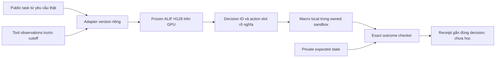

# P1A đề xuất — nối frozen ALIF tới hành động và outcome có nguồn

**CHỜ DUYỆT; chưa code bridge hoặc thực thi neural/tool mới.** Đây là bước
qualification cho đường tác động nhân quả. Không train, không mở DEV/P1B,
không sửa Hermes/main/R13 hoặc nhập research weights vào live.

## Vì sao chưa chạy learning ngay?

[P0 checker5842c6](../docs/hybrid/OUTCOME_CONTRACT_P0_RESULT_20261115.md) đạt scope
kỹ thuật. [Audit định dạng dữ liệu hiện có](../docs/release/evidence/OUTCOME_POLICY_READINESS_20261115.json)
xác nhận42 decisions đều fixed_fixture,14 traces không có public user-task field,
13 first decisions có prior history rỗng,1 trace không có decision. Initial state
cùng hash nhưng5 contract riêng ở phía checker; không thể đưa private contract/
caseID vào policy để che việc thiếu ý nghĩa yêu cầu. Đây không là accuracy bound
của SNN; P0 vốn không được thiết kế như training dataset.

Live head có review/search/verify/ask/defer/consolidate. Shadow đã có từ14/11
dùng show_schema/inspect_status/retry/clarify/defer/finish. Cùng6 slots không làm
hai bộ trọng số tương thích. Raw read_file/commit/poll của P0 cũng không là6
nhãn action đó. Cần một interface/version và macro mapping rõ, không đổi nghĩa
readout đang phục vụ hoặc train trên fixture bằng nhãn suy từ tên folder.

## Literature-first: kế thừa thay vì chạy lại

- [ToolSandbox source đã đọc/pin](../docs/research/literature/sources/toolsandbox-source-check-20261115.json):
  REUSE exact state/dependency/provenance ideas, không import soft similarity
  làm truth label. Dùng checker/audit P0 mới; không chạy lại benchmark upstream.
- [Reflexion](https://github.com/noahshinn/reflexion/blob/main/alfworld_runs/generate_reflections.py)
  và [ExpeL](https://github.com/LeapLabTHU/ExpeL/blob/main/agent/reflect.py):
  REUSE ranh giới environment outcome / reflective text. Không dùng lời tự
  nhận xét làm nhãn. Hai phương pháp là strong experience baselines cho P1B sau.
- REUSE `LocalALIF`/forward và strict snapshot principles của
  `src/scarx/evaluation/recovery_policy.py`, không rerun old wrapper benchmark.
  Không cần learner mới để kiểm đường action này. Không tái lập e-prop/BrainTrace
  hoặc đổi trace/credit từ đề xuất này; history P0 FAIL vẫn nguyên.
- [Input-budget audit cũ](../docs/hybrid/INPUT_BUDGET_ROOT_CAUSE_20261114.md)
  chỉ ra append error sau câu hỏi dài có thể bị bỏ ở128 words. P1A dùng task và
  observation ở các block riêng, không lặp phép đo cũ để gọi là phát hiện mới.

## Interface được đề nghị, chỉ trong evaluation

Public task gồm instruction và các binding/argument thật sự do yêu cầu cung
cấp. Expected file contents, outcome cuối, case/familyID, contract kiểm thử,
snapshot digest hoặc future tool result không được nhập vào policy. Không
serialize cả private contract thành prompt hoặc dùng target để tạo allowed mask.

Adapter mới `scarx-task-observation-bridge-v1`: giữ features64D/ALIF H128/FP32,
không đổi kernel hoặc phương trình. Một8tick block cho public task; tối đa8
block observation8tick riêng, theo actual returned_epoch≤decision cutoff. Tool/
error text và các flag có giới hạn riêng; không bị câu hỏi dài chiếm mất block.
Hash collision/không hiểu nghĩa vẫn có thể xảy ra; tách block chưa là học được
representation. Không silently thay encoder live hoặc old V2 wrapper.

Composition wrapper mới chỉ được tạo LocalALIF **mode=frozen** trên CUDA0;
giữ6 research action semantics đã nêu, weights khởi tạo độc lập, không từ live.
Snapshot envelope mới pin task/observation format, macro version, slot order,
seed, full-state digest; production loader và old shadow loader phải từ chối.

Macro chung, không tùy arm: show_schema đọc registry; inspect_status đọc trạng
thái/source binding; retry lặp đúng request đã cấp quyền, không tự sửa tham số;
clarify ghi pending field còn thiếu vào queue local; defer không làm gì; finish
chỉ trình bày receipt hiện có, không tự tạo proof. File/SQLite owned sandbox,
không app riêng, web/API/credential hoặc quyền OS. Không gửi câu hỏi cho người thật.

Decision ghi trước dispatch: ID, observation cutoff/hash, adapter/macro version,
snapshot model digest, allowed/probabilities/proposed action và origin. Receipt
ghi executed action/guard override, tool ID, scope/source, before/after states,
outcome/cost; không nối reward bằng sự gần nhau theo timestamp. Model output
chưa chứng minh hiểu nguyên nhân, và P1A luôn `learning_authorized=false`.

##8 technical cases khóa trước thực thi

1. Task đọc nguồn: ít nhất2 action read-only được cấp quyền; frozen ALIF chọn,
   macro tương ứng thực thi, raw result/receipt gắn đúng decision và source.
2. Nguồn chưa có: giữ actual error, inspect/retry/clarify/defer theo quyền;
   không biến file khác đọc được thành proof task ban đầu.
3. Job có progress: inspect/retry/defer; ghi actual state, không xem poll thay
   trạng thái là loop. Không yêu cầu frozen policy chọn tối ưu để gate qua.
4. Field request còn thiếu: show_schema/clarify/defer, queue local có provenance,
   không dùng dấu hỏi/keyword để tự chấm task hoàn thành.
5. Đổi task/scope/decision ID của receipt: reject trước credit/learning,0 forward
   mới cho malformed case; không chỉ kiểm hash tự khai của producer.
6. Inject observation sau cutoff hoặc private contract/caseID vào input: reject
   trước model forward, không gọi model rồi mới lọc kết quả.
7. Thu hồi scope giữa proposal và dispatch trên fixture: guard từ chối, giữ
   neural proposal và executed denial riêng. Không quy effect của guard cho SNN.
8. Same-device save/load/rollback: model arrays/RNG/counters và pending decision
   bindings giữ nguyên; cùng input/allowed/mode cho cùng proposal/probabilities.
   Không restore journal để làm phép kiểm trông thành công.

Hai seed kỹ thuật khóa260113/260137, không là statistical quality claim. Tổng
≤24 GPU forwards cả serialization checks,≤10 dispatch attempts gồm tối đa8 local
tool executions và2 guard denials. Case malformed phải reject trước forward.
Ít nhất2 choices ở ordinary decision; forced/guard selections báo riêng.

## Tài nguyên, gate và giới hạn phê duyệt được đề nghị

-Một lượt≤10phút wall, process RSS/private commit≤1GB, artifacts≤20MB, physical
  CUDA0 free reserve≥512MiB ở điểm đo. CPU chỉ encoding/I/O/SQLite/serialization;
  không chuyển serving CPU, không VLM/ASR calls, không thêm model/precision changes.
-Persistent attempt ledger, tính mọi forward/dispatch trước call; không refund,
  reset, đổi seed hoặc mở confirmation khi fail. Dừng ngay khi vượt cap/guard,
  nonfinite, source/identity/persistence violation hoặc bất kỳ learn call nào.
-All8 interface cases phải đúng hợp đồng. Same-device deterministic continuation
  phải exact; không chấm lại hoặc nới CPU/CUDA trajectory gate của history P0 đã
  FAIL. Frozen bridge qualification không là chứng nhận một learning trajectory.
-Code/data manifest trước execution, nguồn và output thật lên localhost; có
  audit riêng đối chiếu decision→macro→effect, actual proposal→executed origin,
  chống oracle/future leakage và budget. Kiểm toàn saved live state trước/sau,
  giữ RC14/main/R13/source serving nguyên vẹn.
-Không train/readout fit/replay, reward auto, credit/importance rule mới, DEV,
  benchmark SNN–RAG hoặc live promotion. Nếu bridge PASS chỉ GO cho đường dữ liệu/
  tác động tronglab; P1B phải được đề xuất và duyệt riêng với task bank có ích,
  strong baselines và cùng acquisition/gain/CI/20stage forgetting3/5pp gates.

Đề nghị duyệt **code + chạy trọn P1A trong budget trên**, không cần hỏi lại từng
fixture đã mô tả. Không coi automatic goal continuation là câu trả lời phê duyệt.
